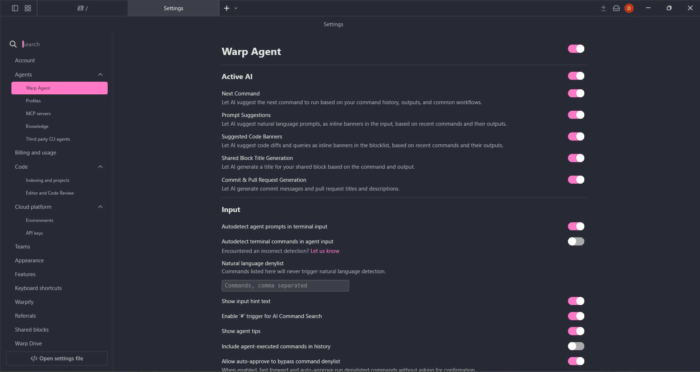
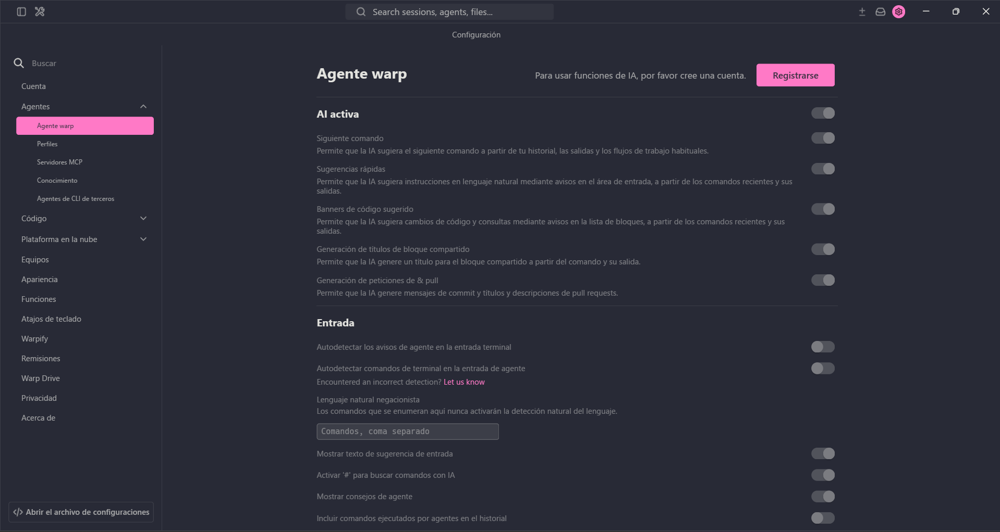
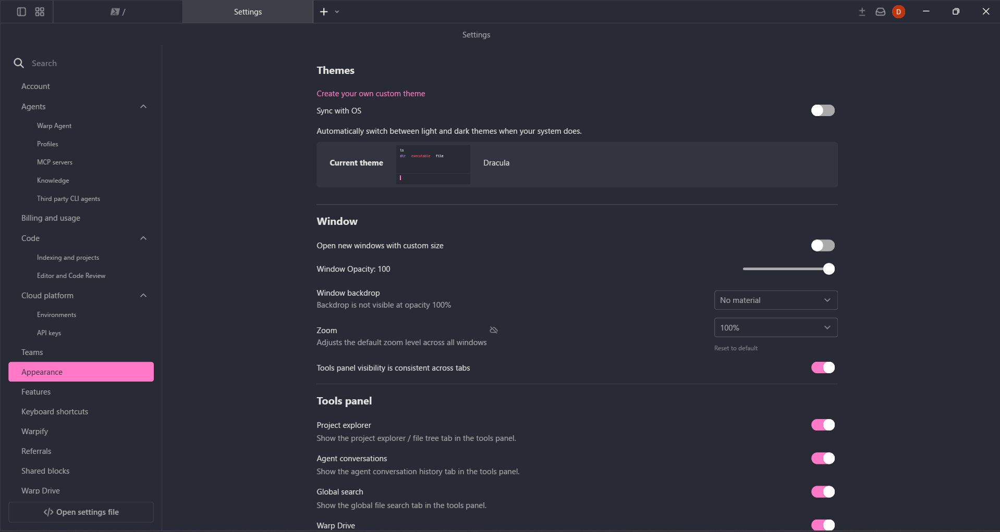
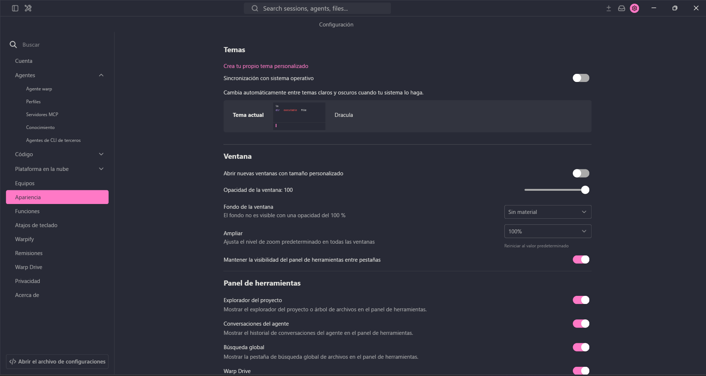

# Initial Spanish GUI localization

Related issue: [#1194](https://github.com/warpdotdev/warp/issues/1194).

Status: proposed initial implementation, submitted for scoping and design review.
The linked issue is currently a tracking request; this document does not imply
maintainer approval or readiness to implement.

## Problem

Developers who prefer Spanish encounter English settings, explanations, menus,
and onboarding tips. Translating only navigation leaves important controls and
their descriptions difficult to understand.

## Initial scope

Provide English and Spanish catalogs and localize existing GUI display strings,
with emphasis on settings, Appearance, the tools panel, MCP settings, tab view
options, built-in tips, and suggested conversation starters. Coverage is partial.
This proposal does not add a language picker, live language switching, translated
server responses, or a requirement that generated agent answers use Spanish.

## Behavior invariants

1. Starting the GUI with Spanish selected displays covered labels in Spanish.
   Regional variants such as es-ES and es-419 use the same initial Spanish catalog.
2. Selecting English preserves the English interface. Unsupported languages use
   English, and a missing Spanish translation falls back to its English value.
3. Translated labels and descriptions remain readable within their existing
   controls. Longer descriptions can wrap; buttons, menus, and dropdown selections
   retain their original actions and values.
4. User content, command text, URLs, paths, stored settings values, language codes,
   action identifiers, and session-restoration identifiers keep their meaning.
5. Messages containing variable values preserve those values and their numeric
   formatting. Placeholder-like characters inside inserted values remain literal.
6. A missing or malformed optional catalog does not prevent the embedded catalogs
   from providing the interface. Without either catalog entry, the lookup exposes
   its key as a diagnostic fallback.
7. Existing availability rules remain in effect. Signed-out and signed-in states
   may show different controls, independent of the chosen display language.
8. Native menu semantics and keyboard shortcuts remain functional. In particular,
   the native macOS Window menu keeps its role when its title is translated.
9. Changing the selected language takes effect after restarting the application;
   this initial implementation does not update already-created widgets live.

## Contributor-provided visual evidence

The following original screenshots were supplied for this contribution and have
not been retouched. They show English reference screens and the Spanish
development build on Windows. The English reference is signed in; the Spanish
build is signed out, which explains disabled agent controls and sidebar differences.
The screenshots establish rendering of these two settings pages; they do not
establish that every interactive flow or every platform has been tested.

### Agent settings

### Appearance and tools panel

## Remaining review

The catalog still requires linguistic review. The provided Spanish screenshots
also show untranslated header-search/help text. Full interface coverage, dropdown
interaction, session restoration, native menus, and Linux/macOS verification remain
follow-up validation. No narrated recording is included.
