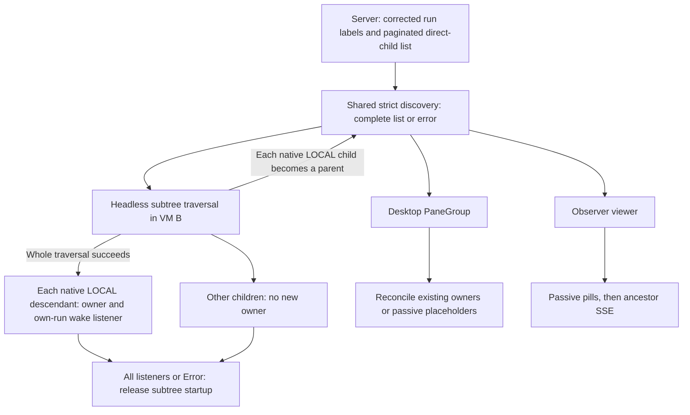
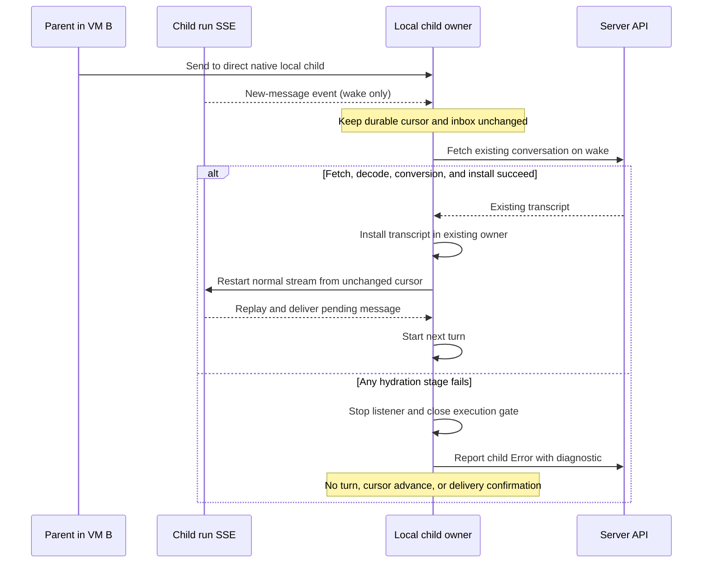

# Restore the local subtree after cloud-parent VM handoff

## Summary
[QUALITY-2186](https://linear.app/warpdotdev/issue/QUALITY-2186/restore-local-child-owners-after-cloud-parent-vm-idle-destroyhandoff) affects a cloud parent that resumes after its VM is destroyed.
The new VM can show the parent's children, but it cannot receive messages for native (Oz) descendants that ran locally in the old VM.
Restore the co-resident native-local **subtree**, not only the root's direct children.
Each descendant keeps its immediate parent and its own execution conversation in the resumed root process.
Subscribe to the child's events immediately; load its full conversation only on its first message or pane open.
The requester approved the subtree contract below for implementation.

## Handoff contract
1. Child restoration inherits the parent's existing handoff and workload-credential safeguards. Do not require an additional physical-VM-destruction barrier or introduce child-specific fencing; predecessor teardown may still be in progress.
2. VM B restores the root's conversation and environment. It discovers all direct children, then repeats complete, paginated discovery beneath each native/Oz child classified `LOCAL`. Stop at every remote or non-Oz child.
3. VM B creates one lightweight owner per eligible descendant. The root and restored descendants may execute only after the entire discovered subtree is listening or explicitly in `Error`. Owner-setup failure affects that run, not its siblings or descendants.
4. A running parent at any recovered level can send to its existing direct local child. For `P → local C → local G`, both C and G are restored before execution resumes. C's message wakes G, which loads its existing transcript before delivery. Failed hydration puts only that child in `Error`.
5. Desktop viewers and the Observer show passive child representations. Viewing a cloud parent's child never makes the desktop the child's owner.

### Terms
- **Parent / child:** An orchestrator run and one of its direct child runs. `ancestor_run_id` lists direct children, not all descendants.
- **Root / local subtree:** The resumed cloud run and descendants reachable through only native/Oz `LOCAL` edges. Shared APIs and fields use `local_subtree`. A descendant below a remote or non-Oz hop is outside this recovery pass, even if that descendant is labeled `LOCAL`.
- **Local owner:** The in-process child conversation, hidden terminal pane, controller, and event consumer that can execute a native child's turn and acknowledge its inbox. `LOCAL` classifies the latest execution's worker, including ended executions; it is **not** proof that an owner is alive.
- **Viewer / placeholder:** A read-only representation for the pill bar or transcript. It cannot consume or confirm the child's inbox. A cloud-owned parent shown on a desktop has viewers, not local child owners on that desktop.
- **Seed / discovery:** One shared helper traverses a parent's direct-child pages. Headless restoration composes these lists into a subtree. Desktop `PaneGroup` and Observer seeds keep their existing direct-child scope.
- **SSE / cursor:** Server-Sent Events notify a process about run events. A cursor is the last sequence already processed or acknowledged. The parent's ancestor stream does **not** deliver a child's inbox; the child needs its own run stream.
- **Local-child restoration:** Fetch and install the child's existing conversation transcript into its lightweight execution conversation before it can execute another turn. `Pending` waits for a wake or pane open; `Restoring` includes fetching, conversion, and installation; `Restored` means history is installed, not that execution is allowed. `Error` closes the gate without an automatic retry.

### Who uses the shared discovery result?

The diagram shows a shared **algorithm**, not one shared cache or process. The three consumers retain separate readiness gates, retries, and lifetimes.

## Context
The implementation candidate at `af4709b220226c5ee87c79e17585c61f9932ed0d` restores only one level in [`driver/restored_children.rs:6-167`](https://github.com/warpdotdev/warp/blob/af4709b220226c5ee87c79e17585c61f9932ed0d/app/src/ai/agent_sdk/driver/restored_children.rs#L6-L167).
[`discovery.rs:8-83`](https://github.com/warpdotdev/warp/blob/af4709b220226c5ee87c79e17585c61f9932ed0d/app/src/ai/ambient_agents/discovery.rs#L8-L83) validates each immediate-parent list; it does not traverse descendants.
[`restored_owners.rs:25-106`](https://github.com/warpdotdev/warp/blob/af4709b220226c5ee87c79e17585c61f9932ed0d/app/src/pane_group/child_agent/restored_owners.rs#L25-L106) already accepts a parent conversation and terminal, so nested restoration can reuse the same pane lifecycle.
Passive snapshot application in [`history_model.rs:655-674`](https://github.com/warpdotdev/warp/blob/af4709b220226c5ee87c79e17585c61f9932ed0d/app/src/ai/blocklist/history_model.rs#L655-L674) and the terminal-only status guard in [`driver.rs:3853-3994`](https://github.com/warpdotdev/warp/blob/af4709b220226c5ee87c79e17585c61f9932ed0d/app/src/ai/agent_sdk/driver.rs#L3853-L3994) also need execution-conversation isolation.
The companion server at `2986008bb56b098c0919779b0a686d0e38224ab7` already authorizes all-local descendant updates in [`update_agent_task.go:55-148`](https://github.com/warpdotdev/warp-server/blob/2986008bb56b098c0919779b0a686d0e38224ab7/logic/ai/ambient_agents/update_agent_task.go#L55-L148).
Subtree restoration must preserve that authorization and its locked revalidation, not broaden it across remote hops.

## Design
### 1. Make the server's location label consistent
**Why:** Today the `LOCAL` filter uses the task's stored worker, but the response uses the active execution's worker. An ended local child can therefore pass the `LOCAL` filter and still say `REMOTE`. Its task source can also be `ORCHESTRATION`; source does not determine ownership.

- Derive the existing public response `execution_location` from the latest nondeleted execution, ordered by `created_at DESC, id DESC`, including ended executions. Its worker `local` is `LOCAL`; a nonlocal, empty, or `NULL` worker, or no execution, is `REMOTE`. Ignore conflicting legacy task-worker assignments; there is no task-row fallback, including for legacy task-only local runs.
- Apply the same latest-execution rule in the `LOCAL` and `REMOTE` SQL filters before pagination and in descendant-update authorization at every hop, including locked revalidation. A superseding remote or unclaimed execution closes the local subtree boundary.
- Keep session-link eligibility separate from the corrected label. In `warp-server/router/handlers/public_api/agent_webhooks.go:2672-2722`, preserve the old active-local-execution exemption and the existing retained-session and GCS-transcript rules. An ended local task with no live execution must not gain a stale `session_id` or `session_link` to VM A.
- Describe the public field as a **latest-execution worker classification**, not evidence of a live execution. This correction changes location/environment labels, cloud platform and timeline display in Oz/Factory web Runs, desktop conversation-card icons, and CLI JSON. Preserve source-based rerun eligibility and the separate server cancellability flag.
- Deploy the corrected server first. Gate client ownership discovery with a rollout flag that remains off in an environment until its server deployment is confirmed. An older server can return a syntactically valid but wrong `REMOTE`; the client cannot detect this from the field. Once the flag is on, a missing `execution_location` is an error, not a remote child.

### 2. Discover direct children completely
**Why:** The existing GUI and Observer seeds stop at 100 results. The current `AIClient::list_ambient_agent_tasks` also drops `page_info` and silently skips malformed rows. Partial discovery can leave a local child's inbox without an owner.

- Add a **strict, page-returning** `AIClient` method in `app/src/server/server_api/ai.rs`. Return `runs`, `page_info.has_next_page`, and `page_info.next_cursor`. Keep the existing lenient `Vec<AmbientAgentTask>` method for unrelated callers.
- Implement one asynchronous `list_direct_children(ai_client, parent_task_id)` helper. All three consumers below call it. Request `ancestor_run_id=parent_task_id` **without** an execution-location filter, sorted by `created_at asc`, up to 100 rows per page. Follow cursors until `has_next_page=false`.
- Fail the entire traversal if a required next cursor is missing, empty, or repeated; a run row cannot decode; its `execution_location` is missing; its `parent_run_id` differs from the requested parent; or repeated data for the same run ID conflicts on parent, location, or harness. Ignore an accidental parent row. Deduplicate identical run IDs in first-seen order.
- Return either the full traversal or an error. No consumer acts on a partial result. Pagination is **not an atomic snapshot**: another child can appear while pages are read. Do not add a global seed cache.

### 2a. Compose a complete native-local subtree
**Why:** Listing only P's children restores C but leaves C's existing local child G without a controller or wake listener.

- Add a headless subtree discovery helper beside `list_direct_children` in `app/src/ai/ambient_agents/discovery.rs`. Keep direct-child API semantics and desktop/Observer call sites unchanged.
- Use an iterative, parent-first queue starting at the resumed root run ID. For each queued parent, await its complete direct-child traversal. Retain that batch with its immediate parent run ID, including remote/non-Oz rows for passive representation.
- Enqueue only native/Oz `LOCAL` children. Use one eligibility predicate for discovery and setup, outside `PaneGroup`; an absent harness defaults to Oz, while an unknown or non-Oz harness stops traversal.
- The direct-child list validates each row’s parent/location/raw-harness identity and deduplicates repeated pages before traversal. Track seen run IDs across the whole pass, seeded with the root: any repeat across parent batches is conflicting parentage or a cycle and fails the traversal. Never flatten descendants under the root.
- Finish every eligible branch, including children of a run with a missing conversation token. Tokens and pane setup are per-run failures after discovery, not reasons to hide an existing branch.
- Return parent-first batches only after all queued lists succeed. Apply no conversations, panes, listeners, or task status updates from a partial traversal. Retry transient failure with the bounded headless retry policy; a permanent or exhausted failure anywhere blocks root setup.
- Do not fetch transcripts during discovery. This traversal is not an atomic tree snapshot; children absent from all list results remain subject to the existing concurrent-creation limitation, not a new scan or polling loop.

### 3. Restore owners in the resumed headless parent
**Why:** Every recovered native-local run needs its own controller and inbox consumer. Restoring an ancestor's transcript does not restore those execution surfaces.

- After the root's conversation and environment exist, await complete subtree discovery before the first resumed turn **or** `--skip-initial-turn` completion. Do not release the root after only its direct-child batch.
- Create owners in parent-first order only for `LOCAL` native/Oz descendants. Remote and non-Oz rows remain passive observations under their actual parent.
- Maintain a run-ID-to-local-conversation mapping seeded with the root. Establish each child's immediate `parent_agent_id` and `parent_conversation_id` from that mapping. Stamp its shell's task and parent environment variables with the child run ID and immediate parent run ID, not the root run ID.
- Reuse each child's existing run ID, server conversation token, title, harness, and the root's restored working directory and environment. A missing usable token enters that child's Error path; never create a replacement server run or transcript. Descendants keep their actual parent link through hydration.
- `TerminalDriver::create` already opens a root workspace with a `PaneGroup`. Retain that group's handle for `AgentDriver`. In the group's `ViewContext`, create each metadata-only execution conversation and reuse `PaneGroup::create_hidden_child_agent_pane`. Each child gets a separate controller, terminal surface, and own-run event consumer in that same workspace.
- Use the immediate parent's pane as the physical insertion anchor when available. If that parent's setup failed before its pane existed, keep its metadata conversation and use the root pane only as an insertion fallback. This must not reparent the descendant or mark it failed because its parent failed.
- Hold a subtree startup gate independently of per-child transcript hydration. A wake or pane open may start hydration during setup, but normal inbox delivery and controller execution require both startup release and successful hydration. Register every successful child's wake listener, account for every failed child as Error, then release startup for the pass and allow the root to continue.
- A listener that already woke and paused for hydration counts as registered for startup. Keep its wake and unchanged cursor until replay can start. Startup does not wait for every transcript or a new network event; releasing the gate must re-evaluate pending work.
- Use the history model's run-ID index as the authoritative conversation mapping; do not maintain a second pane-group run-ID map. Repeated seeds, SSE reconnects, and restoration must not create a second owner, pane, or consumer. Preserve an existing live execution conversation's status, hydration, cursor, and open gate rather than restarting it. If a passive placeholder raced ahead of the owner, replace or promote it without losing the run-ID mapping. A placeholder must not suppress owner creation.
- If an individual pane, controller, or shell cannot be initialized, mark that child `Error` locally and on the server and leave its execution gate closed. Continue preparing its descendants and siblings; never silently skip an eligible run or use a cached Success to hide the failure.
- Use `prepare_restored_local_child` and `register_restored_local_child` for the child-conversation helpers. Keep authority predicates such as `owns_turn_lifecycle`; do not introduce an additional owner object.

### 4. Keep desktop and Observer consumers passive
**Desktop `PaneGroup`:**
- Use the shared discovery in `spawn_ancestor_list_fetch_if_needed`. Keep its pending-parent map, in-flight dispatch token, task-resolution retries, five-second transient retry, terminal-surface check, and hidden-pane reconciliation.
- Preserve hidden child panes that a **locally owned** GUI parent already owns. When the desktop views a **cloud-owned** parent, every discovered child is a passive placeholder, even if its label says `LOCAL`. Never claim a child just because of that label.
- In the headless workspace, defer passive GUI seeding until the entire subtree pass finishes. Keep execution-conversation mappings at every level and add passive placeholders beneath the corresponding immediate parent.
- Apply task snapshots only to passive child placeholders, using their conversation role rather than `execution_location`. An existing execution conversation must retain its status, restoration diagnostic, hydration state, terminal binding, and immediate-parent link. Enforce this at the shared snapshot application boundary so every passive seed caller obeys it.
- Apply ancestor lifecycle status projections only to passive remote-child representations too. A replayed start or first lifecycle may already have inserted the child in `OrchestrationChildTracker`; subsequent Success or Error must not overwrite a native execution conversation's Error or clear its restoration diagnostic. Keep parent lifecycle delivery, tracker bookkeeping, metadata discovery, and passive sibling status updates.
- Guard the native `AgentDriver` status handler with its bound conversation ID as well as its terminal ID. A child status event must never complete, schedule, or cancel the parent's exit, even if a producer supplies the parent's terminal ID. Preserve fresh-run conversation binding.

**Observer:**
- Use the same discovery in `OrchestrationEventStreamer::spawn_ancestor_seed_fetch`. Seed `known_children` as passive pills for both locations. Do not create owners or read child inboxes.
- Keep the refcounted viewer registry. Mark it seeded and open its `AncestorRunId { include_self: false }` SSE **only after** all pages succeed.
- On failure, retry on the existing next registration/reconnect; do not add a timer or accept partial pages. Use a generation guard so a late fetch from an unregistered viewer cannot seed a newer registration for the same parent.

**Observer cursor handoff:**
- Capture the viewer's locally persisted **already-processed** cursor before traversal. Start ancestor SSE from that cursor, not the maximum child `last_event_sequence` returned by the list.
- The latter is an acknowledged per-run cursor, not a pagination snapshot barrier; it can skip a child created during traversal. Deduplicate replayed child IDs against `known_children`, and make an event for a previously unseen child create a passive pill.
- Persist only events the Observer processes, locally; never push its cursor to the server. More historical replay is intentional. Traversal alone still cannot guarantee an atomic view of children created concurrently elsewhere.

### 5. Wake the child; load its history only when needed
**Why:** Normal event draining can advance a cursor or dispatch a stub marked `Success` before its history exists. A wake-only listener must not behave like normal delivery.

- Give each local child `Pending → Restoring → Restored | Error` state in `LocalChildRestorationStatus`. Only `Pending` has a **wake-only** `RunIds([child_run_id])` SSE; fetching and installation stop that listener. Normal delivery requires `Restored` and local-subtree startup release. The parent's ancestor SSE sees child lifecycle but cannot replace this listener, including for a child that is itself a recovered parent.
- Seed the child's cursor from its durable acknowledged sequence at discovery, or zero if absent. Do not merge a newer server cursor while the child is unhydrated; bypass the existing `spawn_task_harness_fetch_if_needed` / `finish_restore_fetch` max-with-server path. A wake event must not fetch or enqueue message contents, advance or persist/ack a cursor, mark mail delivered, or start an LLM turn.
- On wake, stop the wake-only listener and hydrate. A pane open also triggers hydration without mail. Coalesce simultaneous wake/pane-open requests into one operation per run ID.
- Fetch the **existing** server conversation token through `get_ai_conversation`. Convert using `RestorationMode::Continue` and the lightweight owner's existing `AIConversationId`, not a new ID. Merge transcript and metadata into that owner. Preserve run ID, immediate-parent link, child role, terminal surface, and subtree startup gate. Once installation and subtree startup both finish, restart normal child SSE from the unchanged durable cursor; replay, fetch, enqueue, and deliver pending mail; then release the child's controller gate. Do not resume an interrupted in-memory turn. The persisted transcript is authoritative, and the next delivered message starts the next turn. Hydrating C must neither create a second G nor be required to discover G.
- Keep network fetching, generation checks, restoration coordination, and stream eligibility in `OrchestrationEventStreamer`. It retains only owning pane-group/terminal entity IDs, not a concrete terminal handle or terminal-installation code. Emit `LocalChildHistoryPrepared` with the conversation identity, generation, owner identity, and prepared history.
- The owning `PaneGroup` checks the current generation and target, verifies the canonical child pane, execution role, active conversation, and expected terminal binding, and installs history with the native Continue policy. Installation and acknowledgement run synchronously in one view update; queued duplicates observe the invalidated generation after acknowledgement, so no separate claim flag is needed. Other pane groups and stale requests cannot install it. Copy the current local-subtree startup bit immediately before installation, so a release during fetch or event delivery is retained.
- Keep the conversation `Restoring` through terminal history/block side effects. The pane explicitly acknowledges successful installation or failure; only a current successful acknowledgement marks it `Restored`, publishes Success, and reevaluates eligibility. This acknowledgement does not release the independent startup barrier.
- Missing, closed, or replaced panes/terminals fail installation without opening either execution gate. A changed registration invalidates the old generation. A prepared request with no acknowledgement fails after a bounded five-second wait, including when its owning pane group has gone away; removed conversations simply discard stale completions. Installation failure uses the same per-run local/server Error path.
- A closed terminal can leave the conversation in history with no live surface association. Record local Error and its diagnostic using the current terminal binding, or the registered terminal identity solely for error-event attribution when that binding is gone. Do not reattach the conversation or pane to report failure.
- Current local-subtree setup runs in SDK/headless restoration and installation requires the same owning pane group. Reparenting a prepared request across GUI pane-group transfers is outside this contract; no runtime transfer behavior is claimed verified.
- If fetch, decode, conversion, or installation fails, stop the child's wake listener and leave normal delivery blocked. Set **both** local conversation and server task to `Error` with child run ID and failed stage. Use `AIClient::update_agent_task`/status reporting or the smallest explicit equivalent if normal sync requires a turn. Do not execute a request, confirm delivery, or automatically retry the failed child. Surface an Error-reporting failure rather than claiming success. A later deliberate restoration can retry only by creating a new owner from durable state. Other children stay active.

## Boundaries and trade-offs
- **Parent-equivalent safety:** Reuse the parent's existing handoff and inherited-workload-credential safeguards. Physical VM teardown need not finish before restoration. The child uses the parent's restored files; do not add a new destruction barrier, child-specific fencing, child snapshots, or a second workspace.
- **Narrow message scope at every recovered level:** A *running parent* sending to its *direct native/Oz local child* is covered, including recovered C sending to existing G. No messages sent while the root VM is absent, child-to-parent or external-to-child delivery, undelivered-inbox scan, periodic poll, or `read_at` change. The `read_at` timing fix is separate.
- **Subtree, not a flattened child list:** Direct-child-only recovery leaves supported local grandchildren unable to receive mail. Recursively compose the existing lists instead of adding a new server endpoint or waiting for ancestor transcripts. The extra list requests are required startup work; remote and non-Oz boundaries prevent claiming runs with another execution lifecycle.
- **Metadata now, transcript later:** Eager full history would simplify the first message but slow handoff as histories grow. Metadata-only owners subscribe before the parent resumes and fetch only on wake/open.
- **Correct the field, not a new one:** A new ownership field would keep the old response's accidental live-execution meaning but increase contract and client rollout work. Correcting `execution_location` aligns response and filters; decouple session-link eligibility to avoid a stale join link.
- **One direct-child algorithm, three lifecycles:** A global seed/cache could share in-flight work but conflate headless readiness, desktop retries, and Observer permissions/cursors. Share strict page traversal; compose it into a subtree only for headless recovery.
- **Existing pane, not another terminal factory:** Headless `TerminalDriver` already has a `PaneGroup`. Its hidden child pane provides a separate controller and terminal without duplicating terminal lifecycle setup.
- **Replay, not max-child cursor:** Observer replay costs historical events. The max-child shortcut could silently lose concurrent child discovery; use local processed cursor and deduplication.
- **Wake and Error, not premature delivery or blank continuation:** Normal SSE before hydration can skip or execute mail with no context. Gate it; an unhydratable child enters Error rather than inventing a fresh conversation. Do not change the existing dormant-Claude wake bridge.
- **Other work:** Remote child execution, non-Oz local child harnesses, viewer redesign, desktop startup/transcript laziness ([APP-5876](https://linear.app/warpdotdev/issue/APP-5876)), new public fields/schema, and child VM creation are out of scope. The existing API correction and strict client decoder **are** in scope.

### Assumptions to verify
- A resumable native local child has a server conversation token and server transcript. Missing either is a child Error, not permission to start fresh.
- Parent environment restoration finishes before child owner creation; no child-specific workspace reconstruction is required.
- Native/Oz `LOCAL` edges identify the co-resident portion of the tree, using the same latest-execution classification as direct-child restoration. The wire field is not a lease; server authority checks also use the latest execution and reject missing, superseding remote, or unclaimed executions.
- A failed or malformed list anywhere in that subtree blocks root execution. Token, owner-setup, or transcript failure affects only the failed run after complete discovery.
- Server-first rollout is operationally confirmed per environment. The existing wire response cannot prove that an older server's valid `REMOTE` is correct.

## Validation criteria for implementation
For this delivery, the requester chose isolated client and server validation and will integrate and
test both branches locally. VM A → B handoff, real child wake → hydration → replay → message-turn
execution, driver pagination/`--skip-initial-turn` barriers, and remaining race/failure scenarios are
requester-owned local integration checks, not factory pre-handoff gates. The scenarios below remain
the acceptance checklist; an unrun scenario is not a passing result. UI verification is declined.
Add Rust cases adjacent to `app/src/pane_group/child_agent/restoration.rs`, `app/src/ai/blocklist/orchestration_event_streamer.rs`, `app/src/server/server_api/ai.rs`, and `app/src/ai/agent_sdk/driver.rs`. The requester can run named cases from `warp` with `cargo nextest run -p warp --lib -E 'test(restored_local_child_) or test(replayed_lifecycle_)'` and server checks from `warp-server` with `go test ./router/handlers/public_api ./test/integration/ambient_agents` and the integration database configured.
For the client review follow-up, add regression-test source but do not execute client tests. Client runtime unit, component, integration, real message replay/acknowledgement, and cross-VM checks below are requester-owned. Compile native production and test targets with locked/offline dependencies, including `--features restore_local_subtree`, and run targeted Clippy before formatting once last. If the wasm target is already installed, also run the existing wasm Clippy gate, `cargo clippy --locked --offline --target wasm32-unknown-unknown --profile release-wasm-debug_assertions -- -D warnings`. Do not install client tooling or start client services. Compilation is not runtime proof. The requester separately authorized server tests for the latest-execution review revision.

### API labels and rollout
- `RestoreLocalSubtree` is enabled in `DOGFOOD_FLAGS`, which local builds also inherit. Preview and Release defaults remain unchanged. The optional Cargo feature is `restore_local_subtree`.
- Extend `TestConvertTasksToItems_ExecutionLocation` (`warp-server/router/handlers/public_api/agent_webhooks_test.go`). An ended latest `worker_id=local` execution with `source=ORCHESTRATION` returns `LOCAL`; nonlocal, empty, or unset/NULL latest workers and absent executions return `REMOTE`.
- A task-local/latest-execution-remote mismatch returns `REMOTE`; the reverse returns `LOCAL`. Task assignments never override the latest execution.
- In `warp-server/test/integration/ambient_agents/public_api_runs_test.go`, compare GET and paginated-list response/filter parity for both locations, including conflicting task assignments, local/remote successors, unclaimed/empty workers, no execution, deleted successors, and equal creation timestamps resolved by execution ID. Test that a terminal local run gets no stale session link without active local execution or independently verified retained/GCS data. Preserve transcript link precedence and remote retained sessions.
- Test the client flag: before confirmed server deployment, the new owner path stays off. After activation, missing `execution_location` fails setup. A valid but wrong `REMOTE` from an older server cannot be detected from its response.

### Strict discovery
- `restored_local_child_discovery_pages` returns 101+ mixed-location children over multiple pages, a repeated run ID, and a child created while paging. Assert `created_at asc`, a complete deduplicated result, and no partial application.
- Reject malformed rows, missing locations, wrong parents, conflicting duplicate parent/location/harness, and missing, empty, or repeated next cursors.

### Native-local subtree and lifecycle isolation
- `restored_local_child_subtree_discovery` lists a paginated `P → local C → local G` chain and a local sibling. Assert parent-first results, each immediate-parent link, deduplication, and no transcript fetch. Include remote and non-Oz branches: neither their child lists nor their local descendants are claimed.
- `restored_local_child_subtree_incomplete` fails a later page beneath C and supplies a conflicting run identity or root cycle. Each case returns no applicable subtree; no earlier sibling receives a conversation, listener, or task update.
- `restored_local_child_subtree_startup_gate` delays G's setup while a wake hydrates C. Assert no normal mail delivery or C request before every eligible run is listening or Error. Startup release must then allow C's pending work without an extra wake.
- `restored_local_child_subtree_message` uses the mocked client and normal client message/event path after recovery. C sends to G's existing run ID; observe G's lazy transcript installation, replay, and next request. Assert one G conversation/controller/listener, preserved C-to-G IDs and environment parent ID, and no new server run. Constructing a G stub alone is not this proof.
- `restored_local_child_subtree_setup_failure` fails C's token setup through the production Error reporter, then supplies a usable token and verifies preparation does not retry. G and a sibling still prepare successfully; assert C retains local/server Error, G stays linked to C and listening, and root startup releases without flattening or silently skipping G.
- `restored_local_child_deferred_seed_preserves_execution_state` applies one late seed to a busy restored native child, a failed native child, and a passive sibling. Preserve the busy status/binding, failed diagnostic and closed gate, and both immediate-parent links; observe the passive sibling change from Success to InProgress and receive the newer remote update time. Parent completion isolation remains covered by the separate bound-driver regression.
- `restored_local_child_driver_status_isolation` emits a child's status event with the parent's terminal ID. Assert no parent exit or idle scheduling; an event for the bound parent conversation must still settle the parent.
- Preserve server descendant authorization by running `go test ./logic/ai/ambient_agents -run 'TestUpdateAgentTask(LocalGrandchildOfRequesterAllowed|DescendantChainThroughRemoteHopRejected)'`. These existing tests check the authorization boundary; they do not establish cross-VM execution.

### VM A → B
- `restored_local_child_vm_a_to_b` restores the parent and child in B, then sends parent-to-child mail. Preserve the existing parent handoff and inherited-credential fencing checks; physical teardown of A may still be in progress.
- The run ID, server conversation token, parent link, working directory, and B-local conversation ID survive hydration. Assert one owner and own-run SSE before send, zero early transcript fetches, and one message turn.

### Headless and desktop ownership
- `restored_local_child_pagination_and_idempotence` pauses after page one. The parent cannot run or complete `--skip-initial-turn` before the last page and own-run listeners. Transient list failure retries; incomplete listing fails closed.
- Re-seed: assert one hidden owner pane, controller, and SSE per eligible child in the existing `PaneGroup`. Assert no fabricated server run, VM, second workspace, or transcript. Race a passive placeholder with restoration: keep one run-ID mapping and promote it to an owner.
- The desktop retains stale-result rejection, retries, and locally owned hidden panes. A desktop viewing a cloud parent keeps every child passive even when labeled `LOCAL`.
- `restored_local_child_subtree_discovery` covers native local children with absent or Oz harnesses, a remote child, and local non-Oz and unknown-harness children through actual visited parent batches and retained boundary-row assertions; no separate classification-only test is needed.

### Observer
- `restored_local_child_observer_seed` pauses after page one: no seeded flag or SSE before completion. After success, every location yields passive pills with no owner or inbox drain.
- Insert a child during paging that is absent from the result. Replay from the pre-traversal processed cursor must find it. Duplicate lifecycle events yield one pill and advance only the local cursor.
- `restored_local_child_observer_seed_generation` unregisters and re-registers, then supplies stale and current results to the real generation-checked completion boundary without yielding. A stale completion must not seed, open SSE, or clear the newer in-flight marker; a current completion seeds and opens SSE from local cursor 37, not child acknowledgement 999. This deterministic component case does not claim real overlapping network requests. Page failure opens no SSE and retries only on registration/reconnect.

### Public consumers
- Test ended-local location, environment, platform, and timeline in Oz and Factory web Runs with `yarn workspace @warp/agents test --run` and `yarn workspace @warp/factory test --run` from `warp-server/client`.
- Test desktop card classification with `cargo nextest run -p warp --lib -E 'test(test_task_entry_preserves_execution_location_independently_of_task_backing) or test(agent_icon)'`. `LOCAL` no longer gets cloud-run treatment; source-based rerun and server cancellability stay independent.

### Child wake, races, and failure
- `restored_local_child_hydration_gate` delays transcript load while two SSE wakes and a pane open arrive. Assert one load, no cursor/delivery advance or child request before hydration, then one replay and one turn. Re-seed and reconnect without duplicates.
- `restored_local_child_transcript_error` fails fetch, decode, and conversion separately. Assert local and server Error, no child request or delivery confirmation, and other children still owned. A failed Error update must be visible.
- `replayed_lifecycle_preserves_local_child_failure_and_updates_passive_sibling` uses the actual production tracker status writer, including in test builds. Replay start, Success, and Error for a failed local child and a passive sibling; preserve the local Error/diagnostic and closed gate while retaining broadcasts, tracker state, and passive status projection.
- `restored_local_child_installation_acknowledgement_and_duplicate_delivery` delays pane installation after history preparation, releases startup while pending, and checks that history remains `Restoring`. Reject a stale generation and another pane group, then install through the production pane boundary. Preserve identity/cursor and reject a duplicate carrying different history.
- `restored_local_child_subtree_startup_gate` also covers history installation before startup release. Pending controller work must remain blocked until release, then run without another wake; ordinary conversations pass through the same readiness predicate.
- `restored_local_child_missing_canonical_pane_fails_closed`, `restored_local_child_replaced_terminal_rejects_prepared_history`, and `restored_local_child_owner_replacement_invalidates_prepared_history` preserve closed gates and report the failed run without installing obsolete history.
- `restored_local_child_closed_surface_retains_failure_diagnostic_without_reattachment` clears the actual history association for a closed terminal before installation. Preserve local Error, the run/stage diagnostic, the unchanged cursor, and one explicit server report. The surface association must remain absent, and stale or duplicate requests cannot replace the failure.
- `restored_local_child_missing_installation_acknowledgement_fails_closed` covers an owning pane group that cannot acknowledge; the bounded wait must end in Error, not a permanently restoring child.
- Owner-setup failure marks only that child Error, leaves its execution gate closed, and permits the remaining subtree and root to recover after complete discovery.

## Implementation map
- Headless bootstrap and owner lifecycle: [`app/src/ai/agent_sdk/driver.rs:1102-1410`](https://github.com/warpdotdev/warp/blob/1e1acb4d74b3f55155860a785152bd23a2f3d83b/app/src/ai/agent_sdk/driver.rs#L1102-L1410), [`app/src/ai/agent_sdk/driver.rs:3441-3590`](https://github.com/warpdotdev/warp/blob/1e1acb4d74b3f55155860a785152bd23a2f3d83b/app/src/ai/agent_sdk/driver.rs#L3441-L3590), [`app/src/ai/agent_sdk/driver/terminal.rs:214-265`](https://github.com/warpdotdev/warp/blob/1e1acb4d74b3f55155860a785152bd23a2f3d83b/app/src/ai/agent_sdk/driver/terminal.rs#L214-L265), [`app/src/pane_group/mod.rs:2216-2229`](https://github.com/warpdotdev/warp/blob/1e1acb4d74b3f55155860a785152bd23a2f3d83b/app/src/pane_group/mod.rs#L2216-L2229).
- Hidden child owner, desktop seed, and passive viewer: [`app/src/pane_group/child_agent/restoration.rs:58-573`](https://github.com/warpdotdev/warp/blob/1e1acb4d74b3f55155860a785152bd23a2f3d83b/app/src/pane_group/child_agent/restoration.rs#L58-L573), [`app/src/pane_group/child_agent/hydration.rs:479-532`](https://github.com/warpdotdev/warp/blob/1e1acb4d74b3f55155860a785152bd23a2f3d83b/app/src/pane_group/child_agent/hydration.rs#L479-L532).
- Shared list decoder and direct-child REST response: [`app/src/server/server_api/ai.rs:808-1028`](https://github.com/warpdotdev/warp/blob/1e1acb4d74b3f55155860a785152bd23a2f3d83b/app/src/server/server_api/ai.rs#L808-L1028), [`app/src/server/server_api/ai.rs:2664-2675`](https://github.com/warpdotdev/warp/blob/1e1acb4d74b3f55155860a785152bd23a2f3d83b/app/src/server/server_api/ai.rs#L2664-L2675), [`warp-server/router/handlers/public_api/agent_webhooks.go:3075-3091`](https://github.com/warpdotdev/warp-server/blob/ae583264f4a28e1f1f172eea278a6112f8e28006/router/handlers/public_api/agent_webhooks.go#L3075-L3091), [`warp-server/model/ai_tasks.go:3066-3070`](https://github.com/warpdotdev/warp-server/blob/ae583264f4a28e1f1f172eea278a6112f8e28006/model/ai_tasks.go#L3066-L3070).
- Streamer, observer seed, and cursor behavior: [`app/src/ai/blocklist/orchestration_event_streamer.rs:1197-1428`](https://github.com/warpdotdev/warp/blob/1e1acb4d74b3f55155860a785152bd23a2f3d83b/app/src/ai/blocklist/orchestration_event_streamer.rs#L1197-L1428), [`app/src/ai/blocklist/orchestration_event_streamer.rs:1648-1695`](https://github.com/warpdotdev/warp/blob/1e1acb4d74b3f55155860a785152bd23a2f3d83b/app/src/ai/blocklist/orchestration_event_streamer.rs#L1648-L1695), [`app/src/ai/blocklist/orchestration_event_streamer.rs:1901-2211`](https://github.com/warpdotdev/warp/blob/1e1acb4d74b3f55155860a785152bd23a2f3d83b/app/src/ai/blocklist/orchestration_event_streamer.rs#L1901-L2211), [`app/src/ai/blocklist/orchestration_event_streamer.rs:2544-2620`](https://github.com/warpdotdev/warp/blob/1e1acb4d74b3f55155860a785152bd23a2f3d83b/app/src/ai/blocklist/orchestration_event_streamer.rs#L2544-L2620), [`app/src/ai/blocklist/controller.rs:2181-2255`](https://github.com/warpdotdev/warp/blob/1e1acb4d74b3f55155860a785152bd23a2f3d83b/app/src/ai/blocklist/controller.rs#L2181-L2255).
- Server labels/session links and client consequences: [`warp-server/router/handlers/public_api/run_execution_location.go:41-67`](https://github.com/warpdotdev/warp-server/blob/ae583264f4a28e1f1f172eea278a6112f8e28006/router/handlers/public_api/run_execution_location.go#L41-L67), [`warp-server/router/handlers/public_api/agent_webhooks.go:2672-2722`](https://github.com/warpdotdev/warp-server/blob/ae583264f4a28e1f1f172eea278a6112f8e28006/router/handlers/public_api/agent_webhooks.go#L2672-L2722), [`warp-server/logic/ai/ambient_agents/add_task.go:1234-1320`](https://github.com/warpdotdev/warp-server/blob/ae583264f4a28e1f1f172eea278a6112f8e28006/logic/ai/ambient_agents/add_task.go#L1234-L1320), `warp-server/client/packages/agents/src/pages/Runs/{util.tsx,run-platform.ts,RunDetailPane.tsx}` and Factory equivalents, `app/src/ai/agent_conversations_model/entry.rs:175-185`, `app/src/ui_components/agent_icon.rs:102-110`.
- Existing Oz resume/transcript and default harness: [`app/src/ai/agent_sdk/mod.rs:1858-1873`](https://github.com/warpdotdev/warp/blob/1e1acb4d74b3f55155860a785152bd23a2f3d83b/app/src/ai/agent_sdk/mod.rs#L1858-L1873), [`app/src/ai/agent_sdk/mod.rs:1957-2016`](https://github.com/warpdotdev/warp/blob/1e1acb4d74b3f55155860a785152bd23a2f3d83b/app/src/ai/agent_sdk/mod.rs#L1957-L2016), [`app/src/server/server_api/ai.rs:2751-2799`](https://github.com/warpdotdev/warp/blob/1e1acb4d74b3f55155860a785152bd23a2f3d83b/app/src/server/server_api/ai.rs#L2751-L2799), [`warp-server/logic/ai/ambient_agents/wake_driver.go:15-79`](https://github.com/warpdotdev/warp-server/blob/ae583264f4a28e1f1f172eea278a6112f8e28006/logic/ai/ambient_agents/wake_driver.go#L15-L79).
