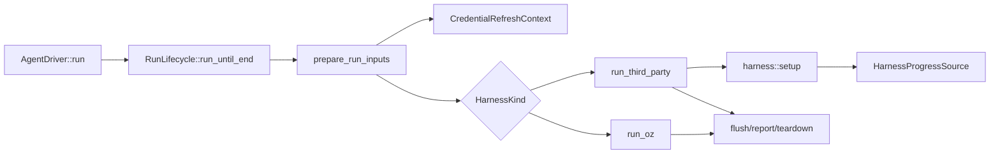

# Agent driver lifecycle decomposition TECH
## Context
This spec proposes architecture improvements for the recent week of changes around local/cloud agent execution in the Warp client. There is no sibling `PRODUCT.md`; the intent is engineering-facing: reduce coupling in the agent driver after recent work on ACP transport, third-party harness lifecycle, idle/debug retention, credential refresh, environment checkout, and server task status synchronization.
The current architecture centralizes most execution orchestration in `AgentDriver`. The driver owns terminal creation, environment preparation, skills and MCP setup, credential refresh, harness dispatch, idle-on-complete/fail behavior, setup-failure debug retention, status synchronization, and output formatting. That centralization made the recent changes possible, but it is now the main maintainability risk because unrelated lifecycle concerns are edited in the same file and share implicit state.
- [`app/src/ai/agent_sdk/driver.rs:146 @ 25e82210a59c8e535a14c3e22c39ec1d3361a7f7`](https://github.com/warpdotdev/warp/blob/25e82210a59c8e535a14c3e22c39ec1d3361a7f7/app/src/ai/agent_sdk/driver.rs#L146) — `with_credential_refreshes` races the harness run against Git and Bedrock credential refresh loops, but lives in the top-level driver beside terminal and harness code.
- [`app/src/ai/agent_sdk/driver.rs:248 @ 25e82210a59c8e535a14c3e22c39ec1d3361a7f7`](https://github.com/warpdotdev/warp/blob/25e82210a59c8e535a14c3e22c39ec1d3361a7f7/app/src/ai/agent_sdk/driver.rs#L248) — `IdleTimeoutSender` implements reusable lifecycle timing behavior for Oz and third-party harnesses, but is private driver infrastructure with tests mixed into `driver_tests.rs`.
- [`app/src/ai/agent_sdk/driver.rs:393 @ 25e82210a59c8e535a14c3e22c39ec1d3361a7f7`](https://github.com/warpdotdev/warp/blob/25e82210a59c8e535a14c3e22c39ec1d3361a7f7/app/src/ai/agent_sdk/driver.rs#L393) — `DebugWindowController` adds setup-failure/debug-turn retention state on top of the same idle timer, further expanding driver lifecycle ownership.
- [`app/src/ai/agent_sdk/driver.rs:1546 @ 25e82210a59c8e535a14c3e22c39ec1d3361a7f7`](https://github.com/warpdotdev/warp/blob/25e82210a59c8e535a14c3e22c39ec1d3361a7f7/app/src/ai/agent_sdk/driver.rs#L1546) — `run_until_end` races the core run, session sharing failure, sandbox shutdown, and process signals, then feeds teardown and reporting.
- [`app/src/ai/agent_sdk/driver.rs:2360-2825 @ 25e82210a59c8e535a14c3e22c39ec1d3361a7f7`](https://github.com/warpdotdev/warp/blob/25e82210a59c8e535a14c3e22c39ec1d3361a7f7/app/src/ai/agent_sdk/driver.rs#L2360-L2825) — environment, file-based MCP, skill loading, credential-refresh setup, Oz dispatch, and third-party harness dispatch are sequenced in one long `run_internal` flow.
- [`app/src/ai/agent_sdk/driver.rs:2940-3265 @ 25e82210a59c8e535a14c3e22c39ec1d3361a7f7`](https://github.com/warpdotdev/warp/blob/25e82210a59c8e535a14c3e22c39ec1d3361a7f7/app/src/ai/agent_sdk/driver.rs#L2940-L3265) — third-party preflight, plugin setup, and harness preparation are driver methods even though they are transport/harness lifecycle concerns.
- [`app/src/ai/agent_sdk/driver.rs:4413-4612 @ 25e82210a59c8e535a14c3e22c39ec1d3361a7f7`](https://github.com/warpdotdev/warp/blob/25e82210a59c8e535a14c3e22c39ec1d3361a7f7/app/src/ai/agent_sdk/driver.rs#L4413-L4612) — CLI-session and native-conversation status subscriptions implement parallel idle/save/status behavior in separate branches.
- [`app/src/ai/agent_sdk/driver/harness/mod.rs:140-241 @ 25e82210a59c8e535a14c3e22c39ec1d3361a7f7`](https://github.com/warpdotdev/warp/blob/25e82210a59c8e535a14c3e22c39ec1d3361a7f7/app/src/ai/agent_sdk/driver/harness/mod.rs#L140-L241) — `ThirdPartyHarness` is the right extension point for harness-specific setup, but its argument list has grown because the caller passes raw driver context instead of a typed preparation context.
- [`app/src/ai/agent_sdk/driver/harness/acp/mod.rs:1-19 @ 25e82210a59c8e535a14c3e22c39ec1d3361a7f7`](https://github.com/warpdotdev/warp/blob/25e82210a59c8e535a14c3e22c39ec1d3361a7f7/app/src/ai/agent_sdk/driver/harness/acp/mod.rs#L1-L19) — ACP already has a clear module boundary with transport-specific docs and submodules; the top-level driver should move toward a similar boundary for lifecycle phases.
- [`app/src/ai/agent_sdk/driver/harness/mod_tests.rs:1-267 @ 25e82210a59c8e535a14c3e22c39ec1d3361a7f7`](https://github.com/warpdotdev/warp/blob/25e82210a59c8e535a14c3e22c39ec1d3361a7f7/app/src/ai/agent_sdk/driver/harness/mod_tests.rs#L1-L267) and [`app/src/ai/agent_sdk/driver_tests.rs:1-260 @ 25e82210a59c8e535a14c3e22c39ec1d3361a7f7`](https://github.com/warpdotdev/warp/blob/25e82210a59c8e535a14c3e22c39ec1d3361a7f7/app/src/ai/agent_sdk/driver_tests.rs#L1-L260) — tests cover the key behavior, but their placement reflects the current coupling: idle/debug lifecycle tests import private driver types, while harness tests exercise driver subscriptions.
## Proposed changes
Decompose `AgentDriver` into phase-specific lifecycle modules while keeping the public driver API and harness behavior unchanged. This should be a refactor-first change with no user-visible behavior changes.
1. Extract run racing and terminal-run finalization into `driver/lifecycle.rs`.
   - Move `sandbox_shutdown_timer`, `run_until_end`, `RunEndCause`, and the interrupt/session-share race wiring into a `RunLifecycle` helper.
   - Expose a small API such as `RunLifecycle::run_until_end(task, foreground, background)` returning the same `(finished, cause, interrupt_watch)` tuple.
   - Keep `AgentDriver::run` responsible for task `InProgress` marking and final server-reporting semantics, but make the concurrency race testable in isolation.
2. Extract idle/debug retention into `driver/idle.rs`.
   - Move `IdleTimeoutSender`, `IdleWait`, `RealIdleWait`, `DebugWindowController`, `HarnessIdleAction`, `idle_window_for_terminal_status`, `idle_window_for_cli_session_status`, and `harness_idle_action_for_conversation_status`.
   - Make the module `pub(super)` and keep types crate-private as needed so existing callers do not become broad API.
   - Move the timer/debug unit tests from `driver_tests.rs` into `driver/idle_tests.rs`.
   - Preserve the existing generation-based cancellation model; do not replace it with abortable tasks unless the new design can prove equivalent race behavior.
3. Extract third-party harness setup orchestration into `driver/harness/setup.rs`.
   - Move preflight checks, plugin setup, platform-plugin verification, and `prepare_harness` out of `driver.rs`.
   - Introduce a typed `HarnessPreparationContext` with fields currently passed individually through `ThirdPartyHarness::build_runner`: prompt pieces, workspace roots, task ID, server API, terminal driver, resolved env vars, skill dirs, resolved secrets, resolved MCP servers, and model config.
   - Add a default adapter so existing harness implementations can migrate one at a time:
     - First add `fn build_runner_from_context(&self, context: HarnessPreparationContext)`.
     - Default it to call the existing `build_runner`.
     - Migrate ACP, Claude, Codex, and Gemini implementations.
     - Remove or narrow the old long-argument method once all in-tree harnesses are migrated.
   - This keeps harness-specific setup with `ThirdPartyHarness` while reducing argument drift in the driver.
4. Normalize status-driven lifecycle handling behind one adapter.
   - Introduce a `HarnessProgressSource` enum or trait with implementations for CLI session status and native conversation status.
   - The adapter should emit a common event shape such as:
     - `Started`
     - `Settled { status, idle_window, failed }`
     - `SessionUpdated`
   - `subscribe_to_cli_agent_session_events` and `subscribe_to_native_conversation_status_events` should share the idle/save/debug-window logic after mapping source-specific events.
   - Keep source-specific behaviors explicit: CLI sessions still drain `PendingCliHarnessPromptQueue` on real `InProgress`, and native conversations still match the bound conversation ID.
5. Extract credential-refresh racing into `driver/credential_refresh.rs`.
   - Move `with_credential_refreshes` and the code that builds the refresh context into a small `CredentialRefreshContext`.
   - This makes it obvious which harness paths run with background refresh and avoids further expanding `run_internal` when new refresh loops are added.
6. Leave environment preparation in `driver/environment.rs` for now, but introduce a `PreparedRunInputs` result from the setup phase.
   - `run_internal` should read like:
     1. `prepare_run_inputs(...)`
     2. `match harness { Oz => run_oz(...), ThirdParty => run_third_party(...), Unsupported => ... }`
   - `PreparedRunInputs` should include `setup_events`, refresh context, resolved workspace/harness working directory state, and setup-derived skills/MCP readiness.
   - This is intentionally smaller than a complete environment rewrite; it gives follow-up work a seam without destabilizing checkout/setup behavior.
## End-to-end flow

## Testing and validation
- Move existing idle/debug unit tests with no behavior changes:
  - `idle_timeout_sender_*`
  - `debug_window_controller_*`
  - `idle_window_for_*`
  - `harness_idle_action_for_conversation_status`
- Add focused tests for the new modules:
  - `RunLifecycle` selects signal, session-share failure, run completion, and sandbox deadline outcomes with deterministic futures where possible.
  - `CredentialRefreshContext` drops refresh loops when the harness future resolves and does not require active refresh tasks when feature/config inputs are absent.
  - `HarnessPreparationContext` preserves existing env var, skill dir, MCP, secret, and model inputs for at least one fake harness.
  - `HarnessProgressSource` maps CLI and native status changes to the same idle/debug decisions while preserving CLI-only prompt-queue draining.
- Keep current ACP tests under `app/src/ai/agent_sdk/driver/harness/acp/*_tests.rs`; the refactor should not change ACP protocol mapping.
- Run targeted Rust tests before merge:
  - `cargo test -p warp-app ai::agent_sdk::driver_tests`
  - `cargo test -p warp-app ai::agent_sdk::driver::harness::tests`
  - `cargo test -p warp-app ai::agent_sdk::driver::harness::acp`
- If package names differ locally, use the repo’s standard Rust test invocation for these modules and record the exact commands in the implementation PR.
## Parallelization
Parallel sub-agents are useful for implementation because the refactor has separable seams but shared behavioral guarantees.
- `idle-lifecycle` — Extracts `driver/idle.rs` and moves unit tests.
  - Execution mode: local, because it only touches Rust modules in the existing checkout and benefits from fast targeted tests.
  - Worktree: `/workspace/warp-idle-lifecycle`
  - Branch: `oz/agent-driver-idle-lifecycle`
  - Owns: idle/debug timer types, status-to-idle mapping helpers, moved tests.
- `harness-setup` — Introduces `HarnessPreparationContext` and moves preflight/plugin/prepare harness setup.
  - Execution mode: local, because it needs to compile against all in-tree harness implementations.
  - Worktree: `/workspace/warp-harness-setup`
  - Branch: `oz/agent-driver-harness-setup`
  - Owns: `driver/harness/mod.rs`, new `driver/harness/setup.rs`, ACP/Claude/Codex/Gemini adapter migrations.
- `run-lifecycle-refresh` — Extracts `RunLifecycle`, `CredentialRefreshContext`, and reshapes `run_internal` around `PreparedRunInputs`.
  - Execution mode: local, because it edits the central driver and should integrate after the other two branches.
  - Worktree: `/workspace/warp-run-lifecycle-refresh`
  - Branch: `oz/agent-driver-run-lifecycle-refresh`
  - Owns: `driver.rs`, `driver/lifecycle.rs`, `driver/credential_refresh.rs`, and `PreparedRunInputs`.
Implementation should proceed in two phases. First, `idle-lifecycle` and `harness-setup` can run in parallel because their owned code is mostly disjoint. Second, `run-lifecycle-refresh` should integrate after the first two branches land or after their patches are available, because it reshapes the central `run_internal` flow and will otherwise conflict with both.
Merge strategy: one combined PR is preferable so reviewers can evaluate the decomposition as a single behavior-preserving refactor. The lead integrator should create a final branch from `master`, cherry-pick or merge the three worktree branches in the order `idle-lifecycle`, `harness-setup`, `run-lifecycle-refresh`, resolve conflicts in `driver.rs`, then run the targeted tests above.
## Risks and mitigations
- Risk: subtle race regressions in idle/debug retention. Mitigation: keep the generation-based timer implementation unchanged during extraction and move tests before changing call sites.
- Risk: harness setup context migration accidentally drops env vars, MCP servers, secrets, or skill dirs. Mitigation: introduce `HarnessPreparationContext` behind an adapter first and add fake-harness tests before migrating real harnesses.
- Risk: CLI-session and native-conversation lifecycle normalization hides source-specific behavior. Mitigation: keep prompt-queue draining and bound-conversation matching source-specific; only share the common idle/save/debug decision path.
- Risk: a large refactor makes functional changes hard to review. Mitigation: land mechanical moves first, then small API changes, then `run_internal` cleanup; include before/after targeted test output in the implementation PR.
## Follow-ups
- Consider moving setup-event recording into phase wrappers so every setup phase has a single owner for observability.
- Consider a future `AgentDriverRunState` struct that carries mutable per-run state instead of storing all transient state on the long-lived `AgentDriver` model.
- Revisit file-based MCP and skill-loading ownership once third-party harness MCP support is implemented, because current setup still branches on `HarnessKind::Oz`.
