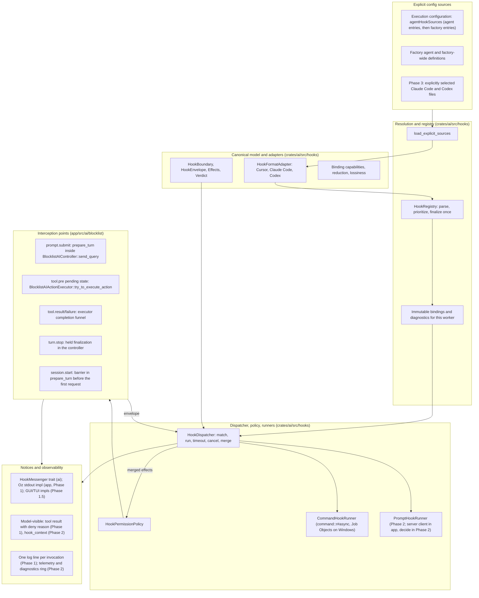

# Agent hooks in Warp: architecture proposal

Status: proposal for engineering review. Baseline: `warp` at `393e97a30a5ed85cf062b75e88326f83746dbecb` (master), vendor documentation read on 2026-10-19. Code paths are relative to the repository root and are cited as path plus symbol; line numbers drift and are not used. Supporting material: `cursor-hooks-coverage.md` (per-hook coverage verdicts), `research/01-cursor-hooks-catalog.md`, `research/02-claude-code-and-codex-hooks.md`, `research/03-warp-agent-loop-map.md`, `research/04-warp-config-process-infra.md`, and `research/05-cursor-cloud-ask-behavior.md`.

## 1. Summary and recommendation

Agent hooks let a user or team run their own scripts, and later model-evaluated prompts, at fixed points in Warp's agent loop: before and after tool calls, when a prompt is submitted, when a turn ends, and at session boundaries. A command hook receives one JSON object on stdin and may return one JSON object on stdout to observe, deny, require confirmation, annotate, or (later) rewrite what the agent does. Prompt hooks evaluate the equivalent payload through a server API. Cursor's `hooks.json` is the first supported format. Claude Code and Codex formats follow as additional adapters.

The recommendation is a layered system with one canonical model in the middle. Format adapters parse vendor configs, encode Warp's canonical envelope into each vendor's wire shape, and decode vendor output into typed effects. Each binding (a Warp boundary, a vendor event, and an adapter) declares which effects it may produce and how it fails, and those declarations are validated when the source is activated. The loop and the process runner never see vendor vocabulary. The pre-tool hook runs at dispatch time inside the existing executor, so it judges the operation that will actually run, and one component, `HookPermissionPolicy`, is the only place hook verdicts meet Warp's own permission result. Permissions are tightening-only in the first release; a bounded, AgentDecides-only form of loosening comes later. Phase 1 loads only hook sources selected by the resolved run or factory configuration. Resolving that configuration is the trust decision; Warp does not also infer trust from a source's repository location or the run's permission posture. Warp follows documented vendor defaults where known and labels its choices where the docs are silent or conflict, with a per-source `strict` setting for uniform fail-closed behavior.

**Key decisions.** Each is argued in the section named; rejected alternatives are collected in §13.

1. One canonical hook model sits in the middle. Vendor vocabulary stays inside format adapters, and each binding declares the effects it may produce, validated at activation (§4). Rejected: implementing Cursor's format directly in the loop; a universal superset event bus.
2. The pre-tool hook runs at dispatch time, inside `BlocklistAIActionExecutor::try_to_execute_action`, through a pending-hook state (§6.1). Rejected: running it during queue-time preprocessing, which sees stale cwd and pre-edit command text; per-executor hooks, except as a fallback for deny-only and observe-only hooks.
3. Hooks only tighten permissions in Phase 1. A later phase adds bounded loosening: a hook `allow` can satisfy only the confirmation Warp would show under `AgentDecides`, never `AlwaysAsk`, denylists, or existing protected paths, and only for sources with a separate "may approve" grant. Both live in `HookPermissionPolicy` (§6.5). Rejected: hooks decide first; tighten-only forever.
4. Phase 1 config sources are the hook directories a factory selects for an agent, delivered with the run in its execution configuration (`ExecutionConfiguration.agentHookSources`). That list is the only input: there is no local flag, environment variable, or config-file key, and a run with no server loads no hooks. A run started by hand with `--task-id` and no execution id fetches no execution configuration and so loads no hooks; every run the server starts carries an execution id (`WARP_EXECUTION_ID`), so this only affects a developer running the CLI by hand. Warp does not scan repositories for hook files and does not read `~/.cursor/hooks.json` (§7). No Warp-owned hooks file is planned.
5. Each worker loads its selected sources once and finalizes the parsed set before hooks can execute. Finalization includes an empty or partially invalid set. Later edits may change a referenced script when it runs, but they cannot add, remove, or replace parsed hook definitions in that worker. Warp adds no hook-specific write protection; deployments that need immutable files must enforce that outside the application (§8).
6. Vendor-faithful defaults with a per-source `strict` setting. A control effect that the current phase or surface cannot honor denies on a pre-execution boundary; it is never dropped silently (§4.3, §4.4, §6.4). Rejected: silently dropping effects; presenting stricter Warp semantics as format parity.
7. Input rewrites wait for Phase 2 and run under a two-pass contract (§6.2). Rejected: one-pass parallel rewrites.
8. A dedicated stdin-capable runner on `command::r#async`, with Job Object cleanup on Windows. The canonical model, adapters, explicit-source resolver, registry, permission policy, dispatcher, and command runner all live in `crates/ai/src/hooks`; interception points, notice implementations, settings wiring, and the server client stay in `app`. No new crate (§3, §9.1). Rejected: reusing `CommandExecutor`; a separate `warp_hooks` crate; splitting the runtime into `app`.
9. Server-owned moments (automatic compaction, server-side subagents, remote-child stop relay) stay out of scope, with no server checkpoints (§10). Rejected: server checkpoints in Phase 2.
10. Phase 1 is cloud and CLI only: Oz cloud runs and `warp agent run`, including remote orchestration children. The GUI and TUI stay inert until Phase 1.5 (§10, §11).

Delivery is four phases, with tentative estimates. Phase 1, cloud and CLI (tentatively 5 to 6 client weeks plus about 1 server week), ships the canonical model, the Cursor adapter, one-time loading of explicitly configured sources, the runner with Windows Job Objects, the dispatch-time pre-tool hook without rewrites, the tool, stop, prompt, session-start, response, and reasoning events, tightening-only composition, and a small proto and server change so a hook's deny reason reaches the model for every tool, through one `denied_by_hook` tool call result (§9.3). Phase 1.5, interactive surfaces (tentatively 2 to 3 client weeks), enables the GUI and TUI with settings, palette toggles, and notice implementations; it still requires explicit source selection. Phase 2 (tentatively 6 to 8 client weeks plus 2 to 3 server weeks, with the server estimate unvalidated) supports 18 of Cursor's 21 event names within the limits in §10. It adds rewrites under the two-pass contract, bounded loosening, `hook_context` fields for `additional_context`, prompt hooks, the remaining events, and observability. `afterAgentResponse` ships in Phase 1 on a client-side heuristic: a text message is treated as final when the next message starts or the stream ends. Phase 3 adds Claude Code and Codex adapters at a tentative 3 to 4 weeks each. Cursor's two Tab hooks and `workspaceOpen` are excluded because Warp has no inline-completion surface and no project-open event (`cursor-hooks-coverage.md` §3.19 to §3.21). The section "Phase 1 as built" (§14) lists the pull requests that implement Phase 1 and where the open questions from that work are kept.

## 2. Goals, non-goals, principles

**Goals.** Run existing Cursor command hooks with documented compatibility limits. Support every surface that runs the native loop: Oz cloud runs, `warp agent run`, native orchestration children, and (from Phase 1.5) the GUI and the TUI. Admit new formats and prompt hooks without changing the loop or the runner. Make denials, failures, unsupported features, and configuration provenance visible. Keep Warp's safety floors independent of hooks. Roll out behind the server's flag, with deterministic, testable decisions.

**Non-goals.** Hooks inside external harnesses (Claude Code or Codex running in Warp): those harnesses own their tools and hooks, and `ConversationDriver::executes_tool_calls_locally` (`app/src/ai/agent/conversation_driver.rs`) is false for them. Sandboxing hook processes or claiming a data-loss-prevention boundary. Reproducing every Claude Code lifecycle event. Guaranteeing cleanup after crashes or exactly-once external side effects. Authoring hooks into third-party agents, which is the existing CLI-agent plugin system (`research/04-warp-config-process-infra.md` §7).

**Principles.**

1. One canonical model; vendor vocabulary stays inside adapters.
2. Separate configuration location, format, execution host, and authority. A Cursor-shaped file may live anywhere; it is active only when the resolved run configuration selected it.
3. Decisions are typed and merged deterministically by source priority and array order, never by completion time.
4. Vendor-faithful defaults; a single strict override. Strict mode is a Warp policy, not format parity.
5. Hooks can tighten from any source. Loosening is a separately granted capability and never crosses Warp's floors.
6. A control effect (one that changes what the agent does) that the current phase or surface cannot honor denies on a pre-execution boundary. Silently dropping a rewrite or a denial is the one failure that must not happen. An observational effect that cannot be delivered is logged.
7. The decision must describe the operation that will run: final arguments, current cwd, and the finalized configuration revision.
8. Resolve hook configuration before execution. Do not make repository scanning, project posture, or mutable application state part of activation.

## 3. Layered architecture



**Placement.** The whole hook system except its interception points lives in `crates/ai/src/hooks/`: the canonical model, the adapters, explicit-source parsing and loading, the registry, the permission policy, the dispatcher, and the command runner. `ai` already depends on `warpui_core`, `regex`, and `serde_json`, and it already keeps native-only modules behind the `local_fs` feature; file loading and process spawning use that gating, and an `UnavailableRunner` stands in for builds that cannot spawn processes (`research/04-warp-config-process-infra.md` §4). Host-specific inputs are supplied by `app` rather than making `ai` depend on application state. `InitialProcessEnvironment` (`app/src/process_environment.rs`) captures the environment at the beginning of `run_internal`, is registered as an app singleton before `initialize_app`, and is passed to the command runner as an immutable snapshot. Login-shell PATH capture (`LocalShellState::get_interactive_path_env_var`, `app/src/terminal/local_shell/mod.rs`) is injected as a shared closure over a slot the app fills once the asynchronous capture resolves. The per-surface notice sink is a `HookMessenger` trait defined in `ai` and implemented in `app`. This keeps the process runner deterministic and app-independent while allowing the application to provide the startup state and services it owns. What stays in `app`: the interception points inside `app/src/ai/blocklist`, the GUI, TUI, and Oz notice implementations, and the `ServerApi` client the Phase 2 prompt runner will use (whether that runner moves to `ai` is decided in Phase 2). No new crate is needed, and both `warp_tui` and the Oz binary already consume `app` and `ai`.

**Registry versioning.** The registry publishes immutable `Arc<RegistrySnapshot>` values while it processes the configured source list. Each installed source increments `revision`; the final revision identifies the complete parsed set that dispatchers read. The loader then finalizes the registry exactly once, including when no sources resolve or some sources fail. After finalization no production API may install or replace a source, so no reload counter, stale state, or snapshot history is needed. A canonical file selected more than once contributes one source under its highest-priority configured provenance.

**Components.**

- **Canonical model** (`crates/ai/src/hooks/model.rs`). Boundaries, envelope, effects, five-valued verdict, reduction rules. Reuses `AIAgentActionType` and `AIAgentActionResultType` (`crates/ai/src/agent/action/mod.rs`, `action_result/mod.rs`) for tool identity and payload encoding.
- **Format adapters** (`crates/ai/src/hooks/adapters/`). A static registry of known formats, modeled on `SKILL_PROVIDER_DEFINITIONS` (`crates/ai/src/skills/skill_provider.rs`) and `MCPProvider` (`app/src/ai/mcp/mod.rs`). Each implements parse, binding declaration, matcher evaluation, input encoding, and output decoding.
- **Explicit-source loader** (`crates/ai/src/hooks/sources.rs`, file access behind `local_fs`). Loads the complete selected list of `ExplicitHookSource` values, merges entries that reach the same file, records source diagnostics, reports each failed source with its own `strict` setting, and finalizes the registry. It never scans a repository or home directory. Selection happens in the run or factory configuration layer before this loader is called; that layer also turns each selected directory into a source through the format's layout rule (`adapters::source_layout`).
- **HookRegistry** (`crates/ai/src/hooks/registry.rs`, an entity model registered at startup). Immutable snapshots of active bindings with provenance and a revision counter; answers "bindings for this boundary"; and rejects production installation after finalization. A source is identified by its canonical path, so a symlink and its target are one source and two files with the same text are two.
- **HookDispatcher** (`crates/ai/src/hooks/dispatch.rs`). The one call the loop makes: fire an envelope, get merged effects. Pins a registry snapshot for each hooked action, runs every matching binding at once (`join_all`) and reduces the results in the snapshot's order whatever order the processes finished in, decodes through the adapter, refuses control effects the boundary cannot honor (§4.3), logs one summary line per dispatch, and routes notices. It has no deadline of its own: each invocation is held to its own timeout by the runner, and the runner's four-slot bound (§9.1) is the only limit on how many hooks run at once. A cancel observed after the processes return discards the partial result and marks the outcome cancelled, so no caller reads it as no opinion. Each hook's output is decoded under its own source's `strict` setting, and the merged result records every hook that asked, with its source's on-ask setting.
- **HookPermissionPolicy** (`crates/ai/src/hooks/permission.rs`). The only component that composes a merged hook verdict with Warp's own permission result (§6.5). Tightening-only in Phase 1; bounded loosening later; changed in one place.
- **CommandHookRunner** (`crates/ai/src/hooks/runner/command.rs`, behind `local_fs`). A dedicated one-shot JSON-over-stdio spawner on `command::r#async::Command` with a process group on Unix and a per-child kill-on-close Job Object on Windows (`Command::spawn_in_job` and `JobGuard`, `crates/command/src/async.rs`). It is not built on `CommandExecutor::execute_command` (`app/src/terminal/model/session/command_executor.rs`), which has no stdin parameter, nor on `LocalCommandExecutor::execute_local_command_internal`, which forces null stdin. The immutable startup environment and login-shell PATH capture are injected from `app`; the timer, SIGTERM, grace, kill shutdown pattern comes from `lsp::ProcessTransport` (`crates/lsp/src/transport.rs`). At most four hooks run at once, output is bounded, and whatever is left of a hook's process tree is ended on every path, including after a normal exit (§9.1).
- **PromptHookRunner** (Phase 2). Calls a new warp-server evaluator, following the REST pattern of `/ai/generate_block_title` (`app/src/server/server_api/block.rs`). The `ServerApi` client lives in `app`; where the runner itself lives is decided in Phase 2.
- **Interception points** (`app/src/ai/blocklist`; §5). Build envelopes, await the dispatcher where the boundary blocks, apply effects.
- **Notices** (`crates/ai/src/hooks/notices.rs` for the `HookMessenger` trait). Phase 1 has one implementation, `OzHookMessenger` (`app/src/ai/agent_sdk/driver/hooks.rs`), which writes each notice and diagnostic as one record through the run's output layer (`app/src/ai/agent_sdk/driver/output.rs`, under one `with_stdout_buffered` call so records from the dispatcher's background thread never interleave with the conversation's own records) rather than through `AgentDriver::write_output`, which is a `&self` method on the driver that formats agent output. In `json` and `ndjson` output the records are `{"type":"hook_notice","kind":"denied|warning|info","conversation_id":<server token or null>,"local_conversation_id":"…","action_id":"…"|null,"text":"…"}` and `{"type":"hook_diagnostic","source":"…","severity":"error|warning|info","message":"…"}`; in `text` and `pretty` output they are one `hook: <kind>: <text>` or `hook: <severity>: <source>: <message>` line each. Source diagnostics are emitted during configured-source loading and remain attached to the finalized snapshot. Phase 1.5 adds the GUI (`AgentNotificationsModel`, `app/src/ai/agent_management/agent_management_model.rs`) and TUI (hints) implementations. Denials are durable notices attached to the action, not only toasts.
- **Observability.** Phase 1 writes one `log::` line per hook invocation from the runner (`hook invocation: event=… source=… binding=… exit=… duration_ms=… stderr_tail=…`, with the escaped tail at most 500 bytes and never the payload or stdout) and one summary line per dispatch from the dispatcher (event, action, bindings matched, verdict, halt, duration). Telemetry via `register_telemetry_event!`, a per-conversation diagnostics ring, and any panel are Phase 2.
- **Activation controls.** The server's `FactoryHooksEnabled` flag; there is no client switch. Phase 1 has no settings and no local inputs. A run's hooks come only from `agentHookSources` on its `ExecutionConfiguration`, which the server fills from the factory configuration. The cold-run query (`ExecutionBootstrap`, `crates/graphql/src/api/queries/execution_config.rs`) selects the field and sends `supportsAgentHooks: true`; a pre-warmed assignment carries the same configuration, and one that predates the field decodes with no hook sources. `build_execution_task_and_options` converts the list for both routes into `RunHooks` on `AgentDriverOptions`; a format, level, on-ask value, or forge this client does not know fails the run rather than dropping the entry. `strict` and on-ask belong to each entry. Hooks run only under the Oz harness; a run whose harness is not Oz but has hooks fails. Phase 1.5 adds a `define_settings_group!` group (`app/src/settings/ai.rs`) with palette toggle pairs for hooks enabled and default timeouts; source selection remains with the configuration.

## 4. Canonical model and adapters

### 4.1 Boundaries and vendor mapping

Boundaries are grounded in moments Warp's loop can supply. A new boundary is added only when Warp can provide its timing and honor at least one of its effects. Several vendor events project onto one boundary; the adapter's matcher and payload view distinguish them.

| Canonical boundary | Cursor | Claude Code | Codex | Phase |
| --- | --- | --- | --- | --- |
| `session.start` | `sessionStart` | `SessionStart` | `SessionStart` | 1 (observe) |
| `session.end` | `sessionEnd` | `SessionEnd` | `SessionEnd` | 2 |
| `prompt.submit` | `beforeSubmitPrompt` | `UserPromptSubmit` | `UserPromptSubmit` | 1 |
| `tool.pre` | `preToolUse`; shell and MCP facets `beforeShellExecution`, `beforeMCPExecution` | `PreToolUse` | `PreToolUse` | 1 |
| `tool.permission_request` | — | `PermissionRequest` | `PermissionRequest` | 3 |
| `tool.result` | `postToolUse`; facets `afterShellExecution`, `afterMCPExecution`, `afterFileEdit` | `PostToolUse` | `PostToolUse` | 1 (edit facet 2) |
| `tool.failure` | `postToolUseFailure` | `PostToolUseFailure` | — | 1 |
| `file.exposure` | `beforeReadFile` | — (reads use `PreToolUse`) | — | 2 |
| `subagent.start` | `subagentStart` | `SubagentStart` (context only) | `SubagentStart` (context only) | 2 |
| `subagent.stop` | `subagentStop` | `SubagentStop` | `SubagentStop` | 2 |
| `turn.stop` | `stop` | `Stop` | `Stop` | 1 |
| `turn.interrupt` | — | — | `Interrupt` | 3 |
| `compaction.pre` | `preCompact` (manual only) | `PreCompact` | `PreCompact` | 2 |
| `compaction.post` | — | `PostCompact` | `PostCompact` | 3 |
| `response.complete` | `afterAgentResponse` (client heuristic) | — | — | 1 (observe) |
| `reasoning.complete` | `afterAgentThought` | — | — | 1 (observe) |

Parsed, reported as unsupported, and never fired: Cursor `beforeTabFileRead`, `afterTabFileEdit`, `workspaceOpen`; Claude `Notification`, `PermissionDenied`, `PostToolBatch`, `StopFailure`, `UserPromptExpansion`, `MessageDisplay`, `Setup`, `InstructionsLoaded`, and the task, teammate, config, cwd, directory, file, worktree, model-switch, and elicitation events.

`file.exposure` is a distinct boundary rather than a facet of `tool.result`. Its timing is "content has been read locally but not yet shown to the model", and its failure semantics are those of a permission hook (`research/01-cursor-hooks-catalog.md` §2.2). Its scope follows Cursor's semantics as closely as Warp's tool set allows. It fires for the agent-invoked tools that read specific files, `ReadFiles`, `ReadSkill`, and `GetFiles`, once per file. For `SearchCodebase` the search runs first, and the hook then checks each surfaced file before its content reaches the model. Project rules are not checked; as in Cursor, rule files appear in the `attachments` array with type `rule`. `Grep` match lines are not checked either, which matches Cursor's `Read`-only scope. Cursor's docs do not say whether loading a skill fires `beforeReadFile`; Warp fires it for `ReadSkill` deliberately, since there is no skill-specific hook (`cursor-hooks-coverage.md` §3.12).

### 4.2 Envelope

The envelope is the in-memory, format-neutral superset of everything a boundary knows. Adapters serialize it into the vendor's stdin shape; scripts never see the envelope itself. For the Cursor adapter the stdin payload is Cursor's documented JSON for that event.

Common fields, with missing values absent rather than fabricated:

- `schema_version`, `occurrence_id`, `invocation_id`.
- `conversation_id` (`AIConversationId`, which exists before the server token; `research/03-warp-agent-loop-map.md` §2).
- `turn_id`: a user-turn identifier allocated when a turn starts, in `prepare_turn` inside `send_query`, and carried across every exchange of that turn. Every `send_query` starts a turn, including inputs Warp builds itself (a passive suggestion result, an agent wake, and the `StartFromAmbientRunPrompt` input an Oz run sends), while tool-result follow-ups continue the current turn. This is what Cursor's `generation_id` and Claude's `prompt_id` map to. `AIAgentExchangeId` changes per request, including tool-result follow-ups, so it is exposed separately as `exchange_id` (`AIConversation::turn_exchange_ids`, `app/src/ai/agent/conversation.rs`). Both are optional because `session.start` precedes the turn and any exchange; the Cursor adapter sends the conversation id under `generation_id` there, because Cursor lists the field in every event's common base and an absent key could crash scripts that index it.
- `action_id` (`AIAgentActionId`) on tool boundaries; `run_id`, parent ids, and child correlation ids when available.
- `surface` (`OzRun`, `CliRun`, `LocalChild`, `Gui`, `Tui`), `execution_host`, `cwd`, `roots`, `source_revision`. A process launched headlessly uses `OzRun` when the server dispatched it (`--task-id` was passed) and `CliRun` otherwise. The driver records that distinction as `RunSurface::Oz` or `RunSurface::CommandLine`; only an Oz run can have hooks in Phase 1, since only it has an execution configuration. An interactive process uses `Tui` or `Gui`, except that a conversation with a parent is `LocalChild`. `LocalChild` records the conversation relationship, not whether approval is available: its pane may begin hidden, but the user can reveal it and approve an action. A `warp agent run --gui` process therefore uses `Gui` even though its coarse execution mode is `Sdk`. `OzRun` and `CliRun` are the headless surfaces.
- Model metadata (`LLMId`), user email, Warp version, hook protocol version (precedent: `warp_core::cli_agent_protocol`). The envelope's shape (`ENVELOPE_SCHEMA_VERSION`) and the stdin and stdout contract scripts see (`HOOK_PROTOCOL_VERSION`) are versioned separately; both are 1.
- Permission facts: whether Warp's own check would ask, the active autonomy level, and the derived vendor `permission_mode` where an adapter needs it. These are left at their default on `tool.pre` because hooks are consulted before `should_autoexecute` runs.
- `session_env`: the variables the conversation's `session.start` hooks set, copied onto every later envelope for that conversation so the runner can apply them (§9.1).
- On `prompt.submit`, `provenance`: `User` for a person's prompt, `HookFollowUp { binding, chain_id }` for a prompt a stop hook asked for, so a hook can tell the two apart.

Per-boundary payloads use Warp's own types serialized to neutral JSON: the action and its arguments, cwd, timing, result or failure, and facets (shell adds the model's command, execution state, sandbox flag, captured output; MCP adds the server installation id, and no more in Phase 1: the server's name, URL, and command are not on the envelope, since filling them needs a field `app` resolves from the MCP manager; file exposure adds host-qualified path, text or an explicit unsupported content kind, range, and revision; edits add path, old and new text, and saved outcome). Shell hooks see the model's command, not the decorated command Warp runs (pager flags, PowerShell wrapping). The proto `risk_category` is dropped today in `From<RunShellCommand>` (`crates/ai/src/agent/action/convert.rs`); plumbing it is a small prerequisite so policy hooks can key on it. `tool.failure` carries the cancellation reason as a fixed snake_case name per variant (`user_cancelled`, `cloud_handoff`, `follow_up_submitted`, `user_ran_command`, `reverted`, `conversation_deleted`, `command_finished`, `user_took_control`, `shell_exited`, `hook_ended_run`), since scripts match on it.

### 4.3 Effects and verdicts

An effect bundle has independent channels: verdict with reason; replacement input; replacement model-visible result; model context; user notice; hook-session environment; halt turn; continuation request. Rewrites are whole validated objects, never partial mutations of app state.

Two words are used precisely throughout this document. A **control effect** changes what the agent does: deny, ask, rewrite input, replace a result, halt the turn, request a follow-up. An **observational effect** does not: a user notice, a log line, session environment for later hooks. An effect is **unsupported** when the current phase or surface cannot honor it. An unsupported control effect on a pre-execution boundary denies; an unsupported observational effect is logged.

The dispatcher owns that rule (`refuse_unhonorable_effects`). Before an operation (`tool.pre`, `tool.permission_request`, `file.exposure`, `subagent.start`) a rewrite, a result replacement, a turn stop or continuation request, a deferral on a headless surface or from a strict source, or a control field the adapter refused because the event does not define it denies the action with a reason that names the binding and either what it asked for or, for a refused field, what the field controls (for example "returned a field that controls whether the turn continues, which this event does not accept"), without claiming the hook asked for that outcome. On `prompt.submit` the same cases hold the prompt. After the fact they are only reported. Model context, which this phase cannot deliver, is logged. Whether the rule should be narrower (deny only for rewrites and report the rest) is a conservative choice awaiting David's decision.

The verdict is five-valued: no opinion, allow, deny, ask, defer. `Defer` is represented because Claude Code defines it, but resumable deferral is unsupported in Warp. Claude's reference says `defer` "exits gracefully so the tool can be resumed later", is honored only in non-interactive `-p` runs where the host process reads `stop_reason: "tool_deferred"` and later resumes, is restricted to a single pending tool call, ignores `updatedInput` and `additionalContext`, and in interactive sessions "logs a warning and ignores the hook result". Warp follows the interactive warning-and-ignore behavior, reported as a diagnostic, except when the hook's source is `strict`, where a deferral is unsupported control output and denies on an interactive surface too (a conservative choice awaiting David's decision; no Phase 1 adapter produces `defer`). On headless surfaces it rejects the unsupported control effect with a specific diagnostic and does not execute the action; it does not claim to have suspended work for later resume. This is not an approval-unavailable result or an `ask` decision. `reduce_effects` never produces a merged `Defer`; the permission policy's own `Defer` arm is a backstop for a caller that bypasses the dispatcher, and since it cannot see which source deferred it denies on every surface.

### 4.4 Per-binding capabilities

A binding is one boundary, one vendor event, and one adapter. It declares the effects that vendor event may produce (for example Cursor `preCompact` produces only a user notice; Claude `PreCompact` may halt), the failure semantics (fail-open or fail-closed, and how malformed or empty output is treated), the matcher target, the handler kind, and for stop events its `loop_limit`. At activation the registry validates those capabilities against what the boundary can honor in the current phase and warns about gaps. It cannot predict an arbitrary script's output; the warning says that a rewrite, if emitted, will be rejected. For the Cursor adapter the warning appears only where Cursor documents context or a rewrite (`sessionStart`, `preToolUse`, `postToolUse`, `postToolUseFailure`), because the permission hooks do not declare model context: `agent_message` on a non-deny has no documented meaning. At runtime, a control effect that the binding does not permit or the phase cannot honor denies on a pre-execution boundary and is reported on any other boundary. The adapter is the one that knows which output fields an event defines, so it reports a field that names a control effect Cursor defines on some other event (`permission`, `hookSpecificOutput`, `updated_input`, `updated_mcp_tool_output`, `continue`, `followup_message`, `decision`) through `HookEffects.unsupported`, which `reduce_effects` carries into the merged effects and the dispatcher turns into a diagnostic for the source and, before an operation, a denial (§4.3). The adapter reads the field's value first: `continue: true`, `permission: "allow"`, a `decision` other than `"block"`, and an empty `followup_message` ask for nothing and are only logged, so Claude-shaped output copied onto a `beforeShellExecution` hook does not deny the command. An observational field the event does not document (`additional_context`, `env`, a message) is only logged. Whether a log line is enough for those is a conservative choice awaiting David's decision. Vendor-defined ignored fields remain governed by the adapter's documented defaults. Capabilities therefore attach to the binding and the boundary, not only to the event enum.

### 4.5 Lossiness tables

Cursor adapter:

| Cursor feature | Warp behavior |
| --- | --- |
| `version` | Only `1` loads. Missing, `0`, a string, a fraction, or any other integer is an error naming the problem, so a future schema is never read with today's meanings; the cost is that a configured source on a newer schema gets no hooks at all, including its deny hooks, until the adapter learns it. A conservative choice awaiting David's decision |
| `ask` per event | `beforeShellExecution` and `beforeMCPExecution`: honored as `ask`. `preToolUse`: no opinion with a log line, as Cursor documents ("accepted by the schema but not enforced"); honored as `ask` when the source is `strict`. `subagentStart`: a denial with a reason saying so, under both policies. `beforeReadFile` and `beforeTabFileRead`: not in Cursor's schema, so a schema mismatch, which denies. The `preToolUse` default is a conservative choice awaiting David's decision. On an `ask` the messages are kept the way a denial's are, so the headless degrade to deny (§6.5) needs no adapter change |
| `permission` missing or unknown | A JSON object with no `permission`, or with a value other than `allow`, `deny`, or `ask`, is malformed output on every permission hook and denies even when the definition fails open; Cursor does not say whether the field may be omitted. Decision words are compared as written, with no trimming. Empty stdout is the separate no-output case and follows `failClosed`. A conservative choice awaiting David's decision |
| `updated_input` | Phase 1: a rewrite request on a pre-execution boundary denies with a reason naming the binding; it is never run with the original input. Cursor documents the field only on `preToolUse`; on the other permission hooks it is also reported as unsupported for the event. Claude's nested `updatedInput` counts only on `preToolUse`. Phase 2: two-pass contract (§6.2) |
| Claude-shaped output | Accepted exactly where Cursor says it translates it: `hookSpecificOutput.permissionDecision`, `permissionDecisionReason`, and `updatedInput` on `preToolUse`, and `decision: "block"` with a `reason` (flat or nested) on `stop` and `subagentStop`, as fallbacks when the flat fields are absent. Everywhere else `hookSpecificOutput` is an undocumented key, so a `beforeShellExecution` hook that answers only in Claude's shape has no decision and denies. A conservative choice awaiting David's decision |
| `additional_context`; denial `agent_message` | Additional context is Phase 2 after `hook_context` protos exist (§9.3); in Phase 1 it is decoded as model context on `sessionStart`, `postToolUse`, and `postToolUseFailure`, reported as unsupported at activation, and logged. Cursor's `agent_message` applies on denial and travels as the reason of the `denied_by_hook` tool call result, for every tool (§9.3). On a deny, `agent_message` is the reason the model reads, `user_message` stands in when there is no `agent_message`, and a `user_message` that is not already the reason is a notice. `agent_message` on an `allow` is logged and dropped. With neither message the reason is `Denied by hook <command> (exit 2).` or `Denied by hook <command>.`, with the command cleaned of control characters |
| Output fields an event does not document | A field naming a control effect Cursor defines on some other event is reported and never applied (§4.4); an observational one is logged. A cut-off stdout (over 1 MiB) is malformed output even when the kept prefix parses |
| `beforeReadFile` | Fires after the local read, before model exposure, for `ReadFiles`, `ReadSkill`, `GetFiles`, and each file surfaced by `SearchCodebase`; not for project rules (sent as `rule` attachments) or `Grep` lines |
| `preCompact` | Manual `/compact` only; automatic compaction is server-side and unsupported |
| `subagentStart`, `subagentStop` | Native children only, parent-side: start can allow or deny; stop is observational. Server-side subagents and child `followup_message` are not advertised |
| `afterAgentResponse` | Phase 1 client heuristic: emit once per text message when the next message starts or the stream ends. `afterAgentThought` uses reasoning `finished_duration` and is exact |
| `transcript_path` | `null`; Warp keeps transcripts in SQLite |
| `cursor_version`, `CURSOR_VERSION` | Format-driven labeled compatibility values, set for every Cursor-format source, whether it lives in a repository or on the worker; `warp_version` carries the real version (both hold Warp's version string) |
| Scalar output merge | Highest-priority source wins; Cursor's pages disagree with each other (§7.4). Within one source, bindings merge in the order Cursor's reference lists the events, then array order, so for one shell command a `preToolUse` definition merges before a `beforeShellExecution` one; Cursor does not define their relative order |
| `loop_limit` | Read on `stop` and `subagentStop`; absent is Cursor's default of 5; `null` and values above 8 become 8 with a load-time warning; on any other event it is ignored with a warning. Enforcement is per binding within one continuation chain plus the host cap of 8 for the whole chain (§9.2) |
| Matcher targets | `preToolUse`, `postToolUse`, `postToolUseFailure`: the canonical tool name. `beforeShellExecution`, `afterShellExecution`: the model's full command. `beforeMCPExecution`, `afterMCPExecution`: the MCP tool's own name without the `MCP:` prefix, since Cursor lists no target and the tool name is what their payload calls `tool_name`; they fire for `CallMCPTool` only, and `ReadMCPResource` is reachable through `preToolUse` as `MCPResource:<name>`. A matcher on an event with no documented target (`sessionStart`, `sessionEnd`, `preCompact`, `workspaceOpen`) is dropped with a warning and the definition matches every occurrence. A matcher that does not compile skips only its definition, with a warning |
| Payload additions | `tool_use_id` on every tool event (Cursor's release notes document it); `exit_code` on `afterShellExecution`, because the output alone cannot say whether the command succeeded; `warp_version` and `model_id`; `cancellation_reason` on `postToolUseFailure`; the model's `is_read_only`, `is_risky`, `wait_until_completion`, `uses_pager`, and `rationale` in a shell `preToolUse.tool_input`. `sandbox`, `model_params` (sent as `[]`), `mcp_server_name`, `url`, and `command` are omitted rather than invented |
| Tab hooks, `workspaceOpen` | Parsed, a warning per definition, no binding (there is no boundary to bind to); never fire. The six Phase 2 events become bindings that never match, with a warning per definition saying so |
| Prompt hooks | Parsed and skipped one definition at a time, each with a warning naming it, while the command hooks beside them load and keep their array positions; this follows Cursor's own headless surfaces, which run command hooks only. Unknown `type` values are errors. A conservative choice awaiting David's decision. Phase 2 runs them after the evaluator exists; documented shell example first |

Claude Code adapter (Phase 3):

| Claude feature | Warp behavior |
| --- | --- |
| Roughly two-thirds of events | Parsed, reported unsupported, never fire |
| `defer` | Represented; ignored interactively with a warning; headless resumable deferral is rejected as unsupported, not treated as `ask` |
| `PermissionRequest` | `tool.permission_request`; fires only when Warp would show a confirmation; its allow is the bounded-loosening path and needs the "may approve" grant |
| `updatedToolOutput` (any tool) | Honored where the Warp result has a replaceable payload; otherwise reported |
| `http`, `mcp_tool`, `agent` handlers; `asyncRewake`; `once`; `if` | Unsupported; `async` runs detached and observe-only |
| `terminalSequence`, `watchPaths`, `sessionTitle`, `initialUserMessage`, `suppressOriginalPrompt`, `CLAUDE_ENV_FILE` | Unsupported |
| Plain-text stdout as context | Honored only once `hook_context` exists |
| `transcript_path` | `null` although the SDK types mark it required |
| Exit code 2 per event | Honored per Claude's table where the event exists |
| Matcher dialect | Exact-name rule plus unanchored regex; JavaScript-only syntax rejected with a diagnostic |

Codex adapter (Phase 3):

| Codex feature | Warp behavior |
| --- | --- |
| `Interrupt` | `turn.interrupt`, observational |
| `PreToolUse` `ask` | Failed hook that proceeds, as Codex documents; honored in strict mode |
| `PermissionRequest` | As for Claude |
| `PostToolUse` `decision: "block"` | Replaces the model-visible result with the reason when the Codex adapter ships in Phase 3, using Phase 2 result-replacement support |
| `commandWindows`, `config.toml` `[hooks]` | Honored; TOML normalized as the MCP parser already does |
| `async`, `mcp_tool`, `prompt`, `agent` | `async` detached; `mcp_tool` unsupported; `prompt` and `agent` not run, matching Codex |
| `additionalContextLimit` | Ignored |
| Completion-order rewrite resolution | Not reproduced; deterministic order instead |

## 5. Interception points

| Canonical boundary | Warp seam | Blockable | Modifiable | Phase |
| --- | --- | --- | --- | --- |
| `session.start` | The barrier at the start of `prepare_turn` (`app/src/ai/blocklist/hooks/session.rs`), which every `send_query` reaches, before the conversation's first request; fired once per conversation id for a conversation this client drives that has no exchanges yet. Not `BlocklistAIHistoryModel::start_new_conversation`: at creation time the conversation's driver is not yet known, so a conversation an external harness later drives would fire it | Barrier only; creation cannot be denied | Hook env; context in Phase 2 | 1 |
| `session.end` | Conversation delete, surface close; Oz `AgentDriver::cleanup` (awaited) | No | No | 2 |
| `prompt.submit` | `BlocklistAIController::send_query` (`app/src/ai/blocklist/controller.rs`), split at the point the request would go out: `prepare_turn` starts the session barrier, allocates the turn id, and either sends on the same call (`send_prepared_query`) or spawns the decision and finishes in `conclude_prepared_query` | Yes (halt: `continue: false`, a `deny`, or an `ask`, since no confirmation step exists for a prompt) | Prompt rewrite has no vendor field | 1 |
| `tool.pre` | Pending-hook state in `BlocklistAIActionExecutor::try_to_execute_action` (§6.1) | Yes | Rewrites Phase 2 | 1 |
| `tool.permission_request` | Same seam, fired only when Warp's verdict is "ask" | Yes | Rewrites Phase 2 | 3 |
| `tool.result`, `tool.failure` | One completion funnel before `BlocklistAIActionModel::handle_action_result` (`app/src/ai/blocklist/action_model.rs`), covering async futures, synchronous results, denials, and cancellations (`app/src/ai/blocklist/hooks/tool_result.rs`). A tool that ran and returned is a `tool.result` whatever it returned; a tool that never ran is a `tool.failure` (§9.2) | Observational in Phase 1; the funnel never holds the result. Holding arrives with replacement output | Replacement output Phase 2 | 1 |
| `file.exposure` | Completion of `ReadFilesExecutor`, `ReadSkillExecutor`, and `GetFilesExecutor` (`app/src/ai/blocklist/action_model/execute/`), and `SearchCodebase` results after the search runs, with content in a private buffer | Yes, per file | Range filtering | 2 |
| `subagent.start` | `RunAgentsExecutor::execute` before dispatch (`app/src/ai/blocklist/action_model/execute/run_agents.rs`) | Yes | Child context for later adapters | 2 |
| `subagent.stop` | `inject_pending_events_for_request` and the follow-up piggyback path in the controller | No | Follow-up not advertised | 2 |
| `turn.stop` | `hold_or_finalize_turn` in the controller, which replaces the two places that set `ConversationStatus::Success` at the end of a turn (the `Done` arm of the stream-finished handler and the `FinishedAction` subscription); the dispatch starts once the turn's stream has been cleaned up (`app/src/ai/blocklist/hooks/turn.rs`) | Hold finalization | Follow-up | 1 |
| `turn.interrupt` | `CancellationReason` paths | No | No | 3 |
| `compaction.pre` | `/compact` via `SlashCommandRequest::Summarize` | Manual only | No | 2 |
| `compaction.post` | Finished `Message::Summarization` | No | No | 3 |
| `response.complete` | Streaming text (`app/src/ai/agent/api/convert_from.rs:ConvertAPIMessageToClientOutputMessage::to_client_output_message`); next-message/stream-end heuristic | No | No | 1 |
| `reasoning.complete` | Same converter; reasoning `finished_duration` marks completion | No | No | 1 |

Tool calls are queued only after the whole response has streamed (`AfterStreamFinished` then `queue_actions`), so pre-tool hooks run between model requests. Detached response and reasoning observers may run while the rest of the response is still streaming. They cannot inject into the in-flight model request or revise text already streamed into the proto history that is replayed to the server (`research/03-warp-agent-loop-map.md` §3.k).

## 6. Decision semantics and permission composition

### 6.1 Dispatch-time pre-tool hook

The pre-tool hook runs at dispatch, inside `BlocklistAIActionExecutor::try_to_execute_action`, for three reasons.

1. A hook `ask` must be resolved before Warp's own confirmation decision, and that decision is made in `try_to_execute_action` before any executor's `execute()` is called. A hook that ran later could not add a confirmation requirement.
2. `ShellCommandExecutor::execute()` starts the command synchronously: it emits `ShellCommandExecutorEvent::ExecuteCommand` before returning its future (`research/03-warp-agent-loop-map.md` §3.d). A per-executor hook for shell would therefore need that executor restructured anyway, which removes the main attraction of the per-executor approach.
3. One call site is what makes `HookPermissionPolicy` real. If each executor composed verdicts on its own, the tightening-only rule and the later loosening rule would be reimplemented per tool.

It also has to be dispatch time rather than queue time: `BlocklistAIActionModel::queue_actions` preprocesses a whole batch before any action runs, so a queue-time check would see the cwd and files as they were before earlier commands in the same batch executed, and `handle_requested_command_accepted` can change the command text after a queue-time decision.

`try_to_execute_action` is synchronous, so the hook has a small state machine (`app/src/ai/blocklist/hooks/pre_tool.rs`). The pending reason is a distinct `NotExecutedReason::WaitingOnHooks` arm rather than a reuse of `NotReady`, which is what executors return when they cannot run yet (busy terminal, missing block); logging and a later UI can tell the two apart, at the cost of one more arm in an exhaustive match. The machine:

- A cached verdict is keyed by conversation id, action id, argument revision (a hash of the action's derived `Debug` form, which covers every field; a field that prints differently for the same value can only cause an extra hook run, never a stale verdict), cwd, and registry revision. The conversation id is part of the key because tool call ids are only unique within a conversation and the cache lives on the process-wide `HookRuntime`. The cheap "any `tool.pre` binding at all" check runs before the action is hashed, so a configuration with only post-tool hooks pays nothing on each try.
- Without a valid verdict, `try_to_execute_action` returns `NotExecuted`, the action model keeps the action pending at the same index, and the executor spawns the dispatcher future on its own context. Several actions may wait during a parallel read-only phase. Each dispatch carries a ticket (conversation id, action id, and its own cancel flag); a verdict whose ticket is cancelled, or is not the one the entry holds, is dropped, so a stale verdict for an old command text is never applied to an edited one.
- On completion the verdict is cached, the executor emits `HookVerdictResolved`, and the action model tries the queue again (or re-runs the user-initiated path when the user approved the action while the verdict was pending). `try_to_execute_action` now finds the verdict, runs Warp's own check once, and hands both to `HookPermissionPolicy`: deny produces a denied result, ask requires confirmation, and allow or no opinion leaves Warp's own checks in place. A denied action finishes with the `DeniedByHook` result, which carries the hook's reason on the wire for every tool (§9.3).
- The user-initiated path (`execute_action` after a confirmation card) consults the same cache. A lookup whose action arguments or cwd differ from the cached one, or whose dispatch died before answering, drops the entry, tells its dispatch to stop, and starts over. Approval satisfies a hook `ask` only for that exact operation under the finalized source revision and never bypasses a hook `deny`. The source revision cannot change after finalization.
- A hook's `ask` reason reaches the user as a warning notice once per verdict when the policy asks for confirmation, since a waiting action is tried more than once; Phase 1.5's card can show it.
- Cancellation kills pending hook processes and prevents execution; the cancel flag is per firing, so cancelling one conversation's pending hooks cannot cancel another's. There is no client switch for the feature: only a non-empty hook list in a run's execution configuration activates hooks. The GUI and TUI never load sources. The server's `FactoryHooksEnabled` flag is the rollout control (§7.1).

This sits on the action model's hot path, but it is small: one `NotExecutedReason` arm, one cache, one re-entry through existing methods. Costs that remain: a denied action is briefly visible as pending (on surfaces with a pending UI); a rewritten file edit (Phase 2) requires `preprocess_action` to run again and a second diff to be generated, and the user must see the final diff before approving.

### 6.2 Rewrites

Phase 1 does not support `updated_input`. On a pre-execution boundary, a rewrite the current phase cannot honor denies with a reason naming the binding; it is never dropped silently and the original input never runs. The dispatcher owns that denial (§4.3); `HookPermissionPolicy::compose` keeps a generic rewrite-denial branch as a backstop for a caller that hands it effects without the dispatcher's reduction. Phase 2 adds rewrites under an explicit two-pass contract: apply the rewrite as a whole validated object; clear the model's risk flags (`is_read_only`, `is_risky`, and the newly carried `risk_category`), because they describe the old command and `BlocklistAIPermissions::can_autoexecute_command` can auto-allow based on `is_read_only` or `is_risky` under `AgentDecides`; recompute preprocessing and permissions; re-run the matching pre-execution hooks on the final input; any deny survives; a second, different rewrite fails as unstable. There is no fixed-point loop. This is documented as Warp behavior: all matching pre-execution hooks may run twice when any hook rewrites, and Cursor does not promise hook idempotence.

### 6.3 Merging across hooks and sources

All matching bindings run at once against the same immutable input (`join_all` over one future per binding), and the results are zipped back onto the bindings in the finalized snapshot's order, so nothing is read from completion order. Results merge in a fixed order: source priority, then, within one source, the adapter's declared order (for Cursor, the reference's event order, then array index). Verdicts merge by severity, deny over ask over allow over no opinion. Halt is any-wins. Notices and model context concatenate in merge order. Scalar fields (replacement input, replacement output, continuation) take the highest-priority value; conflicts are logged. The merged effects record which binding's verdict won and which binding asked for a continuation, so a default reason can name a source and a follow-up can be charged to the binding that asked for it. Identical resolved sources (the same canonical file reached through two configured paths) run once under the highest-priority configured provenance; identical command text in different sources is not deduplicated.

### 6.4 Failure policy, timeouts, strict mode

Defaults follow the adapter's documented semantics. For Cursor: exit 2 denies on the permission hooks and halts the prompt on `beforeSubmitPrompt`, reading any messages printed, and is a plain failure under the failure policy elsewhere; other non-zero exits, crashes, and timeouts fail open unless `failClosed`, so a slow `beforeShellExecution` hook allows the command by default (Cursor's documented default, and a conservative choice awaiting David's confirmation); malformed non-empty output fails closed on Cursor's six permission hooks (`beforeShellExecution`, `beforeMCPExecution`, `beforeReadFile`, `beforeTabFileRead`, `subagentStart`, `preToolUse`) even without `failClosed`, where malformed includes a missing or unknown `permission`, a wrongly typed documented field, and a stdout cut off at the output limit; empty stdout is a no-output failure governed by `failClosed` where the hook decides something and no opinion on `stop` and the observers; malformed output on `beforeSubmitPrompt` follows `failClosed` because Cursor's rule is unstated. On the events where fail-closed means nothing (observers, `sessionStart`, `postToolUse`), `failClosed: true` changes nothing beyond the log line. Observers report failures and continue. Post-result failures preserve the original result. A failed `session.start` adds no context or environment. A failed stop hook does not continue the turn. Cancellation never becomes fail-open execution: a cancelled hook decodes as a deny or a halt where it could have blocked, regardless of `failClosed` (a conservative choice awaiting David's decision; the dispatcher's caller drops a cancelled verdict anyway), and a cancelled dispatch merges nothing and is marked cancelled.

The "strict hook policy" turns every evaluation failure on an event that can block, including timeout, crash, empty output, malformed output, and unsupported control output, into denial, or into a halted prompt on `beforeSubmitPrompt`, which is not one of Cursor's six permission hooks but can block (the broader reading is a conservative choice awaiting David's decision). It also honors schema-accepted `ask` values that the vendor would otherwise ignore or treat as a failed-open hook. It never weakens a vendor denial into an ask, so Cursor `subagentStart.ask` still denies. It is a Warp policy for security deployments and is not described as format parity. It belongs to each source, not to the run: each entry in the configuration that selects a hook directory says whether that source is strict (§7.2), and a hook's output is decoded under its own source's setting, so a strict source never makes another source's hooks fail closed. Because whether an `ask` is honored and whether a failed hook blocks depends on the vendor event, the setting reaches the adapter's decoder as a per-call `DecodePolicy` built from the hook's source.

Default timeouts, a judgment call because Cursor publishes none: 30 seconds for pre-execution boundaries, 60 seconds for post-tool and other boundaries, 5 seconds for `session.end`. All are configurable per definition as a positive number of seconds (fractions allowed); a value above the ceiling of 600 seconds (`HOOK_TIMEOUT_CEILING`) skips that definition with an error diagnostic rather than truncating it, and the rest of the file loads. There is no per-run timeout override; a run-level setting is a follow-up if slow cloud filesystems make the 30 second default a problem under strict.

The Cursor adapter uses Rust `regex`, unanchored and case-sensitive; `""` and `"*"` match everything and are not compiled. Patterns are compiled once per source at parse time and reused by the bindings. Later adapters retain their exact-name and event-specific matching rules before compiling regex patterns. A matcher that fails to compile skips that definition with a warning; every other invalid field (a missing `command`, a bad `timeout` or `loop_limit`, an unknown `type`, a wrongly typed field) is an error for the whole file, because those are mistakes the author meant to run while an unsupported handler and a bad regex are things to report and skip. A source with errors stays inactive with an error while the other configured sources finish loading; the resulting set is then finalized.

### 6.5 Composition with Warp's permissions

`HookPermissionPolicy` is the only place a hook verdict is combined with Warp's own permission result. Its inputs are the merged hook verdict with reasons, Warp's `should_autoexecute` result (today a bool, consumed in `try_to_execute_action` together with `is_user_initiated` and the autonomous shell exception), the named floors, and one run fact, whether the process was launched headlessly. `strict` is not an input: it belongs to each hook's source and was already applied when that hook's output was decoded. Its output is a decision with a reason: execute, require confirmation, or deny, where a denial also carries its cause (a hook, an unsupported rewrite, approval unavailable, or an unsupported deferral). Preserving reasons keeps "hook denied" distinct from "needs confirmation". The policy computes Warp's decision first and only the `deny`, `ask`, and `defer` arms produce anything else, all of them stricter; a generated matrix test over every verdict, every combination of Warp's facts, headless, and all sixteen floor combinations asserts the result is never less strict than Warp's own, and a debug assertion repeats it at run time. A `deny` denies with the denying binding's reason (or the first reason any binding gave, or a fixed sentence) whatever `is_user_initiated` says. Changing the policy later, from tightening-only to bounded loosening, changes this one component.

Warp's floors are spread across `permissions.rs` today, not kept in one layer. `can_autoexecute_command` evaluates organization deny rules first but permits a setting to bypass the user denylist; `can_write_files` checks protected paths only outside sandbox mode; `can_use_mcp_server` returns early under auto-approve; and `is_user_initiated` bypasses a false autoexecute verdict entirely. The floors are named as `PermissionFloors { command_denylist_hit, protected_write_path, mcp_server_denylisted, always_ask_setting }`. There is one `command_denylist_hit` rather than separate organization and user flags because `can_autoexecute_command` already folds in `auto_approve_bypasses_command_denylist` and reports only that a denylist that applies matched; telling the two lists apart would mean copying its command decomposition. `mcp_server_denylisted` is read from the profile's denylist after resolving the server the way `can_call_mcp_tool` and `can_read_mcp_resource` do. The floors are computed only when Warp did not auto-execute, by reading the same permission functions again rather than the executor that ran them, so an auto-approved conversation (which bypasses the MCP denylist in Warp's own check) never carries one. Nothing in Phase 1 reads them except the tightening assertion; they exist so bounded loosening has named facts to check. Whether `permissions.rs` should instead expose its reasons is a conservative choice awaiting David's decision. Naming the floors must not silently turn existing user-confirmable restrictions into absolute prohibitions.

Options:

- **Tighten-only forever.** Hook `allow` means "no objection". Simple and safe, but it breaks the documented meaning of `allow` for Claude hooks (which skip the default prompt) and makes policy automation impossible. Rejected as a permanent position; adopted for Phase 1.
- **Hooks decide first.** Hook `allow` auto-approves anything. Configured hook code could defeat user settings. Rejected.
- **Bounded loosening (recommended for a later phase).** Hook `allow` may satisfy only the confirmation Warp would show under `ActionPermission::AgentDecides`. It never applies under `AlwaysAsk`, never crosses the organization or user denylists or protected write paths, and is available only to sources granted a separate "may approve" capability. Claude Code's reference also preserves deny and ask rules despite hook approval, but Warp's AgentDecides-only restriction is its own narrower policy, not an exact mapping of Claude permission modes.

In an interactive process a hook `ask` adds a confirmation step and is satisfied by the user's approval of that exact revision. This includes local children: although their panes begin hidden, the user can reveal a child and answer its normal confirmation UI. A headless process, such as an Oz run or `warp agent run` without `--gui`, has no approver. Hook `ask` degrades to deny there with the reason `Approval unavailable: an agent hook asked for confirmation (<hook reason>) and this run has no one to ask.`, which the model reads in the `denied_by_hook` tool result, whatever the tool (§9.3). Headless wins over `is_user_initiated`: no person can have approved anything in a headless process, so an approval mark there can only come from an automated re-entry and does not satisfy a hook's request for a human (a conservative choice awaiting David's decision). The precedents are mixed, and `research/05-cursor-cloud-ask-behavior.md` records them: Cursor's docs do not define hook `ask` with no user present, in managed cloud, on self-hosted workers, or in `agent -p`, and its cloud agents auto-run commands without per-step approval; Claude Code documents deny-with-reason for `-p` runs ("Claude reads the reason in the tool result instead"); Codex treats `PreToolUse` `ask` as a failed hook and proceeds. Degrading to deny is the safe reading and the default (a source's on-ask setting `deny`). A source whose on-ask setting is `fail_run` selects the stricter behavior. The merged result records every hook that asked together with its source's setting; when the merged verdict is an ask in a headless process and any hook that asked comes from a `fail_run` source, the action is still denied exactly as under the default, the runtime emits `HookRuntimeEvent::ApprovalUnavailable`, and the Oz and CLI driver answers it by failing the conversation through the same controller path a shell exit uses (`fail_conversation_due_to_hook`, with `CancellationReason::HookEndedRun`): in-flight streams are errored and cancelled, pending actions are cancelled, the status becomes `Error` with a message naming the action and the hook's reason, and the run ends through the normal conversation-error path (task FAILED, `--idle-on-fail` honored, snapshot uploaded). An action that finishes after its conversation failed sends nothing further. An outright deny outranks an ask, so when another hook denied the same action the denial stands and the run is not ended. Failing at once rather than only at exit, so no further tool runs after the hook asked, is a conservative choice awaiting David's decision.

## 7. Config sources and precedence

### 7.1 Explicit selection

Phase 1 reads only sources selected by the resolved configuration for this worker.

0. **Declaration in the factory's files.** Hooks are a `hooks` list in two places: the top level of `factory.yaml`, and an agent's `agent.md` frontmatter (also the `workers/` layout in `v1alpha2`). Not under `agentDefaults`. Both lists apply to an agent: its own entries first, then the factory's, and an agent cannot drop or replace the factory's entries, as with top-level `secrets` and `mcpServers`. Each entry names one hook directory:

   ```yaml
   repositories:
     - owner: acme
       name: api

   hooks:
     - format: cursor          # required; only cursor exists
       repo:                   # optional; same keys as a repositories entry
         owner: acme
         name: api
       path: .cursor           # with repo: relative to the repository root
     - format: cursor
       path: /etc/acme/warp-hooks   # without repo: an absolute directory on the worker
       strict: true            # optional, default false
       onAsk: fail_run         # optional, deny (default) or fail_run
   ```

   `repo` takes `owner`, `name`, and an optional `codeForge`, and accepts and ignores `deferred`, so an entry can be copied from `repositories`. It must match a repository attached to the factory, checked the way `required_repos` references are, and that repository is prepared at run start for the agent's runs even when the factory marks it deferred (for every agent, for a top-level entry). A repository `path` has no `..` and is not absolute (`.` is the root); a worker `path` starts with `/`; drive letters and backslashes are rejected in both. A factory's top-level hooks apply to its declared agents only, not to scorer runs or the self-improvement agent. Hooks come only from the factory's own files: a catalog entry cannot declare them, and an agent that extends a catalog base agent inherits none. Out of scope: a repository not attached to the factory, and hook directories inside a factory definition stored in code.storage (such a factory can still name attached forge repositories and worker paths). The server checks all of this at sync, and while its `FactoryHooksEnabled` flag is off it rejects a factory that declares `hooks` at all. That flag is also the kill switch: turning it off after hooks are stored makes later runs of those agents proceed without hooks, and the server logs each such run. A run's hook list, and the repositories it needs, are fixed when its task is created, as its MCP servers and secrets are; an edit to the hooks applies to tasks created afterwards. Hooks run only on the Oz harness: sync rejects hooks on an agent whose effective harness is not Oz (including the factory's top-level hooks when any agent is not Oz, an automation or benchmark that switches such an agent to another harness, and the GitHub status check, which runs the same plan), and a run that still reaches another harness with hooks fails (item 1).
1. **Factory configuration, delivered with the run.** A factory, or one of its agents, lists hook directories in a `hooks` field. The server sends the agent's entries first and then the factory's, each in declared order, as `agentHookSources` on the run's `ExecutionConfiguration`. Each entry has a `format` (only `cursor`), a `path`, an optional `repository` (forge, owner, name), a `level` (`AGENT` or `FACTORY`), `strict`, and `onAsk` (`DENY` or `FAIL_RUN`). With a repository, `path` is relative to the repository's root and the repository is one the run cloned; without one, `path` is an absolute directory on the worker. There is no local input: a run started without a server, or whose configuration lists nothing, loads no hooks. A run started by hand with `--task-id` and no execution id fetches no execution configuration and loads no hooks either; the server starts every run with an execution id. A client that cannot run a delivered list fails the run rather than running without the hooks: when the run's harness is not Oz (checked before any setup work), or when the build cannot run hooks. The two cases where a run with stored hooks goes ahead without them are the server's kill switch (item 0) and a run started by hand without an execution id. The client says it can run hooks by sending `supportsAgentHooks: true` when it fetches its execution configuration; the server fails a run whose list would not be empty for a client that does not say so, and never gives a run with hooks to a pre-warmed sandbox, which does not fetch its configuration. No pre-warmed pool is created or refilled for an agent with hooks; sync does not reject such an agent, its runs simply start cold.
2. **Finding each directory.** After environment preparation the driver finds each entry on disk. A repository entry is matched against the repositories the run cloned (by forge, and owner and name without regard to case, as environment preparation compares them) and resolves to `<working_dir>/<name>/<path>`. A repository the run did not clone, a repository path with parent, root, or prefix components, or a worker path that is not absolute is a failure of that entry, handled by its `strict`. The path check is on the path as written; a symlink inside the checkout is followed. That grants nothing the repository's content could not already do, since its author controls the hooks file and the scripts it names.

Warp does not scan detected repositories for `.cursor/hooks.json`, inspect the current working directory for hooks, or read `~/.cursor/hooks.json`. A file inside a repository is not ambient merely because of its location: it is active only when the resolved configuration selected it. Conversely, a selected source is authoritative even when its path is inside a repository. There is no second permission-posture or repository-location filter.

This distinction lets an agent edit hook configuration and open a pull request with the change. The edit does not replace the definitions already finalized in that worker. A later worker sees the change only if its own resolved configuration selects the changed source.

### 7.2 Resolution and finalization

The worker builds the complete `ExplicitHookSource` list after environment preparation and before any hook may execute. Each entry names a hook directory, either inside a repository checkout (`HookDirectory::Repository`) or on the worker outside any repository (`HookDirectory::Worker`). The format decides, from that directory, which configuration file it reads and where the file's commands run (`adapters::source_layout`). For the Cursor format the file is `hooks.json` in the directory, and commands run from the repository root for a directory inside a repository and from the hook directory otherwise. That matches Cursor, which runs project hooks from the project root and other hooks from their own directory, so a repository's unchanged `.cursor` directory, whose commands look like `.cursor/hooks/check.sh`, works as written. Each entry also carries its own `strict` and on-ask settings (`HookSourcePolicy`), which are frozen with the source's bindings.

`load_explicit_sources` reads and parses every selected file, records diagnostics for missing, unreadable, malformed, or partly rejected sources, and then finalizes the registry. It returns each failed source together with that source's `strict` setting. A failure of a strict source fails the run before its first request; a failure of any other source is a diagnostic and the run continues with the valid subset. In both cases finalization still happens, including when the selected list is empty, so a later load attempt cannot change the worker's active definitions. Every failure, and every load warning that describes something that already changed what a source does (for example the warning below for one file selected from two locations, a matcher that does not compile so its hook is skipped, or an event Warp does not fire), is written to the run's output as a `hook_diagnostic` record. A diagnostic that only predicts what a hook might emit, such as a `sessionStart` hook that could return model context Warp does not deliver yet, is recorded as `info` and written only to the log.

Source identity is the canonical file path when it can be resolved. A symlink and its target therefore identify one source, while two files with identical text are separate sources. When several entries reach the same file, it contributes bindings once (§7.3).

### 7.3 Precedence

Highest first: factory agent definition, then factory-wide definition. The selected list is ordered the same way, agent entries first and then factory entries, each in declared order. Precedence affects scalar fields and tie-breaks only; verdict severity ignores it.

When several entries reach the same canonical file, the first entry in list order decides the source's scope, working directory, and project directory, and `strict` and on-ask are the stricter of all of them (`strict` if any entry says so; `fail_run` if any entry says so). Because agent entries come first, this gives agent-before-factory without a separate rule. If the merged entries disagree on the working directory, for example one names the file through its repository and another as a worker directory, the source gets a warning diagnostic naming the location in effect; agreeing duplicates are not reported. Within one source, bindings keep the adapter's declared event order and then array order. `onAsk: fail_run` acts only on a hook that actually asks: a Cursor `preToolUse` hook that returns `ask` from a source that is not `strict` is read as no opinion, as Cursor documents, so `fail_run` on that source never fires for it (§4.5). Cursor's pages disagree about scalar precedence, so Warp publishes this deterministic choice as a compatibility note.

Different sources may intentionally run identical command text; Warp does not deduplicate commands. Lower-priority sources still run, and precedence cannot undo their side effects.

## 8. Configuration authority and immutability

**Authority.** Selecting a source in the resolved run or factory configuration is the decision that authorizes it. Warp does not infer authority from repository ownership, execution profile, current directory, or a local approval store. The configuration layer that constructs a worker is responsible for deciding which sources belong in that worker's effective configuration.

**Finalization.** Each worker parses its selected sources once and finalizes one registry before hooks become active. Finalization freezes the parsed definitions, source order, working directories, and diagnostics. Production installation APIs reject every later source addition or replacement. The process-wide registry is shared by native local children, so they use the same finalized definitions, with the same per-source `strict` and on-ask settings, as their local parent.

Remote children do not share process state or a filesystem with their parent. Each remote worker resolves and finalizes its own effective agent configuration. The parent does not promise that a remote child has identical hook files, scripts, dependencies, settings, or environment, and it does not block remote launch merely because its own explicit sources cannot be forwarded.

**Self-modification.** Finalization freezes parsed configuration, not the filesystem. Warp adds no hook-specific protected write paths. An agent may edit a hook configuration or script and open a pull request with that change. Editing a configuration file does not change the definitions active in the current worker. Referenced scripts and their dependencies are read when they execute, so editing them can change later invocations in the same run.

That distinction is deliberate. Application checks cannot provide complete self-modification protection because shell commands, child processes, generated files, and dependencies can bypass a file-edit check. Deployments that require enforcement must provide it outside Warp, for example with read-only mounts, immutable bundles, or a separately controlled checkout. Warp does not claim that finalized definitions make their executable code immutable.

## 9. Execution model

### 9.1 Command hooks

A dedicated one-shot runner spawns each hook through `command::r#async::Command`, outside the interactive PTY, in a process group on Unix and a per-child kill-on-close Job Object on Windows. The command string runs as `/bin/sh -c <command>` on Unix (the absolute path keeps the shell lookup independent of the `PATH` the hook receives) and `cmd.exe /S /C "<command>"` on Windows, with the text appended raw rather than as an encoded argument, because `cmd.exe` does not follow the quoting rules `CreateProcess` arguments are encoded with. It writes one bounded JSON object to stdin and closes it, drains stdout and stderr together with the exit wait so a hook that fills one pipe before touching another cannot deadlock, and decides the outcome from the hook's own exit as soon as it arrives. Payload bytes are never interpolated into shell source. Direct argv execution is kept available internally for future Claude `args` handlers. Runner activity never emits tool hooks recursively. Side-effecting hooks are not retried automatically; late output after cancellation is discarded (on a timeout or cancellation the outcome's stdout is empty, whatever the hook printed from a `TERM` trap, while the stderr tail is kept for the log line).

Working directory: the one the format's layout rule chose for the source (§7.2). For the Cursor format that is the repository root for a hook directory inside a repository and the hook directory otherwise. The runner never falls back to Warp's own working directory. The runner does not rewrite a relative command; the shell resolves it against the working directory.

**Environment policy.** The environment a hook sees is built in two layers, in this order. The runner supplies the host layer (steps 1 to 3 and the protocol version) from the immutable startup snapshot plus the captured login-shell PATH and home directory; the dispatcher supplies the per-invocation layer (steps 4 to 6) from the source's format, the project directory (the repository root for a source inside a repository; otherwise the operation's project when known, else the run's working directory, else the directory the hook runs in), the run, the user, and the conversation's session environment. Login profiles are not sourced per invocation; users wrap commands that need them.

1. Warp's environment captured once at the beginning of `run_internal`, minus the scrub list and the protected names below. Each hook invocation starts from this snapshot, so a variable added, changed, or removed later in application initialization does not change what hooks inherit. This also prevents unrelated runtime environment mutations from making identical hook invocations behave differently. On Windows names compare case-insensitively, so `Path` is replaced rather than shadowed.
2. `HOME` set to the user's home directory (`dirs::home_dir()`, `USERPROFILE`-based on Windows). When that is unknown the snapshot's `HOME` is left alone.
3. `PATH` set to the captured login-shell `PATH` (injected from `app`) when the application has one; otherwise the snapshot's `PATH` stays. The login shell's `PATH` is read after the environment's setup commands have run, so it includes tools they added to the shell's startup files (nvm, rustup, pyenv, asdf), and it is a fresh read rather than the value other features cached earlier in the process. The read starts right after environment preparation, overlapping skill loading, only for a run that has hooks, and never at launch, so a process that loads none pays nothing for it. After loading, setup waits for it, for at most 10 seconds (`LOGIN_SHELL_PATH_WAIT`), before the run's first hook can fire, so every hook in a run gets the same `PATH`. When the login shell's `PATH` cannot be read, or not in time, every hook in the run keeps the snapshot's `PATH`, a later result is ignored, the run's output gets one `hook_diagnostic` warning saying so, and the run goes on, strict or not. The wait is skipped when the load leaves no binding active.
4. The hook-session environment, the `env` a `session.start` hook returned for this conversation. An entry with a protected name is dropped with a warning; an entry whose name is empty or contains `=` or NUL, or whose value contains NUL, is dropped with a warning rather than failing the spawn. Session entries may change anything else, including `PATH` and `HOME`, and affect later hooks only.
5. The protected identity variables, always written last: `WARP_PROJECT_DIR`, `WARP_VERSION`, `WARP_HOOK_PROTOCOL_VERSION` (`1`), `WARP_RUN_ID` (when the run has an id), `WARP_USER_EMAIL` (when known), `WARP_CODE_REMOTE` (`"true"` for an Oz run; absent for a command-line run or a local child).
6. For a Cursor-format source, the aliases, chosen by the source's **format** and not by where the file lives, so every Cursor-format source receives them, whether it lives in a repository or on the worker: `CURSOR_PROJECT_DIR`, `CURSOR_VERSION` (Warp's version, the labeled compatibility value), `CURSOR_USER_EMAIL` (when known), `CURSOR_CODE_REMOTE` (when remote), `CLAUDE_PROJECT_DIR`. `CURSOR_TRANSCRIPT_PATH` is never set.

Scrub list, removed from the captured startup environment by exact name: `WARP_API_KEY`, `WARP_WORKLOAD_TOKEN`, `WARP_CLOUD_AGENT_OTLP_TOKEN`, `WARP_CLOUD_AGENT_OTLP_TOKEN_EXPIRES_AT`, `WARP_STAGING_IAP_BOOTSTRAP_JWT`, `WARP_FACTORY_REPO_CLONE_URL`, `GITHUB_PERSONAL_ACCESS_TOKEN`, `WARP_IS_LOCAL_SHELL_SESSION`, `WARP_HONOR_PS1`, `WARP_USE_SSH_WRAPPER`, `WARP_SSH_REUSE_CONTROL_MASTER`, `WARP_SHELL_DEBUG_MODE`, `WARP_PROMPT_NODE_VERSION_ENABLED`, `WARP_PATH_APPEND`, `WARP_INITIAL_WORKING_DIR`, `WARP_INITIAL_HISTFILESIZE`, `WARP_INITIAL_HISTSIZE`, `WARP_TERMINAL_SESSION_UUID`, `WARP_FOCUS_URL`, `WARP_CLIENT_VERSION`, `WARP_CLI_AGENT_PROTOCOL_VERSION`, `SSH_SOCKET_DIR`; and every name starting with `WARP_METADATA_`. The four credential names are every Warp-owned credential Warp reads from its environment (the CLI API key; the workload token a cloud run sends to fetch its managed secrets and git-host credentials; the tracing token and its expiry; and the `WARP_METADATA_*` names a worker injects, under which managed secrets can be stored). The next three are credentials the server puts in a cloud agent's launch environment: a staging access token, the factory definition repository's clone URL, which can carry a token, and the GitHub token issued for the agent. A factory's hooks get none of the run's credentials, so a hook that calls `gh` or the GitHub API cannot rely on `GITHUB_PERSONAL_ACCESS_TOKEN` and must bring its own. The rest are the session identity and shell-bootstrap switches an enclosing Warp terminal exports. A Warp-owned credential Warp learns to read later belongs on the list, and `env_tests.rs` names each one so a missing entry fails a test.

Protected names, removed from the host environment, refused from the session environment, and written only by Warp: `WARP_PROJECT_DIR`, `WARP_VERSION`, `WARP_HOOK_PROTOCOL_VERSION`, `WARP_RUN_ID`, `WARP_USER_EMAIL`, `WARP_CODE_REMOTE`, `CURSOR_PROJECT_DIR`, `CURSOR_VERSION`, `CURSOR_USER_EMAIL`, `CURSOR_CODE_REMOTE`, `CURSOR_TRANSCRIPT_PATH`, `CLAUDE_PROJECT_DIR`. A `WARP_RUN_ID` from an enclosing run or a `CURSOR_TRANSCRIPT_PATH` from a real Cursor is removed; Warp writes its own value or nothing. `WARP_HOOK_PROTOCOL_VERSION` is written in both layers and once more after the invocation's variables, so not even a hand-built invocation can replace it.

What is not scrubbed: run identity present in Warp's startup environment (`OZ_RUN_ID`, `OZ_CLI`, `WARP_SERVER_ROOT_URL`), `NSC_TOKEN_FILE` (a path to a file the hook could read regardless), and any third-party credential present in that snapshot (for example `ANTHROPIC_API_KEY`, `OPENAI_API_KEY`, and `AWS_*`). They pass through on purpose because the agent's own shell already has them and the partner hooks Cursor advertises (1Password, Semgrep) need their tools' credentials. The run's managed secrets and cloud-provider variables go to the agent's terminal session, not to Warp's startup environment, so they do not reach hooks through this path. The scrub list, and whether third-party credentials should also be removed (an allowlist would break those hooks), are a conservative choice awaiting David's decision.

**Limits and the kill sequence.** At most four hooks run at once (`HOOK_MAX_CONCURRENT`); a hook waits for a slot with the wait counted against its deadline, which is fixed when the invocation starts, so a hook that gets a slot late runs with what is left, and a waiter whose deadline passes is reported timed out without having spawned (logged as such, so it can be told apart from a hook that ran slowly). Stdout is kept up to 1 MiB (`HOOK_STDOUT_LIMIT`); the rest is read and dropped so the hook can exit on its own, and the outcome is marked truncated, which the adapter reads as malformed output. Stderr keeps its last 4 KiB (`HOOK_STDERR_TAIL`) with control characters other than newline and tab, plus DEL, escaped as `\xNN`; stdout is never escaped. Merge is by source priority then declared order (§6.3). Whatever is left of the hook's process tree is ended on every path, including after a normal exit, with a stop request (`SIGTERM` to the process group on Unix; on Windows the job is ended outright, since a console child has no catchable signal), two seconds of grace (`HOOK_KILL_GRACE`), then a kill. After an exit the common case adds no delay, because the tree is checked first and found empty. A hook therefore gets no background work on either platform (`index-repo &` followed by `exit 0` is killed); on Unix `setsid` is the escape the no-sandbox non-goal accepts. That hooks get no background work is a conservative choice awaiting David's decision. On Unix the process group id cannot be reused while any member exists, so the group is signalled while descendants remain and never again once it is found gone; only `ESRCH` means gone, and `EPERM` still counts as a live tree. If Warp itself is PID 1 in a container without a reaping init, an orphan that received the stop request stays a zombie and the invocation pays the full grace before returning; the hook's outcome is unaffected, and the fix (`PR_SET_CHILD_SUBREAPER` or a reaping init) belongs to the Oz runtime's startup. On Windows the child is created without `CREATE_BREAKAWAY_FROM_JOB`, so it stays in Warp's own job, and is assigned to a fresh kill-on-close job as a nested job (Windows 8 and later); a child that cannot be assigned is killed and reported as a spawn failure, so no hook runs outside a job (a conservative choice awaiting David's decision). The assignment happens right after spawn; a grandchild started in the microseconds before it would not be in the job, which is accepted. Windows is therefore supported in Phase 1 with the same cleanup guarantee as Unix. The `cmd.exe` quoting, `&` and `|` in a command string, a script in a directory with a space, Unicode stdin, and no-orphan tests exist behind `cfg(windows)` and run first in CI; the Windows code was written against the `windows` crate's signatures and not compiled on the development machine.

SSH and WSL sessions change the execution host. Hooks do not run silently on the local host against remote paths, and configured remote scripts are never run locally as a fallback. These sessions are unsupported at first; a future explicit policy (local hooks observing a remote session, or remote execution over a transport with stdin and cancellation) is a separate increment. `CommandExecutor` is a routing precedent, not that contract.

Displayed stderr has terminal control characters escaped.

### 9.2 Boundary-specific rules

- `session.start`: owned by the barrier at the start of `prepare_turn`, which every `send_query` reaches, so one place fires it on every surface and `AgentDriver::execute_run` does not fire a second event; it only records the run on the runtime. The selected source set is already finalized before the barrier, and this is the first point where the conversation's driver is known, so a conversation an external harness later drives fires nothing. It fires once per conversation id, for a conversation this client drives that has no exchanges yet, with `is_background_agent` from `AppExecutionMode::is_autonomous()`. The first request waits for it up to the longest matching binding's timeout; a second request that arrives while the hooks run waits on the same firing (at most 5 s longer); a hook that fails or times out adds no environment and the request goes out, so a stuck session hook delays the first request by at most its own timeout and never blocks it. The `env` of a successful run is stored on the runtime and copied onto every later envelope for the conversation. Creation itself cannot be denied. Restored and resumed conversations have exchanges and never fire it. That the wait is the binding's own timeout rather than a separate, shorter bound is a conservative choice awaiting David's decision.
- `prompt.submit`: fires only for prompts the user typed and for the prompts hooks ask for, with the text as typed (a `/plan` or `/orchestrate` prefix is kept); not for custom inputs (code review, passive suggestions, agent wakes), for slash commands (`/compact`, `/init`), which return from `send_query` before the step, or for conversations this client does not drive. A halt covers `continue: false`, a `deny` verdict, and an `ask`: no confirmation step exists for a prompt, so an `ask` is answered nowhere, and the prompt is not sent and a `Denied` notice says a hook asked for a confirmation that is not available for prompts, with the hook's reason appended. Treating `ask` and a `deny` in the permission shape as halts, rather than as no opinion, are conservative choices awaiting David's decision (a prompt is cheap to re-send, and dropping an `ask` silently would send a prompt a hook wanted someone to look at first). A halted prompt leaves the conversation's status unchanged and puts back the dirty orchestration events the query took, without overwriting a plan edited again during the wait. A newer prompt for the same conversation replaces one still waiting, whether on its own hooks or only on the session barrier, and cancelling the conversation drops a waiting prompt; so two prompts sent during a `session.start` wait produce one request, the newer one. No notice is shown while a slow prompt hook runs; the bound is the longest matching binding's timeout, after which the failure policy applies.
- `session.end`: closure or run teardown, not each successful turn. Oz awaits it in `cleanup`; GUI and TUI fire it best-effort on conversation delete or surface close and do not wait.
- `turn.stop`: only a turn that completed fires it (`status: completed`); a cancelled or failed turn is not a stop event in Phase 1. The hold is taken where the turn would be marked `Success` and nowhere else, and the dispatch starts once the turn's own stream has been cleaned up, so a follow-up's request never collides with the stream that ended the turn. While the stop hooks run the conversation stays `InProgress`, so Oz's idle-exit cannot race a follow-up; `Success` is set only when the hooks answered with no follow-up, when the follow-up could not be sent, or when the hold timed out. The hold's bound is the longest matching binding's timeout (default 60 s); on timeout the hooks are told to stop, a late answer is discarded (a follow-up it would have asked for is lost), and the turn is finalized `Success`, so a conversation is never left `InProgress` on account of a hook (a conservative choice awaiting David's decision). A follow-up goes through the normal prompt path and no other: it is appended to `QueuedQueryModel` by conversation id with `HookFollowUp` provenance and a new `QueuedQueryOrigin::HookFollowUp` origin (so the row is distinguishable in the UI and telemetry), sent by `dispatch_queued_warp_agent_prompt`, which respects `is_dispatch_blocked` and an active subagent, and so through `send_query`, where it fires `prompt.submit` with hook provenance, gets its own turn id, and is sent as written: `send_query` does not read a hook's text for a slash command or a mode prefix, so a hook cannot turn its follow-up into a Warp command. The steering step an Oz-bound conversation uses to fold the queue's head into its next tool-result request skips a hook's row, so a follow-up is never sent mid-turn without its prompt hooks and turn id. A follow-up that cannot be sent yet (native setup pending, a server subagent active, or a conversation that is not the surface's active or Oz-bound one) stays queued with a warning and the turn is finalized `Success`; it goes out at the conversation's next drain, and on an Oz run the queued row keeps the idle exit from firing. Whether a run should wait for such a row or drop it is a conservative choice awaiting David's decision. Loop accounting: a chain starts at a person's prompt and every follow-up stays in it; each binding may ask for `loop_limit` follow-ups per chain (5 when the definition sets none; `null` or a value above 8 becomes 8), a continuation with no limit at all gets the host cap, and the chain as a whole never exceeds `HOOK_FOLLOW_UP_CAP` (8), so two bindings feeding each other stop at 8 total; a refused follow-up ends the turn `Success` with a warning diagnostic naming the limit. A person's prompt during the hold takes the status (the held turn's `Success` is never set under it), and the hooks' follow-up, when it arrives, is still queued and goes out after the person's turn ends (a conservative choice awaiting David's decision: the person sees the row and can remove it, and dropping it would make a stop hook's request depend on timing); if that prompt is halted or cancelled before it goes out, the earlier turn is finished then. All of this is decided from live state when the hooks answer (a waiting prompt, an exchange count that moved, an active stream, or actions still pending or running), never from a flag set earlier. Cancelling the conversation while a turn is held drops the hold and settles the status the hold owed; a late answer for a dropped hold is discarded. Verdicts and `halt_turn` on stop are ignored with a warning diagnostic that says a stop hook can only ask for a follow-up. Follow-ups are ordinary prompts for billing purposes until §12's question is decided.
- `tool.result` versus `tool.failure`: a tool that ran and returned is a `tool.result`, whatever it returned (a shell command at any exit code, including 130; a shell that ended under the command, `ShellRecovered`; a long-running snapshot; an MCP tool's error result; a failed file edit), and a tool that never ran is a `tool.failure` (any cancellation, including one during a running command; `CancelledBeforeExecution`; a denylist hit; a hook denial; a busy terminal; a refused `run_agents`). An audit hook on `afterShellExecution` or `afterMCPExecution` therefore sees failing commands and error results, as in Cursor, and a hook that wants failures only reads the exit code. That a cancelled command whose partial output was captured is reported once, as a failure, rather than as a result a hook might act on, is a conservative choice awaiting David's decision.
- `tool.result` for shell: an interact-mode command's tool result is a `LongRunningCommandSnapshot`, not completion. `postToolUse` describes that handoff; `afterShellExecution` fires on the real exit. That exit is seen only by whichever later `read_shell_command_output`, `write_to_long_running_shell_command`, or `transfer_shell_command_control_to_user` poll happens to be waiting when it ends, and those results carry no command text, so the funnel remembers the snapshot by block id and, when a poll reports `CommandFinished` or `ShellRecovered` for that block, fires a second `tool.result` on the command's own action with a completed result (command text, output, exit code, duration from the timestamps). `afterShellExecution` thus fires exactly once per agent-started command, with its exit code, and not for a user-started command the agent only polls; a `read_shell_command_output` poll is not itself a finished shell command. Three exits are not observable this way and fire nothing: a command the model stops polling, a poll cancelled before the exit, and a command handed to the user whose exit no later poll reports. Firing only on an exit the client saw, and never synthesizing one, is a conservative choice awaiting David's decision. PTY writes remain separate generic actions.
- `tool.result` for file edits: after `afterFileEdit` hooks finish, affected file snapshots are refreshed before the next model request, because a formatter may have changed what was just saved.
- `file.exposure`: full text within a size cap is gathered into a private buffer, the hook runs, approved ranges are returned; per-file denial removes that file from a batch with explicit feedback; binary or oversized content is denied with an unsupported-content diagnostic rather than presented partially. The same rule applies to `ReadSkill` and `GetFiles`. For `SearchCodebase` the search runs to completion first, then the hook runs once per surfaced file, and a denied file's snippets are removed from the results before the model sees them. Project rules content is not checked.
- `subagent.start` and `subagent.stop`: native children only, parent-side. Start can allow or deny before dispatch; stop is observational. Child `follow_up` is not advertised until its owner and transport exist; remote child resume through `AgentDriverOptions.resume` is a candidate, not a verified continuation contract. A child follow-up must never become a new prompt in the parent's turn.
- `response.complete`: treat a text message as final when a different message (text, reasoning, or tool call) that is new to the stream starts, or the stream ends, and emit once for that message; an `UpdateTaskMessage` that replaces an earlier tool-call message mid-text does not end the text, and late updates to an already-emitted message are ignored. A stream that errors reports the text streamed so far; a cancelled stream drops its partial text. On a conversation split mid-stream, text before the split is finished under the old conversation id and text after it under the new one, and the old conversation's turn does not fire `turn.stop` because it did not complete. This is a client heuristic, accepted for Phase 1, not a guarantee that the server will never update that message again. Observers may run while later messages stream. A server message-finality signal would make the boundary exact but is not a prerequisite.
- `reasoning.complete`: emit once, on the first update of a message that carries `finished_duration`, keyed by message id; do not treat every reasoning update as completion.

### 9.3 Model-facing context

`AIAgentInput::ActionResult { result, context }` does not transmit its context per result. `convert_input` (`app/src/ai/agent/api/convert_to.rs`) sends a single request-level context taken from the last input that has one, and `convert_input_to_user_input` converts each `ActionResult` to the bare request `ToolCallResult` proto, which has only `tool_call_id` and a result oneof, with no place for context beside the result.

In the MVP the only model-visible channel is therefore the tool result itself, which is how Claude Code delivers a hook's reason too. A per-tool encoding was tried first and dropped. Most result families carry free text on the wire (MCP `Error { message }`, `read_files` failures, file-edit errors, `run_agents` `Denied { reason }`), shell needed a new member in `PermissionDenied.reason`, and seven tools have no text at all (`WriteToLongRunningShellCommand`, `ReadShellCommandOutput`, `TransferShellCommandControlToUser`, `SuggestPrompt`, `WaitForEvents`, `InitProject`, `OpenCodeReview`), so a denial of one of those either ended the turn as cancelled or was reported to the model as completed. It also made the client and the server each depend on how every tool spells a failure.

Phase 1 therefore includes one proto and server change that covers every tool: a `DeniedByHook { string reason }` message (a message, so a hook identifier can be added later without a breaking change), with `reason` marked sensitive because hook authors may echo command text or file paths into it, carried as the `denied_by_hook` member of both tool call result oneofs (warp-proto-apis #412). `cancel` is the nearest precedent, but it exists only on `Message.ToolCallResult`, because the server writes it and clients never send it; a hook denial starts on the client, so `denied_by_hook` is on `Request.Input.ToolCallResult` too, and the server copies it into the message log. On the client the result is `AIAgentActionResultType::DeniedByHook { reason }`, a variant of the result type itself rather than of any one tool's result: `try_to_execute_action` finishes any denied action with it, and wire conversion, restoring a conversation, redaction, and the run's output each handle it once. It is a failed result, not a cancelled one, so the follow-up request is sent and the turn continues. The same result carries the approval-unavailable reason when a headless run turns an `ask` into a deny (§6.5).

On the server (warp-server #21514) one formatter renders it for any tool as an error result, `{"denied_by_hook":true,"message":"An agent hook denied this tool call, so it did not run.","reason":"<reason>"}`, with the reason trimmed; when the reason is empty it is left out and the message ends `The hook gave no reason.` The text names the hook as the actor so the model does not conclude the user forbade the call. The public conversations API reports the action as `denied` with `{"denied_by_hook": {"reason": <reason>}}`. A denied result counts as a request for billing, like any other tool result that starts a model turn; because the result does not name its tool, the exemptions a few tools have (`request_computer_use`, `fetch_conversation`, `suggest_create_plan`, `suggest_new_conversation`) do not apply to a denial of them, which is a choice awaiting David's decision. The server change must be deployed before any client sends the result: a server without it reads the result as unset, and `isChargedAction` ends the server process on a result it has no case for. The reason also reaches the user through the `Denied` notice. `hook_context` fields on the request and result protos, with provenance and server rendering, carry `additional_context` and stay in Phase 2; the first customer does not need them. Cursor's denial-only `agent_message` uses the denial channel, not a new non-deny effect.

Encoding hook text as `SelectedText` or appending it to command output are not compatible channels and are not offered: the first mislabels policy text as user material and the second changes the apparent tool result.

### 9.4 Prompt hooks

Prompt hooks need a tool-free warp-server evaluator: prompt template plus projected input with `$ARGUMENTS` substitution or append, requested model, deadline, tenant and run identity, and a strict `{ok, reason}` response. The native agent's model calls go through warp-server (`research/04-warp-config-process-infra.md` §6). The legacy `GenerateDialogue` client API accepts no model override (`app/src/server/server_api/ai.rs:AIClient::generate_dialogue_answer`); its billing and cancellation behavior has not been established as suitable for hook evaluation. Authorization, model routing and allowlists, billing, token limits, structured validation, cancellation, and isolated logging are open. Unknown model aliases are rejected, not substituted.

Sending hook input to the evaluator is itself disclosure, so a prompt hook cannot be the control that stops data leaving the machine. File-content policy must use local command hooks or explicit consent. The initial implementation uses the documented Cursor shell-permission example and maps `ok: false` to denial and `ok: true` to no restriction; Cursor does not fully specify that translation or a per-event matrix, so Warp publishes the mapping explicitly. Other event mappings remain labeled Warp contracts. The same authenticated evaluator can serve Oz, the CLI, the GUI, and the TUI once each runtime's credentials are authorized; remote authentication and quota handling must be verified rather than inferred from the presence of server credentials.

## 10. Surfaces and the unsupported matrix

The user's belief holds for sharing parsing and native execution code, not for identical runtime behavior. Native GUI, TUI, and Oz runtimes use `initialize_app` and the shared `BlocklistAIController`, `BlocklistAIActionModel`, executors, and permission model; local children create another native surface, while remote children use their own Oz runtime (`research/03-warp-agent-loop-map.md` §1.6, `research/04-warp-config-process-infra.md` §1.7). The canonical model, adapters, source loader, registry, dispatcher, and runner are written once in `crates/ai/src/hooks` and reach every surface; only the interception points and notice implementations live in `app`. Phase 1 enables the Oz cloud runtime and `warp agent run` (`LaunchMode::CommandLine`), which includes remote orchestration children because they are Oz runs. The GUI and TUI are fully inert in Phase 1: no settings key and no UI. The differences between surfaces go beyond configuration paths:

1. Remote orchestration children run no loop on the parent's client; their tool hooks run in the child's own runtime with sources selected by that worker's effective agent configuration (§8). The parent fires `subagent.start` and `subagent.stop` observationally (start can deny the launch; nothing about the child's later tool calls is visible to the parent).
2. External-harness children and shared-session viewers never execute native tools; no native hooks apply. A run on another harness whose execution configuration selected hooks fails rather than running without them.
3. Headless `ask` degrades to deny with a model-visible reason (§6.5; `research/05-cursor-cloud-ask-behavior.md`).
4. Notice channels differ: Oz structured stdout (`hook_notice` and `hook_diagnostic` records; §3) in Phase 1; GUI cards and notifications, TUI hints, and the parent mailbox for hidden local children in Phase 1.5. A notice can echo command text and a diagnostic carries the source path, both unredacted, consistent with the existing tool-call records.
5. GUI and TUI configuration surfaces differ (`~/.warp*` versus `~/.warp_cli*`), so each launcher must produce an explicit source list before finalizing its registry.
6. Restored conversations have no fresh `session.start`, and transcript availability differs.
7. SSH and WSL sessions change the execution host, filesystem, shell, and cancellation mechanics; hooks are unsupported there at first.
8. In Oz runs the first prompt is `AIAgentInput::StartFromAmbientRunPrompt`; the client sends an empty `runtime_base_prompt` because the server resolves the stored task prompt (`app/src/ai/agent/api/convert_to.rs:convert_input`). That turn starts (turn id, session barrier) but fires no `prompt.submit`; the current client path cannot supply the first prompt's text to `beforeSubmitPrompt` and needs new prompt-resolution plumbing.
9. A headless run is `OzRun` only when `--task-id` was passed; otherwise it is `CliRun`, even though a local `warp agent run` creates a task and runs in the autonomous mode. A task resumed locally with `--task-id` is `OzRun`. `warp agent run --gui` is interactive and uses `Gui` despite sharing the `Sdk` execution mode with the headless command-line launch. The envelope's `surface` and `WARP_CODE_REMOTE` are independent: the latter is set only for an Oz run. The remote server daemon is not a surface at all (§3).

Unsupported matrix (server-owned or deferred moments):

| Moment | Why | Status |
| --- | --- | --- |
| Automatic compaction | Triggered inside warp-server; client sees only `MoveMessagesToNewTask` afterwards | Unsupported; `preCompact` is manual only |
| Server-side subagents (CLI, research, advice, computer use) | Start and stop without a client-side pre-execution point | Unsupported |
| Child `follow_up`, including remote-child stop relay | Needs continuation ownership and, remotely, transport; resume behavior is not verified | Not advertised |
| Oz first prompt text | Resolved server-side | Unsupported for `beforeSubmitPrompt` |
| Exact assistant-message finality | No completion signal for text today | `afterAgentResponse` ships in Phase 1 on the next-message/stream-end heuristic, accepted; a later server signal would make it exact |
| Server checkpoints (SSE checkpoint plus reply) | Needed for true server-owned pre-operation control; separate from a finality notification | Deferred; not in Phase 2 |
| Tab hooks, `workspaceOpen` | No corresponding Warp surface or contract | Excluded |
| Project rules content and `Grep` match lines | Not checked by `file.exposure`; matches Cursor's `Read`-only scope, and rules appear as `rule` attachments | Excluded by design |
| Remote-host hooks (SSH, WSL) | No stdin transport, cancellation, or host-bound trust yet | Unsupported |
| `defer` resumption | No pause-and-resume host contract | Represented, unsupported |
| Hook configuration for remote children | A remote worker has its own resolved agent configuration, filesystem, and environment | Resolved and finalized independently; identical behavior is not promised (§8) |
| Factory hook delivery | Server field on `ExecutionConfiguration` | Built: the factory files declare hooks and the run reads them from its execution configuration (§7.1) |

## 11. Phased delivery, sizing, and test contracts

All estimates are tentative engineering weeks for one client owner with fractional server and security review. Server figures are not validated against warp-server. The test contracts below adopt the cross-critique's list (rewrite stability, edited diffs, batch denial, stop/idle race, finalized configuration, orphan processes, duplicate lifecycle callbacks, and permission bypasses) as per-phase acceptance criteria.

**Phase 1, cloud and CLI (tentatively 5 to 6 client weeks plus about 1 server week).** Surfaces: Oz cloud runs and `warp agent run`, including remote orchestration children; the GUI and TUI stay inert. Canonical model, reduction, and binding capabilities in `crates/ai/src/hooks` with fixtures. Cursor adapter: full `hooks.json` parsing for all 21 events, matcher compilation, encoding and decoding for the events fired in this phase. Explicit sources from the resolved run or factory configuration load once and finalize before hooks execute; there is no repository scan, posture-based activation, reload, or hook-specific write protection. Runner with deadlines, cancellation, output limits, injected PATH capture, and Job Object support added to the `command` crate for Windows. Dispatch-time pre-tool hook without rewrites, and `HookPermissionPolicy` with tightening-only composition and the floors named. Events: `tool.pre` (`preToolUse`, `beforeShellExecution`, `beforeMCPExecution`), `tool.result` (`postToolUse`, `afterShellExecution`, `afterMCPExecution`), `tool.failure` (`postToolUseFailure`), `turn.stop` with follow-up, `prompt.submit` (the turn id is allocated by the turn start it sits in), `session.start` observe-only, `response.complete` on the heuristic, and `reasoning.complete`. The `HookMessenger` trait with the Oz structured-stdout implementation; one log line per invocation. Server: the `denied_by_hook { reason }` tool call result, which any tool can report, with rendering (§9.3).

Phase 1 test contracts: adapter and reducer fixtures; real subprocess stdin, malformed and empty output, timeout, cancellation, and output-limit tests; permission matrix including `RunToCompletion`, `is_user_initiated` on the CLI path, no-UI `ask`, and the named floors; batch denial with cwd changes between actions; stop versus Oz idle-exit race; empty and partially invalid source sets finalizing; late source installation being rejected; configuration edits leaving the finalized snapshot unchanged; duplicate `session.start` between conversation creation and `execute_run`; no orphan processes on Unix or Windows after timeout; once-per-message response observations; and deny reasons reaching the wire for a shell command and for a tool whose own result has no text (`InitProject`), each with a `Denied` notice. The end-to-end suite that proves these, with real `sh` scripts and the real runner, lives in `crates/ai/src/hooks/e2e_tests.rs` and `app/src/ai/blocklist/hooks/e2e_tests.rs`, with fixtures under `crates/ai/src/hooks/fixtures`: a repository whose unchanged `.cursor` directory denies dangerous commands (`sample_project`), and a factory layout (`factory_layout`) with a definition repository that keeps the factory's and an agent's hook directories beside its own files. The factory-layout tests check out both repositories side by side, as a run clones them, and cover the second repository's root-relative hook really denying with its reason reaching the wire, per-entry `strict` (a missing strict entry stops the run, a missing lenient one is reported), stricter-wins for a file selected twice, a `fail_run` asker ending the run, and agent entries running before factory entries. The Windows no-orphans test is written and ignored until a Windows machine runs it.

**Phase 1.5, interactive surfaces (tentatively 2 to 3 client weeks).** GUI and TUI enablement: the settings group and palette toggles; explicit source selection for each launcher; GUI and TUI `HookMessenger` implementations; and the "may approve" grant UI ahead of the loosening it enables. Test contracts: approval satisfying `ask` only for the exact operation and never `deny`; local-child inheritance of the finalized set; and manual notice verification on each surface.

**Phase 2, Cursor coverage (tentatively 6 to 8 client weeks, 2 to 3 server weeks; server estimate unvalidated).** Remaining events: `file.exposure` (`beforeReadFile` across `ReadFiles`, `ReadSkill`, `GetFiles`, and `SearchCodebase` results, with its permission-hook failure semantics), `afterFileEdit` with snapshot refresh, `session.end`, `subagent.start` and `subagent.stop` parent-side, and manual `preCompact`. Rewrites under the two-pass contract with risk-flag reset and regenerated diffs. Bounded loosening in `HookPermissionPolicy` with the per-source "may approve" grant. Observability: telemetry, the diagnostics ring, and a panel. Server: `hook_context` on request and result protos with rendering, and the prompt-hook evaluator with the client `PromptHookRunner`. This targets 18 of Cursor's 21 event names and is described as coverage, not parity, because automatic compaction, server-side subagents, child continuation, and exact assistant-message finality remain unsupported.

Phase 2 test contracts: rewrite stability and second-pass denial; edited diffs never executing stale content; per-file batch denial; real long-running command exit for `afterShellExecution`; child completion deduplication and no accidental parent-turn continuation; loosening never crossing `AlwaysAsk`, denylists, or protected paths; prompt evaluator failures under both policies; format-driven Cursor aliases from run-delivered sources.

**Phase 3, additional adapters (tentatively 3 to 4 weeks each).** Claude Code: three settings files, matcher-group shape, exact-name versus regex rule, `hookSpecificOutput` and legacy decoding, `PermissionRequest` to `tool.permission_request`, `async` as detached, prompt handlers on the existing runner, lossiness table published. Codex: `hooks.json` and `config.toml` `[hooks]`, `commandWindows`, `Interrupt`, lossiness table published. Tested against versioned fixtures from `research/02-claude-code-and-codex-hooks.md`, including differing exit-2 semantics, plain-text context, matcher aliases, deduplication, and unsupported output. HTTP, MCP-tool, and agent handlers, managed distribution, and SSH execution are separate priced increments.

## 12. Risks and open questions

**Risks.** Latency: a process per tool call; mitigated by firing only boundaries with bindings, bounded concurrency, and measurement before widening defaults. Security: selected hooks are arbitrary code with full payload access; explicit configuration, one-time parsing, fail-closed handling of malformed output, and loosening-by-grant limit surprises but do not sandbox that code. Referenced scripts remain live and writable unless the deployment protects them outside Warp. Vendor ambiguity (`ask`, merge order, empty output, prompt-hook mappings, field requiredness): every choice is recorded as a compatibility note. The dispatch-time state machine touches the hottest path in the action model. External side effects can still collide (two formatters on one file); distinct conversation ids do not prevent that. Privacy: prompts, file contents, and unredacted command output reach scripts, and prompt hooks send them to warp-server. Server estimates are unvalidated.

**Decisions recorded from review.** Shell hooks see the model's command, not the decorated one. Hook payloads are not redacted. `hook_context` as the Phase 2 channel for `additional_context`, and the next-message/stream-end heuristic for `afterAgentResponse`, are acceptable. No Warp-owned hooks format for now. Windows is in Phase 1 via Job Objects.

**Open questions.** Should resume paths fire `session.start`, as Claude's `source: resume` does? Which events accept prompt hooks, and how is the evaluator billed and authorized? Do stop follow-ups count against AI quota? For Phase 2, how should `hook_context` be rendered to the model: as a system-style note, as part of the tool result, or as a separate message type? The Phase 1 run's conservative choices are listed in §14.

## 13. Alternatives considered and rejected

- **Cursor's format implemented directly in the loop.** Fastest to ship; leaves Cursor names in `execute.rs` and `controller.rs` and forces per-vendor interception later.
- **A universal superset event bus.** Implies timing and effects Warp does not own; obscures ownership. **An intersection-only model** loses Cursor's shell, MCP, and file-exposure behavior and the permission-request seam.
- **Adapters that translate names only.** Cannot preserve defer, continuation, malformed-output, or handler semantics.
- **Queue-time preprocessing as the pre-tool hook point.** Stale cwd and input, and approval bypass after user edits.
- **Per-executor pre-tool hooks.** Each executor would compose verdicts itself, `ask` could not add a confirmation requirement after the decision in `try_to_execute_action`, and `ShellCommandExecutor::execute()` would still need restructuring because it starts the command before returning its future. Kept only as a fallback for deny-only and observe-only hooks if the pending-hook state proves harder than expected.
- **One-pass parallel rewrites.** A mutator can change the input after another hook allowed it.
- **Tighten-only forever.** Breaks documented `allow` semantics and blocks policy automation.
- **Hooks decide first.** Configured hook code could defeat user settings and floors.
- **Ambient repository discovery.** Merely opening or cloning a repository is not a request to run its `.cursor/hooks.json`; source selection belongs in the resolved agent configuration.
- **Application-level self-modification protection.** File-edit checks do not cover shell commands, subprocesses, or dependencies. Enforcement belongs in the worker environment.
- **Default-on import of `~/.cursor/hooks.json`.** Starts scripts whose owner expressed intent only about Cursor.
- **A Warp-owned hooks file now.** Binds Warp's namespace to Cursor's schema or forces a second format before any cross-format need exists; revisit if repository-scoped Warp-only policy is requested.
- **Server-side hook execution.** Cannot run local scripts, breaks offline, moves repository code onto Warp infrastructure.
- **Server checkpoints in Phase 2.** Heavy protocol work for small Cursor payoff (`preCompact` cannot block); deferred.
- **`SelectedText` or output-appending as context channels.** Mislabels policy text or alters the apparent tool result; not compatible channels.
- **Hooks inside the PTY.** Corrupts stdin and output, inherits interactive state, risks recursive notifications.
- **Exact emulation of Cursor's ambiguous ordering.** Sacrifices determinism for an unclear compatibility contract.
- **A separate `warp_hooks` crate, or splitting the runtime into `app`.** `ai` already has the dependencies (`warpui_core`, `regex`, `serde_json`) and the `local_fs` gating pattern, and the two app-only needs (PATH capture, notice sinks) are injected the way `ProjectRuleContentReader` already is. Nothing below `app` needs a new crate, and keeping the runtime in `ai` keeps it testable without the app.
- **Waiting for a standard.** AHP and MCP interceptors are drafts; the adapter boundary is where one plugs in later.

## 14. Phase 1 as built

Phase 1 was implemented as a stack of nine client pull requests on top of this document's branch, plus one proto and one server pull request. Each PR body records its decisions and its departures from this document under `### Decisions` and `### Departures from architecture.md`; this document describes the result.

1. warpdotdev/warp #16577, scaffold: the canonical model, traits, registry, dispatcher, permission policy, feature flag, the `DeniedByHook` result that any action can finish with, and every Phase 1 interception point, with test doubles.
2. warpdotdev/warp #16579, vertical slice: a real `beforeShellExecution` denial through a real Cursor file, a minimal runner, and a stopgap loader, end to end through `try_to_execute_action`.
3. warpdotdev/warp #16582, Cursor adapter: all 21 events, matcher semantics, stdin encoding for the twelve Phase 1 events, output decoding with the exit-code, malformed-output, empty-output, and strict rules, and checked-in fixtures.
4. warpdotdev/warp #16583, command runner: the kill sequence with process groups and Windows Job Objects, output limits, four concurrent slots, the environment policy (§9.1), and the per-invocation log line.
5. warpdotdev/warp #16588, explicit-source registry: configured-source parsing, canonical-path deduplication and precedence, immutable snapshots, and one-time finalization for each worker.
6. warpdotdev/warp #16590, dispatcher and permission policy: concurrent dispatch with snapshot-order merge, refusal of unhonorable control effects, the full verdict key, headless `ask`, per-source strict and on-ask behaviors, named floors, and the denied-by-hook result for every tool.
7. warpdotdev/warp #16593, remaining boundaries: the blocking prompt step and turn ids, the held turn stop with follow-ups and loop accounting, the session barrier, the result-versus-failure routing rule, the real exit for interact-mode commands, and the stream observers under splits and errors.
8. warpdotdev/warp #16602, delivery from the execution configuration: the `agentHookSources` field and `supportsAgentHooks` argument, the decoding default on the pre-warmed route, conversion with unknown values failing the run, finding each directory, the single loader call after environment preparation with per-entry `strict`, run identity and surface, the Oz messenger records, fail-the-run, and independent remote-worker resolution.
9. warpdotdev/warp #16605, end-to-end tests, the sample project, and the factory-layout fixture; no product code.

Out of this repository: warpdotdev/warp-proto-apis #412 (the `denied_by_hook` tool call result) and warpdotdev/warp-server #21514 (storing it, rendering the reason to the model, and reporting it through the public conversations API), which replace the shell-only #404 and #20448; the server PR re-pins to the merged proto commit before it merges, and the client stack re-pins likewise.

Every conservative choice this document marks as awaiting David's decision is listed, with the question, the choice taken, and where it lives in the code, in the implementation run's directory on David's machine (not in any repository): `questions.md` under `/Users/david/.agent-scratch/agent-hooks-impl/`, with the factory hooks delivery design in `factory-hooks-proposal.md` and the manual test procedure for the sample project in `PROGRESS.md` beside it.

## Appendix A: how the two drafts converged

This proposal was produced from two independent drafts written from the same research, one focused on layering and contracts and one on decision boundaries and existing seams, followed by a round in which each author critiqued the other's draft. Both drafts already agreed on vendor-free loop code, adapters owning wire shapes, a `command::r#async` runner, and headless `ask` degrading to deny. The layering draft contributed the verified finding that `ActionResult.context` is not transmitted, the explicit adapter interface, the lossiness tables, and the bounded dispatcher. The seams draft contributed dispatch-time hooks, two-pass rewrites, risk-flag reset, per-binding failure semantics, the distinct file-exposure boundary, and the remote-lifecycle ownership analysis. Both drafts had Claude `defer` wrong; the reference was fetched and the correct semantics adopted. Later review replaced ambient discovery and application-level self-protection with explicitly selected, once-finalized sources and independent remote-worker resolution.
