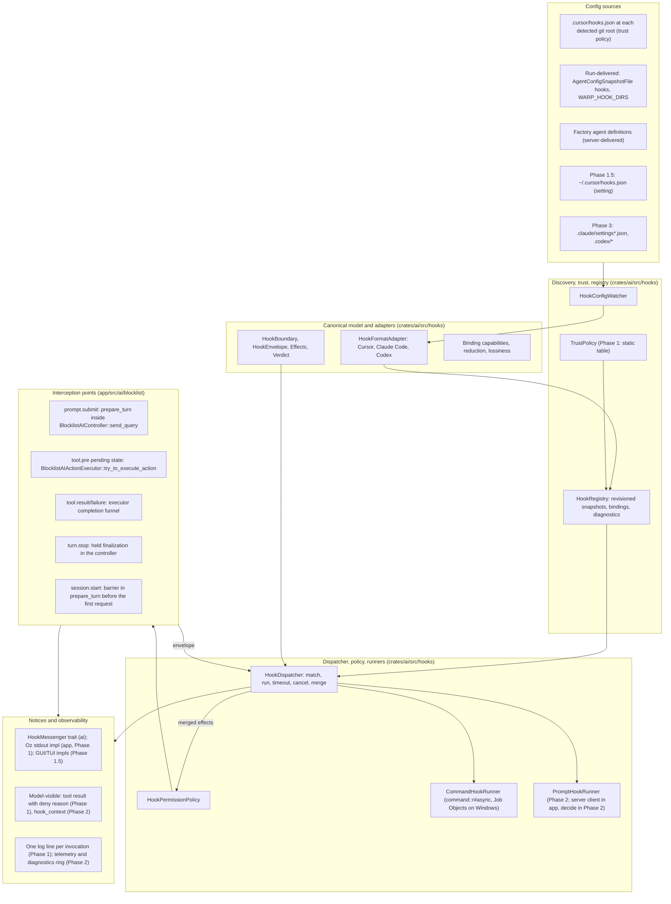

# Agent hooks in Warp: architecture proposal

Status: proposal for engineering review. Baseline: `warp` at `393e97a30a5ed85cf062b75e88326f83746dbecb` (master), vendor documentation read on 2026-10-19. Code paths are relative to the repository root and are cited as path plus symbol; line numbers drift and are not used. Supporting material: `cursor-hooks-coverage.md` (per-hook coverage verdicts), `research/01-cursor-hooks-catalog.md`, `research/02-claude-code-and-codex-hooks.md`, `research/03-warp-agent-loop-map.md`, `research/04-warp-config-process-infra.md`, and `research/05-cursor-cloud-ask-behavior.md`.

## 1. Summary and recommendation

Agent hooks let a user or team run their own scripts, and later model-evaluated prompts, at fixed points in Warp's agent loop: before and after tool calls, when a prompt is submitted, when a turn ends, and at session boundaries. A command hook receives one JSON object on stdin and may return one JSON object on stdout to observe, deny, require confirmation, annotate, or (later) rewrite what the agent does. Prompt hooks evaluate the equivalent payload through a server API. Cursor's `hooks.json` is the first supported format. Claude Code and Codex formats follow as additional adapters.

The recommendation is a layered system with one canonical model in the middle. Format adapters parse vendor configs, encode Warp's canonical envelope into each vendor's wire shape, and decode vendor output into typed effects. Each binding (a Warp boundary, a vendor event, and an adapter) declares which effects it may produce and how it fails, and those declarations are validated when the source is activated. The loop and the process runner never see vendor vocabulary. The pre-tool hook runs at dispatch time inside the existing executor, so it judges the operation that will actually run, and one component, `HookPermissionPolicy`, is the only place hook verdicts meet Warp's own permission result. Permissions are tightening-only in the first release; a bounded, AgentDecides-only form of loosening comes later. Where a hook file lives never grants permission to execute it: project hooks activate automatically only when the run already auto-approves command execution, and otherwise need an explicit decision. Warp follows documented vendor defaults where known and labels its choices where the docs are silent or conflict, with one "strict hook policy" setting for uniform fail-closed behavior.

**Key decisions.** Each is argued in the section named; rejected alternatives are collected in §13.

1. One canonical hook model sits in the middle. Vendor vocabulary stays inside format adapters, and each binding declares the effects it may produce, validated at activation (§4). Rejected: implementing Cursor's format directly in the loop; a universal superset event bus.
2. The pre-tool hook runs at dispatch time, inside `BlocklistAIActionExecutor::try_to_execute_action`, through a pending-hook state (§6.1). Rejected: running it during queue-time preprocessing, which sees stale cwd and pre-edit command text; per-executor hooks, except as a fallback for deny-only and observe-only hooks.
3. Hooks only tighten permissions in Phase 1. A later phase adds bounded loosening: a hook `allow` can satisfy only the confirmation Warp would show under `AgentDecides`, never `AlwaysAsk`, denylists, or protected paths, and only for sources with a separate "may approve" grant. Both live in `HookPermissionPolicy` (§6.5). Rejected: hooks decide first; tighten-only forever.
4. Phase 1 config sources are project `.cursor/hooks.json` at each detected git root, explicit sources delivered with the run (`AgentConfigSnapshotFile` and a `WARP_HOOK_DIRS`-style input), and factory agent definitions. The user file `~/.cursor/hooks.json` follows in Phase 1.5 behind a setting (§7). No Warp-owned hooks file is planned. Rejected: default-on import of the user file; a Warp-owned file in Cursor's schema.
5. Location never grants permission to execute code. A `TrustPolicy` decides activation: project hooks activate automatically when the run's execution profile already auto-approves command execution, explicit run sources are approved by construction, and anything else needs an explicit flag or config entry. The active set is pinned at run start, and hook files and scripts become protected write paths (§8). Rejected: unconditional automatic trust regardless of the run's permission posture.
6. Vendor-faithful defaults with one "strict hook policy" setting. A control effect that the current phase or surface cannot honor denies on a pre-execution boundary; it is never dropped silently (§4.3, §4.4, §6.4). Rejected: silently dropping effects; presenting stricter Warp semantics as format parity.
7. Input rewrites wait for Phase 2 and run under a two-pass contract (§6.2). Rejected: one-pass parallel rewrites.
8. A dedicated stdin-capable runner on `command::r#async`, with Job Object cleanup on Windows. The canonical model, adapters, registry, config watcher, trust policy, permission policy, dispatcher, and command runner all live in `crates/ai/src/hooks`; interception points, notice implementations, settings wiring, and the server client stay in `app`. No new crate (§3, §9.1). Rejected: reusing `CommandExecutor`; a separate `warp_hooks` crate; splitting the runtime into `app`.
9. Server-owned moments (automatic compaction, server-side subagents, remote-child stop relay) stay out of scope, with no server checkpoints (§10). Rejected: server checkpoints in Phase 2.
10. Phase 1 is cloud and CLI only: Oz cloud runs and `warp agent run`, including remote orchestration children. The GUI and TUI stay inert until Phase 1.5 (§10, §11).

Delivery is four phases, with tentative estimates. Phase 1, cloud and CLI (tentatively 5 to 6 client weeks plus about 1 server week), ships the canonical model, the Cursor adapter, discovery of project and run-delivered sources under the static trust policy, the runner with Windows Job Objects, the dispatch-time pre-tool hook without rewrites, the tool, stop, prompt, session-start, response, and reasoning events, tightening-only composition, and a small proto and server change so a hook's deny reason reaches the model for shell commands; the other tool families whose results already carry text get the reason client-side, and the few with no text slot do not (§9.3). Phase 1.5, interactive surfaces (tentatively 2 to 3 client weeks), enables the GUI and TUI: settings and palette toggles, the per-root trust review card, the first-run discovery prompt, the user file, and the GUI and TUI notice implementations. Phase 2 (tentatively 6 to 8 client weeks plus 2 to 3 server weeks, with the server estimate unvalidated) supports 18 of Cursor's 21 event names within the limits in §10. It adds rewrites under the two-pass contract, bounded loosening, `hook_context` fields for `additional_context`, prompt hooks, the remaining events, and observability. `afterAgentResponse` ships in Phase 1 on a client-side heuristic: a text message is treated as final when the next message starts or the stream ends. Phase 3 adds Claude Code and Codex adapters at a tentative 3 to 4 weeks each. Cursor's two Tab hooks and `workspaceOpen` are excluded because Warp has no inline-completion surface and no project-open event (`cursor-hooks-coverage.md` §3.19 to §3.21). The section "Phase 1 as built" (§14) lists the pull requests that implement Phase 1 and where the open questions from that work are kept.

## 2. Goals, non-goals, principles

**Goals.** Run existing Cursor command hooks with documented compatibility limits. Support every surface that runs the native loop: Oz cloud runs, `warp agent run`, native orchestration children, and (from Phase 1.5) the GUI and the TUI. Admit new formats and prompt hooks without changing the loop or the runner. Make denials, failures, unsupported features, and configuration provenance visible. Keep Warp's safety floors independent of hooks. Ship behind one feature flag with deterministic, testable decisions.

**Non-goals.** Hooks inside external harnesses (Claude Code or Codex running in Warp): those harnesses own their tools and hooks, and `ConversationDriver::executes_tool_calls_locally` (`app/src/ai/agent/conversation_driver.rs`) is false for them. Sandboxing hook processes or claiming a data-loss-prevention boundary. Reproducing every Claude Code lifecycle event. Guaranteeing cleanup after crashes or exactly-once external side effects. Authoring hooks into third-party agents, which is the existing CLI-agent plugin system (`research/04-warp-config-process-infra.md` §7).

**Principles.**

1. One canonical model; vendor vocabulary stays inside adapters.
2. Separate configuration location, format, execution host, and authority. A Cursor-shaped file may live anywhere; where it lives never grants permission to execute it. The run's permission posture or an explicit decision does.
3. Decisions are typed and merged deterministically by source priority and array order, never by completion time.
4. Vendor-faithful defaults; a single strict override. Strict mode is a Warp policy, not format parity.
5. Hooks can tighten from any source. Loosening is a separately granted capability and never crosses Warp's floors.
6. A control effect (one that changes what the agent does) that the current phase or surface cannot honor denies on a pre-execution boundary. Silently dropping a rewrite or a denial is the one failure that must not happen. An observational effect that cannot be delivered is logged.
7. The decision must describe the operation that will run: final arguments, current cwd, current configuration revision.
8. Reuse infrastructure, not incidental semantics: the MCP watcher's discovery loop is reusable; its no-prompt trust posture is not.

## 3. Layered architecture

**Placement.** The whole hook system except its interception points lives in `crates/ai/src/hooks/`: the canonical model, the adapters, the config watcher, the trust policy, the registry, the permission policy, the dispatcher, and the command runner. `ai` already depends on `warpui_core`, `watcher` (native only), `regex`, and `serde_json`, and it already keeps native-only modules behind the `local_fs` feature; the file-watching and process-spawning parts of the hook system use the same gating (the watcher and the command runner compile only with `local_fs`, and an `UnavailableRunner` stands in for builds that cannot spawn processes; `research/04-warp-config-process-infra.md` §4). Two things the runtime needs are injected from `app` rather than depended on, with the same precedent as the `ProjectRuleContentReader` function pointer in `crates/ai/src/project_context`: login-shell PATH capture (`LocalShellState::get_interactive_path_env_var`, `app/src/terminal/local_shell/mod.rs`), injected as a shared closure over a slot the app fills once the capture resolves, because the capture needs a model context and returns a future, so a plain function pointer cannot call it; and the per-surface notice sink (a `HookMessenger` trait defined in `ai`, implemented in `app`). What stays in `app`: the interception points inside `app/src/ai/blocklist`, the GUI, TUI, and Oz notice implementations, settings and feature-flag wiring, and the `ServerApi` client the Phase 2 prompt runner will use (whether that runner moves to `ai` is decided in Phase 2). No new crate is needed, and both `warp_tui` and the Oz binary already consume `app` and `ai`.

**Registry versioning.** "Versioned" means two things only: a revision counter that invalidates in-flight decisions when the active set changes, and the last valid snapshot kept active when a reload fails to parse. No history is retained. The snapshot carries two counters. `revision`, which pre-tool verdicts and envelopes are keyed on, moves only when the bindings that can run or the project roots that scope them differ from the previous snapshot. `generation` moves on every published snapshot, including a failed reload, a reload with the same definitions, and a change recorded after the run is pinned, and is what `SnapshotChanged` and the diagnostics reporting follow. So a touch of a pinned hook file, a reload that fails and keeps the last valid configuration, or a rewrite with identical definitions does not drop an in-flight verdict or run a hook twice, while a change that could alter `bindings_for` still does. A second pin and a change to an unknown source move neither.

**Components.**

- **Canonical model** (`crates/ai/src/hooks/model.rs`). Boundaries, envelope, effects, five-valued verdict, reduction rules. Reuses `AIAgentActionType` and `AIAgentActionResultType` (`crates/ai/src/agent/action/mod.rs`, `action_result/mod.rs`) for tool identity and payload encoding.
- **Format adapters** (`crates/ai/src/hooks/adapters/`). A static registry of known formats, modeled on `SKILL_PROVIDER_DEFINITIONS` (`crates/ai/src/skills/skill_provider.rs`) and `MCPProvider` (`app/src/ai/mcp/mod.rs`). Each implements parse, binding declaration, matcher evaluation, input encoding, and output decoding.
- **HookConfigWatcher** (`crates/ai/src/hooks/watcher.rs`, behind `local_fs`). Finds and watches the project file at each root it is given, reads it synchronously on the spot when the root is added and again on each debounced change (500 ms), and upserts it into the registry with the trust decision for the current surface and posture; because loads are synchronous there is no in-flight parse to tag with a generation. One platform watch per root, filtered to the root directory and its `.cursor` directory. Modeled on `FileMCPWatcher`, `global_config_sources`, `PendingScan`, and `update_servers_from_config_file` (`app/src/ai/mcp/file_mcp_watcher.rs`). Run-delivered sources are loaded once, separately, through `load_explicit_sources` (`crates/ai/src/hooks/sources.rs`). Roots come from `DetectedRepositories` (`crates/repo_metadata/src/repositories.rs`): roots found by terminal navigation on every surface, cloud-prepared roots (`register_cloned_repo`, `app/src/ai/agent_sdk/driver/environment.rs`) only on Oz and CLI runs, and never roots found only by project rules indexing or code review initialization, since those are not where the agent's session is (`watch_matrix`). The remote server daemon neither watches roots nor pins a run (`AppExecutionMode::is_remote_server_daemon`). The user file and `HomeDirectoryWatcher` are added in Phase 1.5.
- **TrustPolicy** (`crates/ai/src/hooks/trust.rs`). A trait that answers "may this source activate on this surface". The Phase 1 implementation is a static table keyed by surface, source kind, and the execution profile's command-execution posture (§8). Phase 1.5 adds an interactive implementation backed by a local approval store and the review card.
- **HookRegistry** (`crates/ai/src/hooks/registry.rs`, an entity model registered at startup). Immutable snapshots of active bindings with provenance and a revision counter; answers "bindings for this boundary at this cwd and host"; keeps the last valid snapshot on malformed reload. The snapshot also carries the known project roots and the protected paths (§8). A source is identified by its canonical path, so a symlink and its target are one source and two files with the same text are two. Root resolution follows `FileBasedMCPManager::get_servers_for_working_directory` (`app/src/ai/mcp/file_based_manager.rs`): the project for a working directory is the deepest known root that contains it (§7.3).
- **HookDispatcher** (`crates/ai/src/hooks/dispatch.rs`). The one call the loop makes: fire an envelope, get merged effects. Pins a registry snapshot for each hooked action, runs every matching binding at once (`join_all`) and reduces the results in the snapshot's order whatever order the processes finished in, decodes through the adapter, refuses control effects the boundary cannot honor (§4.3), logs one summary line per dispatch, and routes notices. It has no deadline of its own: each invocation is held to its own timeout by the runner, and the runner's four-slot bound (§9.1) is the only limit on how many hooks run at once. A cancel observed after the processes return discards the partial result and marks the outcome cancelled, so no caller reads it as no opinion. The dispatch policy (strict or not) is passed per call.
- **HookPermissionPolicy** (`crates/ai/src/hooks/permission.rs`). The only component that composes a merged hook verdict with Warp's own permission result (§6.5). Tightening-only in Phase 1; bounded loosening later; changed in one place.
- **CommandHookRunner** (`crates/ai/src/hooks/runner/command.rs`, behind `local_fs`). A dedicated one-shot JSON-over-stdio spawner on `command::r#async::Command` with a process group on Unix and a per-child kill-on-close Job Object on Windows (`Command::spawn_in_job` and `JobGuard`, `crates/command/src/async.rs`). It is not built on `CommandExecutor::execute_command` (`app/src/terminal/model/session/command_executor.rs`), which has no stdin parameter, nor on `LocalCommandExecutor::execute_local_command_internal`, which forces null stdin. PATH capture is injected from `app`; the timer, SIGTERM, grace, kill shutdown pattern comes from `lsp::ProcessTransport` (`crates/lsp/src/transport.rs`). At most four hooks run at once, output is bounded, and whatever is left of a hook's process tree is ended on every path, including after a normal exit (§9.1).
- **PromptHookRunner** (Phase 2). Calls a new warp-server evaluator, following the REST pattern of `/ai/generate_block_title` (`app/src/server/server_api/block.rs`). The `ServerApi` client lives in `app`; where the runner itself lives is decided in Phase 2.
- **Interception points** (`app/src/ai/blocklist`; §5). Build envelopes, await the dispatcher where the boundary blocks, apply effects.
- **Notices** (`crates/ai/src/hooks/notices.rs` for the `HookMessenger` trait). Phase 1 has one implementation, `OzHookMessenger` (`app/src/ai/agent_sdk/driver/hooks.rs`), which writes each notice and diagnostic as one record through the run's output layer (`app/src/ai/agent_sdk/driver/output.rs`, under one `with_stdout_buffered` call so records from the dispatcher's background thread never interleave with the conversation's own records) rather than through `AgentDriver::write_output`, which is a `&self` method on the driver that formats agent output. In `json` and `ndjson` output the records are `{"type":"hook_notice","kind":"denied|warning|info","conversation_id":<server token or null>,"local_conversation_id":"…","action_id":"…"|null,"text":"…"}` and `{"type":"hook_diagnostic","source":"…","severity":"error|warning|info","message":"…"}`; in `text` and `pretty` output they are one `hook: <kind>: <text>` or `hook: <severity>: <source>: <message>` line each. Diagnostics about a repository's own hook file are written when the run pins and again whenever a file is found, changed, or broken after the pin. Phase 1.5 adds the GUI (cards and `AgentNotificationsModel`, `app/src/ai/agent_management/agent_management_model.rs`) and TUI (hints) implementations. Denials are durable notices attached to the action, not only toasts.
- **Observability.** Phase 1 writes one `log::` line per hook invocation from the runner (`hook invocation: event=… source=… binding=… exit=… duration_ms=… stderr_tail=…`, with the escaped tail at most 500 bytes and never the payload or stdout) and one summary line per dispatch from the dispatcher (event, action, bindings matched, verdict, halt, duration). Telemetry via `register_telemetry_event!`, a per-conversation diagnostics ring, and any panel are Phase 2.
- **Activation controls.** `FeatureFlag::AgentHooks` (`crates/warp_features/src/lib.rs`), off on every channel. Phase 1 has no settings: the `warp agent run` config file (`AgentConfigSnapshotFile`, `app/src/ai/agent_sdk/config_file.rs`) accepts `hooks` (a list of entries with `path`, optional `format`, only `cursor`, and optional `scope`, one of `run`, `factory_agent`, `factory_wide`), `hooks_strict`, and `hooks_on_ask` (`deny` or `fail_run`); the `WARP_HOOK_DIRS` environment input names hook directories; and the hidden flags `--hooks-strict`, `--hooks-on-ask <deny|fail-run>`, and `--hook-dir <PATH>` (repeatable, added after the `WARP_HOOK_DIRS` entries rather than replacing them) do the same from the command line. The command line wins over the file, and `--hooks-strict` can only make a run stricter. These settings live in a client-only `HookRunOptions` on `AgentDriverOptions`, not in `AgentConfigSnapshot`, which is uploaded to the server on every local run and which the server could not use. `run-cloud`, `schedule`, and `integration` reject the keys with a message saying they apply only to `agent run`, and `agent run --harness <other>` rejects the flags and keys because third-party harnesses run their own hooks. The strict policy and the on-ask behavior are fields on `HookRuntime` set by the run's launcher. Phase 1.5: a `define_settings_group!` group (`app/src/settings/ai.rs`) with palette toggle pairs for hooks enabled, read Cursor user file, strict hook policy, and default timeouts.

## 4. Canonical model and adapters

### 4.1 Boundaries and vendor mapping

Boundaries are grounded in moments Warp's loop can supply. A new boundary is added only when Warp can provide its timing and honor at least one of its effects. Several vendor events project onto one boundary; the adapter's matcher and payload view distinguish them.

| Canonical boundary | Cursor | Claude Code | Codex | Phase |
| --- | --- | --- | --- | --- |
| `session.start` | `sessionStart` | `SessionStart` | `SessionStart` | 1 (observe) |
| `session.end` | `sessionEnd` | `SessionEnd` | `SessionEnd` | 2 |
| `prompt.submit` | `beforeSubmitPrompt` | `UserPromptSubmit` | `UserPromptSubmit` | 1 |
| `tool.pre` | `preToolUse`; shell and MCP facets `beforeShellExecution`, `beforeMCPExecution` | `PreToolUse` | `PreToolUse` | 1 |
| `tool.permission_request` | — | `PermissionRequest` | `PermissionRequest` | 3 |
| `tool.result` | `postToolUse`; facets `afterShellExecution`, `afterMCPExecution`, `afterFileEdit` | `PostToolUse` | `PostToolUse` | 1 (edit facet 2) |
| `tool.failure` | `postToolUseFailure` | `PostToolUseFailure` | — | 1 |
| `file.exposure` | `beforeReadFile` | — (reads use `PreToolUse`) | — | 2 |
| `subagent.start` | `subagentStart` | `SubagentStart` (context only) | `SubagentStart` (context only) | 2 |
| `subagent.stop` | `subagentStop` | `SubagentStop` | `SubagentStop` | 2 |
| `turn.stop` | `stop` | `Stop` | `Stop` | 1 |
| `turn.interrupt` | — | — | `Interrupt` | 3 |
| `compaction.pre` | `preCompact` (manual only) | `PreCompact` | `PreCompact` | 2 |
| `compaction.post` | — | `PostCompact` | `PostCompact` | 3 |
| `response.complete` | `afterAgentResponse` (client heuristic) | — | — | 1 (observe) |
| `reasoning.complete` | `afterAgentThought` | — | — | 1 (observe) |

Parsed, reported as unsupported, and never fired: Cursor `beforeTabFileRead`, `afterTabFileEdit`, `workspaceOpen`; Claude `Notification`, `PermissionDenied`, `PostToolBatch`, `StopFailure`, `UserPromptExpansion`, `MessageDisplay`, `Setup`, `InstructionsLoaded`, and the task, teammate, config, cwd, directory, file, worktree, model-switch, and elicitation events.

`file.exposure` is a distinct boundary rather than a facet of `tool.result`. Its timing is "content has been read locally but not yet shown to the model", and its failure semantics are those of a permission hook (`research/01-cursor-hooks-catalog.md` §2.2). Its scope follows Cursor's semantics as closely as Warp's tool set allows. It fires for the agent-invoked tools that read specific files, `ReadFiles`, `ReadSkill`, and `GetFiles`, once per file. For `SearchCodebase` the search runs first, and the hook then checks each surfaced file before its content reaches the model. Project rules are not checked; as in Cursor, rule files appear in the `attachments` array with type `rule`. `Grep` match lines are not checked either, which matches Cursor's `Read`-only scope. Cursor's docs do not say whether loading a skill fires `beforeReadFile`; Warp fires it for `ReadSkill` deliberately, since there is no skill-specific hook (`cursor-hooks-coverage.md` §3.12).

### 4.2 Envelope

The envelope is the in-memory, format-neutral superset of everything a boundary knows. Adapters serialize it into the vendor's stdin shape; scripts never see the envelope itself. For the Cursor adapter the stdin payload is Cursor's documented JSON for that event.

Common fields, with missing values absent rather than fabricated:

- `schema_version`, `occurrence_id`, `invocation_id`.
- `conversation_id` (`AIConversationId`, which exists before the server token; `research/03-warp-agent-loop-map.md` §2).
- `turn_id`: a user-turn identifier allocated when a turn starts, in `prepare_turn` inside `send_query`, and carried across every exchange of that turn. Every `send_query` starts a turn, including inputs Warp builds itself (a passive suggestion result, an agent wake, and the `StartFromAmbientRunPrompt` input an Oz run sends), while tool-result follow-ups continue the current turn. This is what Cursor's `generation_id` and Claude's `prompt_id` map to. `AIAgentExchangeId` changes per request, including tool-result follow-ups, so it is exposed separately as `exchange_id` (`AIConversation::turn_exchange_ids`, `app/src/ai/agent/conversation.rs`). Both are optional because `session.start` precedes the turn and any exchange; the Cursor adapter sends the conversation id under `generation_id` there, because Cursor lists the field in every event's common base and an absent key could crash scripts that index it.
- `action_id` (`AIAgentActionId`) on tool boundaries; `run_id`, parent ids, and child correlation ids when available.
- `surface` (`OzRun`, `CliRun`, `LocalChild`, `Gui`, `Tui`), `execution_host`, `cwd`, `roots`, `source_revision`. A run is `OzRun` when the server dispatched it (`--task-id` was passed) and `CliRun` otherwise, since a local `warp agent run` creates a task too and the command-line mode is always autonomous. A conversation with a parent in a desktop or TUI process is `LocalChild`, so a hidden child's envelopes do not claim an interactive surface. `OzRun`, `CliRun`, and `LocalChild` are the headless surfaces.
- Model metadata (`LLMId`), user email, Warp version, hook protocol version (precedent: `warp_core::cli_agent_protocol`). The envelope's shape (`ENVELOPE_SCHEMA_VERSION`) and the stdin and stdout contract scripts see (`HOOK_PROTOCOL_VERSION`) are versioned separately; both are 1.
- Permission facts: whether Warp's own check would ask, the active autonomy level, and the derived vendor `permission_mode` where an adapter needs it. These are left at their default on `tool.pre` because hooks are consulted before `should_autoexecute` runs.
- `session_env`: the variables the conversation's `session.start` hooks set, copied onto every later envelope for that conversation so the runner can apply them (§9.1).
- On `prompt.submit`, `provenance`: `User` for a person's prompt, `HookFollowUp { binding, chain_id }` for a prompt a stop hook asked for, so a hook can tell the two apart.

Per-boundary payloads use Warp's own types serialized to neutral JSON: the action and its arguments, cwd, timing, result or failure, and facets (shell adds the model's command, execution state, sandbox flag, captured output; MCP adds the server installation id, and no more in Phase 1: the server's name, URL, and command are not on the envelope, since filling them needs a field `app` resolves from the MCP manager; file exposure adds host-qualified path, text or an explicit unsupported content kind, range, and revision; edits add path, old and new text, and saved outcome). Shell hooks see the model's command, not the decorated command Warp runs (pager flags, PowerShell wrapping). The proto `risk_category` is dropped today in `From<RunShellCommand>` (`crates/ai/src/agent/action/convert.rs`); plumbing it is a small prerequisite so policy hooks can key on it. `tool.failure` carries the cancellation reason as a fixed snake_case name per variant (`user_cancelled`, `cloud_handoff`, `follow_up_submitted`, `user_ran_command`, `reverted`, `conversation_deleted`, `command_finished`, `user_took_control`, `shell_exited`, `hook_ended_run`), since scripts match on it.

### 4.3 Effects and verdicts

An effect bundle has independent channels: verdict with reason; replacement input; replacement model-visible result; model context; user notice; hook-session environment; halt turn; continuation request. Rewrites are whole validated objects, never partial mutations of app state.

Two words are used precisely throughout this document. A **control effect** changes what the agent does: deny, ask, rewrite input, replace a result, halt the turn, request a follow-up. An **observational effect** does not: a user notice, a log line, session environment for later hooks. An effect is **unsupported** when the current phase or surface cannot honor it. An unsupported control effect on a pre-execution boundary denies; an unsupported observational effect is logged.

The dispatcher owns that rule (`refuse_unhonorable_effects`). Before an operation (`tool.pre`, `tool.permission_request`, `file.exposure`, `subagent.start`) a rewrite, a result replacement, a turn stop or continuation request, a deferral on a headless surface or under the strict policy, or a control field the adapter refused because the event does not define it denies the action with a reason that names the binding and either what it asked for or, for a refused field, what the field controls (for example "returned a field that controls whether the turn continues, which this event does not accept"), without claiming the hook asked for that outcome. On `prompt.submit` the same cases hold the prompt. After the fact they are only reported. Model context, which this phase cannot deliver, is logged. Whether the rule should be narrower (deny only for rewrites and report the rest) is a conservative choice awaiting David's decision.

The verdict is five-valued: no opinion, allow, deny, ask, defer. `Defer` is represented because Claude Code defines it, but resumable deferral is unsupported in Warp. Claude's reference says `defer` "exits gracefully so the tool can be resumed later", is honored only in non-interactive `-p` runs where the host process reads `stop_reason: "tool_deferred"` and later resumes, is restricted to a single pending tool call, ignores `updatedInput` and `additionalContext`, and in interactive sessions "logs a warning and ignores the hook result". Warp follows the interactive warning-and-ignore behavior, reported as a diagnostic, except under the strict hook policy, where a deferral is unsupported control output and denies on an interactive surface too (a conservative choice awaiting David's decision; no Phase 1 adapter produces `defer`). On headless surfaces it rejects the unsupported control effect with a specific diagnostic and does not execute the action; it does not claim to have suspended work for later resume. This is not an approval-unavailable result or an `ask` decision. `reduce_effects` never produces a merged `Defer`; the permission policy's own `Defer` arm applies the same rule for a caller that bypasses the dispatcher's reduction.

### 4.4 Per-binding capabilities

A binding is one boundary, one vendor event, and one adapter. It declares the effects that vendor event may produce (for example Cursor `preCompact` produces only a user notice; Claude `PreCompact` may halt), the failure semantics (fail-open or fail-closed, and how malformed or empty output is treated), the matcher target, the handler kind, and for stop events its `loop_limit`. At activation the registry validates those capabilities against what the boundary can honor in the current phase and warns about gaps. It cannot predict an arbitrary script's output; the warning says that a rewrite, if emitted, will be rejected. For the Cursor adapter the warning appears only where Cursor documents context or a rewrite (`sessionStart`, `preToolUse`, `postToolUse`, `postToolUseFailure`), because the permission hooks do not declare model context: `agent_message` on a non-deny has no documented meaning. At runtime, a control effect that the binding does not permit or the phase cannot honor denies on a pre-execution boundary and is reported on any other boundary. The adapter is the one that knows which output fields an event defines, so it reports a field that names a control effect Cursor defines on some other event (`permission`, `hookSpecificOutput`, `updated_input`, `updated_mcp_tool_output`, `continue`, `followup_message`, `decision`) through `HookEffects.unsupported`, which `reduce_effects` carries into the merged effects and the dispatcher turns into a diagnostic for the source and, before an operation, a denial (§4.3). The adapter reads the field's value first: `continue: true`, `permission: "allow"`, a `decision` other than `"block"`, and an empty `followup_message` ask for nothing and are only logged, so Claude-shaped output copied onto a `beforeShellExecution` hook does not deny the command. An observational field the event does not document (`additional_context`, `env`, a message) is only logged. Whether a log line is enough for those is a conservative choice awaiting David's decision. Vendor-defined ignored fields remain governed by the adapter's documented defaults. Capabilities therefore attach to the binding and the boundary, not only to the event enum.

### 4.5 Lossiness tables

Cursor adapter:

| Cursor feature | Warp behavior |
| --- | --- |
| `version` | Only `1` loads. Missing, `0`, a string, a fraction, or any other integer is an error naming the problem, so a future schema is never read with today's meanings; the cost is that a repository on a newer schema gets no hooks at all, including its deny hooks, until the adapter learns it. A conservative choice awaiting David's decision |
| `ask` per event | `beforeShellExecution` and `beforeMCPExecution`: honored as `ask`. `preToolUse`: no opinion with a log line, as Cursor documents ("accepted by the schema but not enforced"); honored as `ask` under the strict hook policy. `subagentStart`: a denial with a reason saying so, under both policies. `beforeReadFile` and `beforeTabFileRead`: not in Cursor's schema, so a schema mismatch, which denies. The `preToolUse` default is a conservative choice awaiting David's decision. On an `ask` the messages are kept the way a denial's are, so the headless degrade to deny (§6.5) needs no adapter change |
| `permission` missing or unknown | A JSON object with no `permission`, or with a value other than `allow`, `deny`, or `ask`, is malformed output on every permission hook and denies even when the definition fails open; Cursor does not say whether the field may be omitted. Decision words are compared as written, with no trimming. Empty stdout is the separate no-output case and follows `failClosed`. A conservative choice awaiting David's decision |
| `updated_input` | Phase 1: a rewrite request on a pre-execution boundary denies with a reason naming the binding; it is never run with the original input. Cursor documents the field only on `preToolUse`; on the other permission hooks it is also reported as unsupported for the event. Claude's nested `updatedInput` counts only on `preToolUse`. Phase 2: two-pass contract (§6.2) |
| Claude-shaped output | Accepted exactly where Cursor says it translates it: `hookSpecificOutput.permissionDecision`, `permissionDecisionReason`, and `updatedInput` on `preToolUse`, and `decision: "block"` with a `reason` (flat or nested) on `stop` and `subagentStop`, as fallbacks when the flat fields are absent. Everywhere else `hookSpecificOutput` is an undocumented key, so a `beforeShellExecution` hook that answers only in Claude's shape has no decision and denies. A conservative choice awaiting David's decision |
| `additional_context`; denial `agent_message` | Additional context is Phase 2 after `hook_context` protos exist (§9.3); in Phase 1 it is decoded as model context on `sessionStart`, `postToolUse`, and `postToolUseFailure`, reported as unsupported at activation, and logged. Cursor's `agent_message` applies on denial and travels inside the denied tool result: Phase 1 adds the wire slot for shell; the other families with a text slot already carry it; the few with none do not (§9.3). On a deny, `agent_message` is the reason the model reads, `user_message` stands in when there is no `agent_message`, and a `user_message` that is not already the reason is a notice. `agent_message` on an `allow` is logged and dropped. With neither message the reason is `Denied by hook <command> (exit 2).` or `Denied by hook <command>.`, with the command cleaned of control characters |
| Output fields an event does not document | A field naming a control effect Cursor defines on some other event is reported and never applied (§4.4); an observational one is logged. A cut-off stdout (over 1 MiB) is malformed output even when the kept prefix parses |
| `beforeReadFile` | Fires after the local read, before model exposure, for `ReadFiles`, `ReadSkill`, `GetFiles`, and each file surfaced by `SearchCodebase`; not for project rules (sent as `rule` attachments) or `Grep` lines |
| `preCompact` | Manual `/compact` only; automatic compaction is server-side and unsupported |
| `subagentStart`, `subagentStop` | Native children only, parent-side: start can allow or deny; stop is observational. Server-side subagents and child `followup_message` are not advertised |
| `afterAgentResponse` | Phase 1 client heuristic: emit once per text message when the next message starts or the stream ends. `afterAgentThought` uses reasoning `finished_duration` and is exact |
| `transcript_path` | `null`; Warp keeps transcripts in SQLite |
| `cursor_version`, `CURSOR_VERSION` | Format-driven labeled compatibility values, set for every Cursor-format source including run-delivered and factory sources; `warp_version` carries the real version (both hold Warp's version string) |
| Scalar output merge | Highest-priority source wins; Cursor's pages disagree with each other (§7.4). Within one source, bindings merge in the order Cursor's reference lists the events, then array order, so for one shell command a `preToolUse` definition merges before a `beforeShellExecution` one; Cursor does not define their relative order |
| `loop_limit` | Read on `stop` and `subagentStop`; absent is Cursor's default of 5; `null` and values above 8 become 8 with a load-time warning; on any other event it is ignored with a warning. Enforcement is per binding within one continuation chain plus the host cap of 8 for the whole chain (§9.2) |
| Matcher targets | `preToolUse`, `postToolUse`, `postToolUseFailure`: the canonical tool name. `beforeShellExecution`, `afterShellExecution`: the model's full command. `beforeMCPExecution`, `afterMCPExecution`: the MCP tool's own name without the `MCP:` prefix, since Cursor lists no target and the tool name is what their payload calls `tool_name`; they fire for `CallMCPTool` only, and `ReadMCPResource` is reachable through `preToolUse` as `MCPResource:<name>`. A matcher on an event with no documented target (`sessionStart`, `sessionEnd`, `preCompact`, `workspaceOpen`) is dropped with a warning and the definition matches every occurrence. A matcher that does not compile skips only its definition, with a warning |
| Payload additions | `tool_use_id` on every tool event (Cursor's release notes document it); `exit_code` on `afterShellExecution`, because the output alone cannot say whether the command succeeded; `warp_version` and `model_id`; `cancellation_reason` on `postToolUseFailure`; the model's `is_read_only`, `is_risky`, `wait_until_completion`, `uses_pager`, and `rationale` in a shell `preToolUse.tool_input`. `sandbox`, `model_params` (sent as `[]`), `mcp_server_name`, `url`, and `command` are omitted rather than invented |
| Tab hooks, `workspaceOpen` | Parsed, a warning per definition, no binding (there is no boundary to bind to); never fire. The six Phase 2 events become bindings that never match, with a warning per definition saying so |
| Prompt hooks | Parsed and skipped one definition at a time, each with a warning naming it, while the command hooks beside them load and keep their array positions; this follows Cursor's own headless surfaces, which run command hooks only. Unknown `type` values are errors. A conservative choice awaiting David's decision. Phase 2 runs them after the evaluator exists; documented shell example first |

Claude Code adapter (Phase 3):

| Claude feature | Warp behavior |
| --- | --- |
| Roughly two-thirds of events | Parsed, reported unsupported, never fire |
| `defer` | Represented; ignored interactively with a warning; headless resumable deferral is rejected as unsupported, not treated as `ask` |
| `PermissionRequest` | `tool.permission_request`; fires only when Warp would show a confirmation; its allow is the bounded-loosening path and needs the "may approve" grant |
| `updatedToolOutput` (any tool) | Honored where the Warp result has a replaceable payload; otherwise reported |
| `http`, `mcp_tool`, `agent` handlers; `asyncRewake`; `once`; `if` | Unsupported; `async` runs detached and observe-only |
| `terminalSequence`, `watchPaths`, `sessionTitle`, `initialUserMessage`, `suppressOriginalPrompt`, `CLAUDE_ENV_FILE` | Unsupported |
| Plain-text stdout as context | Honored only once `hook_context` exists |
| `transcript_path` | `null` although the SDK types mark it required |
| Exit code 2 per event | Honored per Claude's table where the event exists |
| Matcher dialect | Exact-name rule plus unanchored regex; JavaScript-only syntax rejected with a diagnostic |

Codex adapter (Phase 3):

| Codex feature | Warp behavior |
| --- | --- |
| `Interrupt` | `turn.interrupt`, observational |
| `PreToolUse` `ask` | Failed hook that proceeds, as Codex documents; honored in strict mode |
| `PermissionRequest` | As for Claude |
| `PostToolUse` `decision: "block"` | Replaces the model-visible result with the reason when the Codex adapter ships in Phase 3, using Phase 2 result-replacement support |
| `commandWindows`, `config.toml` `[hooks]` | Honored; TOML normalized as the MCP parser already does |
| `async`, `mcp_tool`, `prompt`, `agent` | `async` detached; `mcp_tool` unsupported; `prompt` and `agent` not run, matching Codex |
| `additionalContextLimit` | Ignored |
| Completion-order rewrite resolution | Not reproduced; deterministic order instead |

## 5. Interception points

| Canonical boundary | Warp seam | Blockable | Modifiable | Phase |
| --- | --- | --- | --- | --- |
| `session.start` | The barrier at the start of `prepare_turn` (`app/src/ai/blocklist/hooks/session.rs`), which every `send_query` reaches, before the conversation's first request; fired once per conversation id for a conversation this client drives that has no exchanges yet. Not `BlocklistAIHistoryModel::start_new_conversation`: at creation time the run is not yet pinned, so project hooks are not visible, and the conversation's driver is not yet known, so a conversation an external harness later drives would fire it | Barrier only; creation cannot be denied | Hook env; context in Phase 2 | 1 |
| `session.end` | Conversation delete, surface close; Oz `AgentDriver::cleanup` (awaited) | No | No | 2 |
| `prompt.submit` | `BlocklistAIController::send_query` (`app/src/ai/blocklist/controller.rs`), split at the point the request would go out: `prepare_turn` pins the run, starts the session barrier, allocates the turn id, and either sends on the same call (`send_prepared_query`) or spawns the decision and finishes in `conclude_prepared_query` | Yes (halt: `continue: false`, a `deny`, or an `ask`, since no confirmation step exists for a prompt) | Prompt rewrite has no vendor field | 1 |
| `tool.pre` | Pending-hook state in `BlocklistAIActionExecutor::try_to_execute_action` (§6.1) | Yes | Rewrites Phase 2 | 1 |
| `tool.permission_request` | Same seam, fired only when Warp's verdict is "ask" | Yes | Rewrites Phase 2 | 3 |
| `tool.result`, `tool.failure` | One completion funnel before `BlocklistAIActionModel::handle_action_result` (`app/src/ai/blocklist/action_model.rs`), covering async futures, synchronous results, denials, and cancellations (`app/src/ai/blocklist/hooks/tool_result.rs`). A tool that ran and returned is a `tool.result` whatever it returned; a tool that never ran is a `tool.failure` (§9.2) | Observational in Phase 1; the funnel never holds the result. Holding arrives with replacement output | Replacement output Phase 2 | 1 |
| `file.exposure` | Completion of `ReadFilesExecutor`, `ReadSkillExecutor`, and `GetFilesExecutor` (`app/src/ai/blocklist/action_model/execute/`), and `SearchCodebase` results after the search runs, with content in a private buffer | Yes, per file | Range filtering | 2 |
| `subagent.start` | `RunAgentsExecutor::execute` before dispatch (`app/src/ai/blocklist/action_model/execute/run_agents.rs`) | Yes | Child context for later adapters | 2 |
| `subagent.stop` | `inject_pending_events_for_request` and the follow-up piggyback path in the controller | No | Follow-up not advertised | 2 |
| `turn.stop` | `hold_or_finalize_turn` in the controller, which replaces the two places that set `ConversationStatus::Success` at the end of a turn (the `Done` arm of the stream-finished handler and the `FinishedAction` subscription); the dispatch starts once the turn's stream has been cleaned up (`app/src/ai/blocklist/hooks/turn.rs`) | Hold finalization | Follow-up | 1 |
| `turn.interrupt` | `CancellationReason` paths | No | No | 3 |
| `compaction.pre` | `/compact` via `SlashCommandRequest::Summarize` | Manual only | No | 2 |
| `compaction.post` | Finished `Message::Summarization` | No | No | 3 |
| `response.complete` | Streaming text (`app/src/ai/agent/api/convert_from.rs:ConvertAPIMessageToClientOutputMessage::to_client_output_message`); next-message/stream-end heuristic | No | No | 1 |
| `reasoning.complete` | Same converter; reasoning `finished_duration` marks completion | No | No | 1 |

Tool calls are queued only after the whole response has streamed (`AfterStreamFinished` then `queue_actions`), so pre-tool hooks run between model requests. Detached response and reasoning observers may run while the rest of the response is still streaming. They cannot inject into the in-flight model request or revise text already streamed into the proto history that is replayed to the server (`research/03-warp-agent-loop-map.md` §3.k).

## 6. Decision semantics and permission composition

### 6.1 Dispatch-time pre-tool hook

The pre-tool hook runs at dispatch, inside `BlocklistAIActionExecutor::try_to_execute_action`, for three reasons.

1. A hook `ask` must be resolved before Warp's own confirmation decision, and that decision is made in `try_to_execute_action` before any executor's `execute()` is called. A hook that ran later could not add a confirmation requirement.
2. `ShellCommandExecutor::execute()` starts the command synchronously: it emits `ShellCommandExecutorEvent::ExecuteCommand` before returning its future (`research/03-warp-agent-loop-map.md` §3.d). A per-executor hook for shell would therefore need that executor restructured anyway, which removes the main attraction of the per-executor approach.
3. One call site is what makes `HookPermissionPolicy` real. If each executor composed verdicts on its own, the tightening-only rule and the later loosening rule would be reimplemented per tool.

It also has to be dispatch time rather than queue time: `BlocklistAIActionModel::queue_actions` preprocesses a whole batch before any action runs, so a queue-time check would see the cwd and files as they were before earlier commands in the same batch executed, and `handle_requested_command_accepted` can change the command text after a queue-time decision.

`try_to_execute_action` is synchronous, so the hook has a small state machine (`app/src/ai/blocklist/hooks/pre_tool.rs`). The pending reason is a distinct `NotExecutedReason::WaitingOnHooks` arm rather than a reuse of `NotReady`, which is what executors return when they cannot run yet (busy terminal, missing block); logging and a later UI can tell the two apart, at the cost of one more arm in an exhaustive match. The machine:

- A cached verdict is keyed by conversation id, action id, argument revision (a hash of the action's derived `Debug` form, which covers every field; a field that prints differently for the same value can only cause an extra hook run, never a stale verdict), cwd, and registry revision. The conversation id is part of the key because tool call ids are only unique within a conversation and the cache lives on the process-wide `HookRuntime`. The cheap "any `tool.pre` binding at all" check runs before the action is hashed, so a configuration with only post-tool hooks pays nothing on each try.
- Without a valid verdict, `try_to_execute_action` returns `NotExecuted`, the action model keeps the action pending at the same index, and the executor spawns the dispatcher future on its own context. Several actions may wait during a parallel read-only phase. Each dispatch carries a ticket (conversation id, action id, and its own cancel flag); a verdict whose ticket is cancelled, or is not the one the entry holds, is dropped, so a stale verdict for an old command text is never applied to an edited one.
- On completion the verdict is cached, the executor emits `HookVerdictResolved`, and the action model tries the queue again (or re-runs the user-initiated path when the user approved the action while the verdict was pending). `try_to_execute_action` now finds the verdict, runs Warp's own check once, and hands both to `HookPermissionPolicy`: deny produces a denied result, ask requires confirmation, and allow or no opinion leaves Warp's own checks in place. The denied result carries the hook's reason on the wire where the family has a slot (§9.3).
- The user-initiated path (`execute_action` after a confirmation card) consults the same cache. A lookup whose key differs from the cached one, or whose dispatch died before answering, drops the entry, tells its dispatch to stop, and starts over. Approval satisfies a hook `ask` only for the exact approved revision and never bypasses a hook `deny`, and it does not carry over to a restarted check: approval covers the operation the user saw under the hook configuration of that moment, and a changed configuration may ask for a confirmation the user never saw, so the card is shown again, with the hook's reason as a notice. A verdict judged under a registry revision that has since moved is dropped and the action resumes without approval, so the next lookup runs the hooks once more against the new configuration. The cost is a second approval in a rare sequence; a conservative choice awaiting David's decision.
- An action whose check starts over more than three times is denied with a Warp-written reason saying the configuration kept changing. The registry's `revision` moves only when the active bindings or project roots differ (§3), so a touch of a pinned file or an identical rewrite does not restart a check; the bound covers a configuration whose active set really keeps changing before the run is pinned, which a shell command rewriting a hook file in a loop could cause (protected paths stop only the file-edit tool). The bound and its value are a conservative choice awaiting David's decision.
- A hook's `ask` reason reaches the user as a warning notice once per verdict when the policy asks for confirmation, since a waiting action is tried more than once; Phase 1.5's card can show it.
- Cancellation kills pending hook processes and prevents execution; the cancel flag is per firing, so cancelling one conversation's pending hooks cannot cancel another's. Disabling the feature cancels every pending invocation. There is no runtime switch for the feature in Phase 1.

This sits on the action model's hot path, but it is small: one `NotExecutedReason` arm, one cache, one re-entry through existing methods. Costs that remain: a denied action is briefly visible as pending (on surfaces with a pending UI); a rewritten file edit (Phase 2) requires `preprocess_action` to run again and a second diff to be generated, and the user must see the final diff before approving.

### 6.2 Rewrites

Phase 1 does not support `updated_input`. On a pre-execution boundary, a rewrite the current phase cannot honor denies with a reason naming the binding; it is never dropped silently and the original input never runs. The dispatcher owns that denial (§4.3); `HookPermissionPolicy::compose` keeps a generic rewrite-denial branch as a backstop for a caller that hands it effects without the dispatcher's reduction. Phase 2 adds rewrites under an explicit two-pass contract: apply the rewrite as a whole validated object; clear the model's risk flags (`is_read_only`, `is_risky`, and the newly carried `risk_category`), because they describe the old command and `BlocklistAIPermissions::can_autoexecute_command` can auto-allow based on `is_read_only` or `is_risky` under `AgentDecides`; recompute preprocessing and permissions; re-run the matching pre-execution hooks on the final input; any deny survives; a second, different rewrite fails as unstable. There is no fixed-point loop. This is documented as Warp behavior: all matching pre-execution hooks may run twice when any hook rewrites, and Cursor does not promise hook idempotence.

### 6.3 Merging across hooks and sources

All matching bindings run at once against the same immutable input (`join_all` over one future per binding), and the results are zipped back onto the bindings in the pinned snapshot's order, so nothing is read from completion order. Results merge in a fixed order: source priority, then, within one source, the adapter's declared order (for Cursor, the reference's event order, then array index). Verdicts merge by severity, deny over ask over allow over no opinion. Halt is any-wins. Notices and model context concatenate in merge order. Scalar fields (replacement input, replacement output, continuation) take the highest-priority value; conflicts are logged. The merged effects record which binding's verdict won and which binding asked for a continuation, so a default reason can name a source and a follow-up can be charged to the binding that asked for it. Identical resolved sources (the same file reached through two paths) run once; a file delivered with the run and also found as a repository's project file runs once, as the run-delivered source (§7.3); identical command text in different sources is not deduplicated.

### 6.4 Failure policy, timeouts, strict mode

Defaults follow the adapter's documented semantics. For Cursor: exit 2 denies on the permission hooks and halts the prompt on `beforeSubmitPrompt`, reading any messages printed, and is a plain failure under the failure policy elsewhere; other non-zero exits, crashes, and timeouts fail open unless `failClosed`, so a slow `beforeShellExecution` hook allows the command by default (Cursor's documented default, and a conservative choice awaiting David's confirmation); malformed non-empty output fails closed on Cursor's six permission hooks (`beforeShellExecution`, `beforeMCPExecution`, `beforeReadFile`, `beforeTabFileRead`, `subagentStart`, `preToolUse`) even without `failClosed`, where malformed includes a missing or unknown `permission`, a wrongly typed documented field, and a stdout cut off at the output limit; empty stdout is a no-output failure governed by `failClosed` where the hook decides something and no opinion on `stop` and the observers; malformed output on `beforeSubmitPrompt` follows `failClosed` because Cursor's rule is unstated. On the events where fail-closed means nothing (observers, `sessionStart`, `postToolUse`), `failClosed: true` changes nothing beyond the log line. Observers report failures and continue. Post-result failures preserve the original result. A failed `session.start` adds no context or environment. A failed stop hook does not continue the turn. Cancellation never becomes fail-open execution: a cancelled hook decodes as a deny or a halt where it could have blocked, regardless of `failClosed` (a conservative choice awaiting David's decision; the dispatcher's caller drops a cancelled verdict anyway), and a cancelled dispatch merges nothing and is marked cancelled.

The "strict hook policy" turns every evaluation failure on an event that can block, including timeout, crash, empty output, malformed output, and unsupported control output, into denial, or into a halted prompt on `beforeSubmitPrompt`, which is not one of Cursor's six permission hooks but can block (the broader reading is a conservative choice awaiting David's decision). It also honors schema-accepted `ask` values that the vendor would otherwise ignore or treat as a failed-open hook. It never weakens a vendor denial into an ask, so Cursor `subagentStart.ask` still denies. It is a Warp policy for security deployments and is not described as format parity. Because whether an `ask` is honored and whether a failed hook blocks depends on the vendor event, the setting reaches the adapter's decoder as a per-call `DecodePolicy`; in Phase 1 it is set per run by `--hooks-strict` or `hooks_strict`, not by a setting (§3).

Default timeouts, a judgment call because Cursor publishes none: 30 seconds for pre-execution boundaries, 60 seconds for post-tool and other boundaries, 5 seconds for `session.end`. All are configurable per definition as a positive number of seconds (fractions allowed); a value above the ceiling of 600 seconds (`HOOK_TIMEOUT_CEILING`) skips that definition with an error diagnostic rather than truncating it, and the rest of the file loads. There is no per-run timeout override; a run-level setting is a follow-up if slow cloud filesystems make the 30 second default a problem under strict.

The Cursor adapter uses Rust `regex`, unanchored and case-sensitive; `""` and `"*"` match everything and are not compiled. Patterns are compiled once per source at parse time and reused by the bindings. Later adapters retain their exact-name and event-specific matching rules before compiling regex patterns. A matcher that fails to compile skips that definition with a warning; every other invalid field (a missing `command`, a bad `timeout` or `loop_limit`, an unknown `type`, a wrongly typed field) is an error for the whole file, because those are mistakes the author meant to run while an unsupported handler and a bad regex are things to report and skip. On hot reload of a file that was valid, the registry keeps the last valid snapshot active, marks it stale, and shows a diagnostic. On first activation, a source with errors stays inactive with an error.

### 6.5 Composition with Warp's permissions

`HookPermissionPolicy` is the only place a hook verdict is combined with Warp's own permission result. Its inputs are the merged hook verdict with reasons, Warp's `should_autoexecute` result (today a bool, consumed in `try_to_execute_action` together with `is_user_initiated` and the autonomous shell exception), the named floors, and two run facts, whether the surface is headless and whether the strict policy is on. Its output is a decision with a reason: execute, require confirmation, or deny, where a denial also carries its cause (a hook, an unsupported rewrite, approval unavailable, or an unsupported deferral). Preserving reasons keeps "hook denied" distinct from "needs confirmation". The policy computes Warp's decision first and only the `deny`, `ask`, and `defer` arms produce anything else, all of them stricter; a generated matrix test over every verdict, every combination of Warp's facts, headless, strict, and all sixteen floor combinations asserts the result is never less strict than Warp's own, and a debug assertion repeats it at run time. A `deny` denies with the denying binding's reason (or the first reason any binding gave, or a fixed sentence) whatever `is_user_initiated` says. Changing the policy later, from tightening-only to bounded loosening, changes this one component.

Warp's floors are spread across `permissions.rs` today, not kept in one layer. `can_autoexecute_command` evaluates organization deny rules first but permits a setting to bypass the user denylist; `can_write_files` checks protected paths only outside sandbox mode; `can_use_mcp_server` returns early under auto-approve; and `is_user_initiated` bypasses a false autoexecute verdict entirely. The floors are named as `PermissionFloors { command_denylist_hit, protected_write_path, mcp_server_denylisted, always_ask_setting }`. There is one `command_denylist_hit` rather than separate organization and user flags because `can_autoexecute_command` already folds in `auto_approve_bypasses_command_denylist` and reports only that a denylist that applies matched; telling the two lists apart would mean copying its command decomposition. `mcp_server_denylisted` is read from the profile's denylist after resolving the server the way `can_call_mcp_tool` and `can_read_mcp_resource` do. The floors are computed only when Warp did not auto-execute, by reading the same permission functions again rather than the executor that ran them, so an auto-approved conversation (which bypasses the MCP denylist in Warp's own check) never carries one. Nothing in Phase 1 reads them except the tightening assertion; they exist so bounded loosening has named facts to check. Whether `permissions.rs` should instead expose its reasons is a conservative choice awaiting David's decision. Naming the floors must not silently turn existing user-confirmable restrictions into absolute prohibitions.

Options:

- **Tighten-only forever.** Hook `allow` means "no objection". Simple and safe, but it breaks the documented meaning of `allow` for Claude hooks (which skip the default prompt) and makes policy automation impossible. Rejected as a permanent position; adopted for Phase 1.
- **Hooks decide first.** Hook `allow` auto-approves anything. Repository code could defeat user settings. Rejected.
- **Bounded loosening (recommended for a later phase).** Hook `allow` may satisfy only the confirmation Warp would show under `ActionPermission::AgentDecides`. It never applies under `AlwaysAsk`, never crosses the organization or user denylists or protected write paths, and is available only to sources granted a separate "may approve" capability, distinct from trust-to-run; project sources need that grant explicitly. Claude Code's reference also preserves deny and ask rules despite hook approval, but Warp's AgentDecides-only restriction is its own narrower policy, not an exact mapping of Claude permission modes.

On an interactive surface a hook `ask` adds a confirmation step and is satisfied by the user's approval of that exact revision. Headless surfaces (Oz runs, `warp agent run`, hidden local children, decided per conversation so a hidden child in a desktop process is headless while its parent is not) have no approver. Hook `ask` degrades to deny there with the reason `Approval unavailable: an agent hook asked for confirmation (<hook reason>) and this run has no one to ask.`, which the model reads in the tool result where the family has a slot; Phase 1 adds that slot for shell (§9.3). Headless wins over `is_user_initiated`: no person can have approved anything on a headless surface, so an approval mark there can only come from an automated re-entry and does not satisfy a hook's request for a human (a conservative choice awaiting David's decision). The precedents are mixed, and `research/05-cursor-cloud-ask-behavior.md` records them: Cursor's docs do not define hook `ask` with no user present, in managed cloud, on self-hosted workers, or in `agent -p`, and its cloud agents auto-run commands without per-step approval; Claude Code documents deny-with-reason for `-p` runs ("Claude reads the reason in the tool result instead"); Codex treats `PreToolUse` `ask` as a failed hook and proceeds. Degrading to deny is the safe reading and the default (`HeadlessAskBehavior::DenyWithReason`). The run flag `--hooks-on-ask fail-run` (or `hooks_on_ask: fail_run`) selects the stricter behavior: the action is still denied exactly as under the default, the runtime emits `HookRuntimeEvent::ApprovalUnavailable`, and the Oz and CLI driver answers it by failing the conversation through the same controller path a shell exit uses (`fail_conversation_due_to_hook`, with `CancellationReason::HookEndedRun`): in-flight streams are errored and cancelled, pending actions are cancelled, the status becomes `Error` with a message naming the action and the hook's reason, and the run ends through the normal conversation-error path (task FAILED, `--idle-on-fail` honored, snapshot uploaded). An action that finishes after its conversation failed sends nothing further. An `ask` in a hidden child's conversation fails the run's own conversation. Failing at once rather than only at exit, so no further tool runs after the hook asked, is a conservative choice awaiting David's decision.

## 7. Config sources and precedence

### 7.1 Options

- **Cursor's own files only.** Lowest friction and the strongest compatibility expectation. Costs: scripts may assume Cursor's environment; a user's `~/.cursor/hooks.json` expresses intent about Cursor; when both products are used on one repo, both run the same formatters and notifications for their own sessions, and precedence cannot undo scripts that already ran.
- **A Warp-owned Cursor-schema file only.** Clear execution ownership and no cross-host surprise. Costs: no reuse without copying, and pressure to make a temporary schema choice Warp's permanent format.
- **Both.** Flexible, but duplicated definitions can run twice and users must understand that a lower-priority file still executes.

### 7.2 Recommendation

Phase 1 reads three kinds of source.

1. **Project files.** `<root>/.cursor/hooks.json` at each detected git root (§7.3), activated under the trust policy in §8.
2. **Explicit sources delivered with the run.** A `hooks` entry in the `warp agent run` config file (`AgentConfigSnapshotFile`, `app/src/ai/agent_sdk/config_file.rs`; each entry names a `path`, an optional `format`, only `cursor`, and an optional `scope`, one of `run`, `factory_agent`, `factory_wide`, validated when the file loads), the `WARP_HOOK_DIRS` environment input modeled on `WARP_SKILL_DIRS` (`app/src/ai/agent_sdk/driver/agent_setup.rs`; it is read from the variables the run hands its terminal session when they set it, otherwise from the process environment `warp` was started with), and the repeatable `--hook-dir` flag, whose entries are added after the `WARP_HOOK_DIRS` entries. They are loaded once, after environment preparation and skill loading and before the first request, through `load_explicit_sources`, and only on the agent SDK path with the Oz harness, since third-party harnesses run their own hooks. Hook directories are approved by construction: whoever set the variable or passed the flag started the process. A config-file entry is approved by construction only when the file is not itself inside a git repository: a config file can be committed in a repository (`warp agent run --config ./agent.yaml`), which would make the repository's author the configurer, so an entry whose file belongs to a repository (the file is inside one once symbolic links are followed, or the path as written is inside one, or an unresolvable path is inside one with `..` removed or under the deepest detected project root) activates only when the posture rule would activate that repository's own `.cursor/hooks.json`, and otherwise is not loaded and a diagnostic says why. An entry that passes is still a run-delivered source, so it ranks above the repository's own project file and applies at every working directory; hooks can only tighten, so this cannot loosen anything. A config entry that names the same file as a hook directory is covered by the hook directory. Holding in-repository config entries to the project rule is a conservative choice awaiting David's decision. Under the strict hook policy every explicit source is required: a source that is missing, unreadable, does not parse, has a rejected definition, or is held back fails the run before the first request (`AgentDriverError::HookSourcesUnavailable`, reported to the server as FAILED with one line per source); without strict each problem is a diagnostic and the run goes on. That reading of "required" is a conservative choice awaiting David's decision.
3. **Factory agent definitions.** Factory trees declare skills by directory convention (`skills/**` factory-wide, `agents/<name>/skills/**` per agent) and declare `mcpServers` and `secrets` as fields, where an agent-level declaration replaces the inherited value. The hooks analogue proposed is `hooks/hooks.json` at the factory root and `agents/<name>/hooks/hooks.json` per agent, in Cursor format, with scripts beside them and relative commands resolving against that directory, both active with the agent directory first, delivered by warp-server through a new `FactoryHookDirs` field on the task snapshot and `ExecutionConfiguration` that carries scope, with `WARP_HOOK_DIRS` left for directories a human or config file chose. warp-server owns the factory file schema (published at `/api/v1/factory-files/schemas`), so the exact naming is decided together with that schema. The client side is ready (the `factory_agent` and `factory_wide` scopes and their precedence exist), but the server delivery is not built in Phase 1: cloud workers pass no `--config`, so the config-file `hooks` key is a CLI and local input only, and server-delivered sources have to arrive through `ExecutionConfiguration`. The full design, with its eight sub-decisions (naming, additive versus replace, delivery route, missing-directory handling, scripts outside the declaring directory, the self-improvement agent, a server feature flag, sync-time validation) and its recommended conservative readings (a factory directory without a `hooks.json` is a quiet skip while user-chosen directories keep the strict failure above; nothing widens automatic activation; a server flag keeps the server from emitting hook directories before the client flag is on), is in `/Users/david/.agent-scratch/agent-hooks-impl/factory-hooks-proposal.md`, awaiting David's approval. A named factory agent's effective hook set is its own definition plus project hooks under the trust policy. It is never inherited from the foreman or a parent agent.

Phase 1.5 adds the user file `~/.cursor/hooks.json` behind an explicit setting, with a first-run discovery prompt on the GUI and TUI when a project or user file is found and not yet active, so the feature does not look broken. Unattended runs emit a diagnostic instead.

A Warp-owned project and user file (for example `.warp/hooks.json` with a format discriminator) is a possible future addition if repository-scoped Warp-only policy is requested. It is not planned for any phase in this document. Claude Code and Codex files slot in later as additional sources after native ones.

### 7.3 Resolution rules

**What a project is.** Warp defines the project as the detected git root for the session cwd. `DetectedRepositories` walks up from the cwd to the nearest `.git` directory or gitfile and stops at `$HOME` (`crates/repo_metadata/src/repositories.rs`); it runs on every cwd change in the GUI and TUI and on environment prep in Oz for each cloned repo (`register_cloned_repo`). The hook set for a tool call is the one whose root is the deepest known root containing the action's cwd, where the known roots are every root the watcher was given plus the root of every project file that loaded, with or without a hook file. A nested repository or submodule is therefore its own project even when it declares nothing: a working directory under a project with no hook file, or with a broken one, gets no project hooks, and an enclosing project's hooks do not reach into it, which is what `FileBasedMCPManager::get_servers_for_working_directory` does for MCP configs. The set of projects is pinned with the run (§8): a root found after the run started (a directory the agent ran `git init` in, or cloned) would otherwise take its working directory away from the enclosing project's hooks, so it is reported and becomes a project only at the next run start, and a pinned root is not removed. Both halves are a conservative choice awaiting David's decision. A cloud run with several cloned repos has one project set per root. A cwd outside any git repository has no project source. This is the same rule project rules (`WARP.md` and `AGENTS.md`) use today, and those files also load without a prompt. A `.cursor/hooks.json` that is a symlink to a file outside the repository is still that repository's project source, scoped to the root that holds the link, with the target as its protected path; the repository chose to ship the link, and the posture rule is what admits it.

Relative commands resolve against the project root for project files (as Cursor documents), against the config file's directory for user files (`~/.cursor` for Cursor's user file), and against the declaring directory for factory definitions and other explicit sources; a named explicit source with no file and no project root has no directory, so its definitions are not activated and nothing falls back to Warp's own working directory. Relative paths in the sources themselves resolve against the config file's directory for config-file `hooks` entries and against the run's working directory (`--cwd`, else the process directory) for `WARP_HOOK_DIRS` and `--hook-dir`, as `WARP_SKILL_DIRS` does; `~` is expanded in config entries and `WARP_HOOK_DIRS` and left to the shell for `--hook-dir`. Scope follows the active operation's host and root; the cloud behavior of treating every known directory as in scope is not copied from skills. Run-delivered sources stay active when cwd changes.

One design question is open for David. §8 says a run whose profile asks before running commands can turn a repository's project hooks on with an explicit flag or configuration entry, but Phase 1 ships no such flag (`--hooks-strict`, `--hooks-on-ask`, and `--hook-dir` only), and the spelling that fills the gap, `WARP_HOOK_DIRS=<root>/.cursor` or `--hook-dir <root>/.cursor`, loads the repository's own file as a run-delivered source: the same file reached two ways runs once, as the higher tier (§6.3, §7.4), so its commands run from `.cursor` rather than the repository root, a Cursor-style root-relative command (`.cursor/scripts/check.sh`) is not found, exits 127, and fails open, and the project-file copy that would have run correctly is suppressed. The registry follows this document literally, so this is a design choice rather than a defect, and the end-to-end test `a_project_file_also_named_as_a_hook_dir_runs_from_its_cursor_directory` pins today's behavior. Two options: keep project semantics for an explicit source whose canonical path is a detected root's `.cursor/hooks.json` (working directory is that root, since activating it is what the person asked for; a few lines in the registry's placements), or add the flag §8 promised (`--trust-project-hooks` or a config-file entry) in a small follow-up and stop recommending the `.cursor` spelling; the second is the cleaner contract. Until David decides, a directory delivered with the run should hold its own `hooks.json` with commands written relative to that directory (the sample fixture ships `run_hooks/hooks.json` for this), and pointing `WARP_HOOK_DIRS` or `--hook-dir` at a repository's `.cursor` directory is not a safe way to force its hooks on.

### 7.4 Precedence

Highest first: managed or team (future) → factory agent definition → factory-wide definition → other run-delivered sources → Cursor project file → Cursor user file (Phase 1.5) → Claude project-local, Claude project, Claude user → Codex project, Codex user. Precedence affects scalar fields and tie-breaks only; verdict severity ignores it. Scalar fields take the highest-priority value. Cursor's main page says the opposite ("last response wins", so a lower-priority source can override) and its third-party page says higher priority wins; Warp's choice is published as a compatibility note. Deduplication is by resolved source identity (the canonical path), never by command text; a file delivered with the run and also found as a repository's project file is loaded under both kinds but runs once, as the explicit source, and the project load gets an info diagnostic and contributes no bindings while the explicit one exists. Lower-priority scripts still run, and precedence cannot undo their side effects.

## 8. Trust and activation

Location never grants permission to execute code. Reading project rules, skills, or MCP configs from a repository is not consent to run its scripts. No reusable native-agent workspace execution-trust mechanism was found in the inspected `app/src` and `crates/ai` code; the relevant trust writes configure third-party harnesses (`app/src/ai/agent_sdk/driver/harness/codex.rs:prepare_codex_config_toml`). Processes Warp spawns for itself have no separate sandbox in the inspected paths (`research/04-warp-config-process-infra.md` §3.5).

**TrustPolicy.** Activation is decided by a `TrustPolicy` trait in `crates/ai/src/hooks/trust.rs`. The Phase 1 implementation is a static table keyed by surface, source kind, and the execution profile's command-execution posture. The rule it encodes:

- Project hooks activate automatically when the run's execution profile already auto-approves command execution. The Oz default profile does (`create_default_cli_profile`, `crates/cloud_object_models/src/ai_execution_profile.rs`, sets every action to `AlwaysAllow`). The posture is the active profile's execute-commands setting, read through `BlocklistAIPermissions::get_execute_commands_setting` so a workspace rule that replaces it is seen: `AlwaysAllow` is `AutoApproves`; `AlwaysAsk` and `AgentDecides` are `RequiresApproval`; an unknown setting is `Unknown`. The setting is read through every open window's team context and the strictest answer wins (`RequiresApproval` over `Unknown` over `AutoApproves`); a process with no window gets `Unknown`, which keeps every project file inert, and headless runs do have a window because `AgentDriver::create` opens one for the run's terminal view. The per-conversation auto-approve toggle does not count. That a workspace rule tightening the profile keeps project hooks inert, and that `AgentDecides` does not count as auto-approving, are conservative choices awaiting David's decision.
- Otherwise, project hooks need an explicit flag or configuration entry for the run. Phase 1 ships no dedicated flag for this; how a run under a profile that asks should turn a repository's own hooks on is an open question for David (§7.3). The static table (`StaticTrustPolicy`) is exhaustive over surface, source kind, and posture: a project file activates only on `OzRun` and `CliRun` with `AutoApproves`; `RequiresApproval`, `Unknown`, every interactive surface, and a local child are inert, each with its own reason, which the source's diagnostics carry.
- Explicit sources delivered with the run (the config-file entry, `WARP_HOOK_DIRS`, `--hook-dir`, factory definitions) are approved by construction and their loader activates them without asking the table, with the one exception of a config-file entry inside a git repository (§7.2).

**Why this is safe enough.** In an all-`AlwaysAllow` run the agent can already run any script in the repository on its own initiative, so activating the repository's hooks adds no new capability. The marginal risks are three. First, hooks get guaranteed execution with full payload visibility, before any model decision; this is accepted as the purpose of the feature and is made visible by diagnostics. Second, the agent could write a hook file or a hook script and have it take effect mid-run; this is closed by pinning (below) and by protected write paths. Third, a run with a restrictive profile would otherwise have repository code run with authority the profile withholds; this is closed by the posture rule, since such a run gets no automatic activation.

**Pinning.** The active hook set is pinned once per process, at the moment the run's first request is prepared: `HookRuntime::pin_for_run` is idempotent and is called from the session barrier in `prepare_turn`, from the first `BlocklistAIHistoryEvent::AppendedExchange`, and, on Oz and CLI runs, from `execute_run` before anything is submitted, so whichever comes first wins and on a run it is always `execute_run`. By then the explicit sources have loaded, environment preparation has registered every cloned repository (each `register_cloned_repo` is awaited and the watcher reads the hook file synchronously when a root is added), and the driver has waited for detection of the working directory's repository. Until that moment project files are discovered but inert: the watcher trusts them with posture `Unknown`, which the table maps to inert, and `pin_for_run` reads the posture once, decides trust again for every loaded root against it, and pins; a profile change after pinning does not re-trust anything. Pinning this late rather than on discovery matters because a command-line run applies `--profile` after the terminal has already navigated into its repository, so a decision made on discovery could use the default CLI profile for a run whose real profile asks for approval. A conservative choice awaiting David's decision. Pinning was not placed on `prompt.submit` because that boundary fires only when some binding is already active, which a run with only project hooks never has before trust, and because an Oz run's first prompt is resolved server-side so no `prompt.submit` fires for it. After pinning nothing changes in either direction: a changed or newly written file, a read failure, a removal, or a trust change for a pinned source publishes a new snapshot (moving the `generation`, not the `revision`, so in-flight verdicts stand; §3) and records one warning per distinct message, and leaves the bindings as they were; a removed project file keeps its hooks until the run ends, because dropping them would let a shell command delete the file to escape a policy hook; a source first seen after pinning is parsed, so its file and scripts are protected, but it is inert (a project file waits for the next run start with a warning, an explicit source is an error the loader returns); and the set of project roots is frozen too (§7.3). That "pinned" means the set cannot shrink either is a conservative choice awaiting David's decision. A long-lived GUI session would keep the set from its first prompt, which Phase 1.5 revisits with per-root approval. Untrusted replacement definitions never activate automatically.

**Protected hook source files.** Hook configuration files and the scripts they name become protected write paths in `can_write_files`, next to the MCP config paths already checked there (`app/src/ai/blocklist/permissions.rs:check_protected_write_paths`). The protected set is every source file the registry knows, whether it loaded, is inert, is stale, or never parsed, plus each definition's script when it resolves to a file relative to the source's working directory: the first word of the `command` (`./check.sh --strict`), or the second word when the first names a program rather than a path (`bash scripts/check.sh`, `node ./hooks/format.js`); `npx foo` and a quoted path with spaces resolve to nothing. Inert files are protected because they can activate at the next run start, so an unattended edit to one is an edit to a future run's policy; a file that never parsed is still a hook file the agent should not repair unasked. Protecting inert and stale sources, not only active ones, is a conservative choice awaiting David's decision. Protected files are matched by absolute path: `can_write_files` expects paths already resolved against the session's working directory, and `RequestFileEditsExecutor::should_autoexecute` resolves the model's paths that way before the check, as the read-files executor and the diff application already do, because a path left relative cannot match a protected file (an edit of `.cursor/hooks.json` written relative to the session directory would otherwise pass under an auto-approving profile). The resolved path is then compared after resolving symlinks when the file exists. Two callers still reach the check unresolved outside the hook stack: the ACP harness policy, which passes a third-party agent's paths as written (ACP paths are absolute by spec, so this is latent), and a relative path before the session has reported a working directory; the recommended follow-up, resolve against the session's working directory when there is one and require confirmation otherwise, is a question awaiting David's decision. The guard also applies in sandboxed runs (the MCP config check keeps its sandbox exemption) and cannot be bypassed by hook approval. This is an agent file-edit guard, not operating-system write protection: shell commands and indirect scripts can still alter files. Enforcement-grade sources should live outside the writable checkout or be made read-only by the environment.

**Interactive surfaces (Phase 1.5).** On the GUI and TUI the posture rule is replaced by an explicit per-root approval. A project source is inert until the user approves it in a review card listing each event, matcher, and command or prompt, with the data each boundary exposes and the execution host. The approval is keyed by repository root, execution host, resolved source identity (so symlinks, worktrees, and SSH hosts are distinct), and configuration revision. Any configuration change requires re-approval and shows a diff. Warp records changes to scripts the configuration directly names where it can resolve them, without claiming to track arbitrary shell dependencies. Approvals are local and never synced. The separate "may approve" grant (§6.5) is never implied by trust-to-run; its UI also arrives with the interactive surfaces, ahead of the loosening it enables.

**Children.** Personal hooks are not silently inherited. Local children (Phase 1.5) share the parent's process and registry and run under the parent's approved project set and its strict and on-ask settings; `inherit_child_agent_settings` (`app/src/ai/blocklist/child_agent_launch.rs`) copies profile and model only, not files. Remote children are Oz runs, and in Phase 1 they receive no explicit source set from the parent: `SpawnAgentRequest` has no field for hook sources or environment variables, and the worker starts the child with `warp agent run --task-id`, server-chosen variables, and no `--config`, so nothing the client adds to the launch would reach the child. `prepare_remote_child_launch` (`app/src/ai/orchestration/remote_child.rs`) therefore forwards nothing: a run under the strict hook policy that has explicit sources refuses to start a remote child (`PrepareRemoteChildLaunchError::HookSourcesNotForwarded`, naming the sources), and any other run starts the child and sends the parent conversation a warning notice that the child runs only its own repository's hooks. The parent's strict and on-ask settings do not reach the child either. The child still gets the project hooks of its own checkout under the posture rule. The server path that would close this is a hook-source field on `SpawnAgentRequest`, stored on `AmbientAgentConfigSnapshot` and delivered through `ExecutionConfiguration`, the same route the factory hooks proposal recommends (§7.2); never putting a field in a payload the server drops is a conservative choice awaiting David's decision. Passing a hook set, once possible, does not move scripts, dependencies, or an approved execution host to another machine; the child's environment must already contain them, and a missing required source blocks launch.

## 9. Execution model

### 9.1 Command hooks

A dedicated one-shot runner spawns each hook through `command::r#async::Command`, outside the interactive PTY, in a process group on Unix and a per-child kill-on-close Job Object on Windows. The command string runs as `/bin/sh -c <command>` on Unix (the absolute path keeps the shell lookup independent of the `PATH` the hook receives) and `cmd.exe /S /C "<command>"` on Windows, with the text appended raw rather than as an encoded argument, because `cmd.exe` does not follow the quoting rules `CreateProcess` arguments are encoded with. It writes one bounded JSON object to stdin and closes it, drains stdout and stderr together with the exit wait so a hook that fills one pipe before touching another cannot deadlock, and decides the outcome from the hook's own exit as soon as it arrives. Payload bytes are never interpolated into shell source. Direct argv execution is kept available internally for future Claude `args` handlers. Runner activity never emits tool hooks recursively. Side-effecting hooks are not retried automatically; late output after cancellation is discarded (on a timeout or cancellation the outcome's stdout is empty, whatever the hook printed from a `TERM` trap, while the stderr tail is kept for the log line).

Working directory: project root for project sources (a project file with no root given runs in the parent of its `.cursor` directory), the config file's directory for user sources, the declaring directory for factory and other explicit sources. A source with no directory does not activate; the runner never falls back to Warp's own working directory. The runner does not rewrite a relative command; the shell resolves it against the working directory.

**Environment policy.** The environment a hook sees is built in two layers, in this order. The runner supplies the host layer (steps 1 to 3 and the protocol version); the dispatcher supplies the per-invocation layer (steps 4 to 6) from the source's format, the project directory (a project file's own root; for an explicit source the operation's project, else the working directory, else the directory the hook runs in), the run, the user, and the conversation's session environment. Login profiles are not sourced per invocation; users wrap commands that need them.

1. Warp's own process environment, minus the scrub list and the protected names below. On Windows names compare case-insensitively, so `Path` is replaced rather than shadowed.
2. `HOME` set to the user's home directory (`dirs::home_dir()`, `USERPROFILE`-based on Windows). When that is unknown an inherited `HOME` is left alone.
3. `PATH` set to the captured login-shell `PATH` (injected from `app`) when the application has one; otherwise the inherited `PATH` stays. The capture starts at startup only when the feature flag is on and `LocalShellState` exists, and is `None` on Windows.
4. The hook-session environment, the `env` a `session.start` hook returned for this conversation. An entry with a protected name is dropped with a warning; an entry whose name is empty or contains `=` or NUL, or whose value contains NUL, is dropped with a warning rather than failing the spawn. Session entries may change anything else, including `PATH` and `HOME`, and affect later hooks only.
5. The protected identity variables, always written last: `WARP_PROJECT_DIR`, `WARP_VERSION`, `WARP_HOOK_PROTOCOL_VERSION` (`1`), `WARP_RUN_ID` (when the run has an id), `WARP_USER_EMAIL` (when known), `WARP_CODE_REMOTE` (`"true"` for an Oz run; absent for a command-line run or a local child).
6. For a Cursor-format source, the aliases, chosen by the source's **format** and not by where the file lives, so run-delivered and factory sources in Cursor format receive them too: `CURSOR_PROJECT_DIR`, `CURSOR_VERSION` (Warp's version, the labeled compatibility value), `CURSOR_USER_EMAIL` (when known), `CURSOR_CODE_REMOTE` (when remote), `CLAUDE_PROJECT_DIR`. `CURSOR_TRANSCRIPT_PATH` is never set.

Scrub list, removed from the host environment by exact name: `WARP_API_KEY`, `WARP_WORKLOAD_TOKEN`, `WARP_CLOUD_AGENT_OTLP_TOKEN`, `WARP_CLOUD_AGENT_OTLP_TOKEN_EXPIRES_AT`, `WARP_IS_LOCAL_SHELL_SESSION`, `WARP_HONOR_PS1`, `WARP_USE_SSH_WRAPPER`, `WARP_SSH_REUSE_CONTROL_MASTER`, `WARP_SHELL_DEBUG_MODE`, `WARP_PROMPT_NODE_VERSION_ENABLED`, `WARP_PATH_APPEND`, `WARP_INITIAL_WORKING_DIR`, `WARP_INITIAL_HISTFILESIZE`, `WARP_INITIAL_HISTSIZE`, `WARP_TERMINAL_SESSION_UUID`, `WARP_FOCUS_URL`, `WARP_CLIENT_VERSION`, `WARP_CLI_AGENT_PROTOCOL_VERSION`, `SSH_SOCKET_DIR`; and every name starting with `WARP_METADATA_`. The four credential names are every Warp-owned credential Warp reads from its own process environment (the CLI API key; the workload token a cloud run sends to fetch its managed secrets and git-host credentials; the tracing token and its expiry; and the `WARP_METADATA_*` names a worker injects, under which managed secrets can be stored); the rest are the session identity and shell-bootstrap switches an enclosing Warp terminal exports. A Warp-owned credential Warp learns to read later belongs on the list, and `env_tests.rs` names each one so a missing entry fails a test.

Protected names, removed from the host environment, refused from the session environment, and written only by Warp: `WARP_PROJECT_DIR`, `WARP_VERSION`, `WARP_HOOK_PROTOCOL_VERSION`, `WARP_RUN_ID`, `WARP_USER_EMAIL`, `WARP_CODE_REMOTE`, `CURSOR_PROJECT_DIR`, `CURSOR_VERSION`, `CURSOR_USER_EMAIL`, `CURSOR_CODE_REMOTE`, `CURSOR_TRANSCRIPT_PATH`, `CLAUDE_PROJECT_DIR`. A `WARP_RUN_ID` from an enclosing run or a `CURSOR_TRANSCRIPT_PATH` from a real Cursor is removed; Warp writes its own value or nothing. `WARP_HOOK_PROTOCOL_VERSION` is written in both layers and once more after the invocation's variables, so not even a hand-built invocation can replace it.

What is not scrubbed: run identity a worker set on Warp's process (`OZ_RUN_ID`, `OZ_CLI`, `WARP_SERVER_ROOT_URL`), `NSC_TOKEN_FILE` (a path to a file the hook could read regardless), and any third-party credential a worker put in Warp's process environment (for example `ANTHROPIC_API_KEY`, `OPENAI_API_KEY`, and `AWS_*`), passed through on purpose because the agent's own shell already has them and the partner hooks Cursor advertises (1Password, Semgrep) need their tools' credentials. The run's managed secrets and cloud-provider variables go to the agent's terminal session, not to Warp's process, so they do not reach hooks through this path. The scrub list, and whether third-party credentials should also be removed (an allowlist would break those hooks), are a conservative choice awaiting David's decision.

**Limits and the kill sequence.** At most four hooks run at once (`HOOK_MAX_CONCURRENT`); a hook waits for a slot with the wait counted against its deadline, which is fixed when the invocation starts, so a hook that gets a slot late runs with what is left, and a waiter whose deadline passes is reported timed out without having spawned (logged as such, so it can be told apart from a hook that ran slowly). Stdout is kept up to 1 MiB (`HOOK_STDOUT_LIMIT`); the rest is read and dropped so the hook can exit on its own, and the outcome is marked truncated, which the adapter reads as malformed output. Stderr keeps its last 4 KiB (`HOOK_STDERR_TAIL`) with control characters other than newline and tab, plus DEL, escaped as `\xNN`; stdout is never escaped. Merge is by source priority then declared order (§6.3). Whatever is left of the hook's process tree is ended on every path, including after a normal exit, with a stop request (`SIGTERM` to the process group on Unix; on Windows the job is ended outright, since a console child has no catchable signal), two seconds of grace (`HOOK_KILL_GRACE`), then a kill. After an exit the common case adds no delay, because the tree is checked first and found empty. A hook therefore gets no background work on either platform (`index-repo &` followed by `exit 0` is killed); on Unix `setsid` is the escape the no-sandbox non-goal accepts. That hooks get no background work is a conservative choice awaiting David's decision. On Unix the process group id cannot be reused while any member exists, so the group is signalled while descendants remain and never again once it is found gone; only `ESRCH` means gone, and `EPERM` still counts as a live tree. If Warp itself is PID 1 in a container without a reaping init, an orphan that received the stop request stays a zombie and the invocation pays the full grace before returning; the hook's outcome is unaffected, and the fix (`PR_SET_CHILD_SUBREAPER` or a reaping init) belongs to the Oz runtime's startup. On Windows the child is created without `CREATE_BREAKAWAY_FROM_JOB`, so it stays in Warp's own job, and is assigned to a fresh kill-on-close job as a nested job (Windows 8 and later); a child that cannot be assigned is killed and reported as a spawn failure, so no hook runs outside a job (a conservative choice awaiting David's decision). The assignment happens right after spawn; a grandchild started in the microseconds before it would not be in the job, which is accepted. Windows is therefore supported in Phase 1 with the same cleanup guarantee as Unix. The `cmd.exe` quoting, `&` and `|` in a command string, a script in a directory with a space, Unicode stdin, and no-orphan tests exist behind `cfg(windows)` and run first in CI; the Windows code was written against the `windows` crate's signatures and not compiled on the development machine.

SSH and WSL sessions change the execution host. Hooks do not run silently on the local host against remote paths, and remote project scripts are never run locally as a fallback. These sessions are unsupported at first; a future explicit policy (local user hooks observing a remote session, or remote execution over a transport with stdin, cancellation, and host-bound trust) is a separate increment. `CommandExecutor` is a routing precedent, not that contract.

Displayed stderr has terminal control characters escaped. Disabling the feature kills pending invocations and invalidates their decisions.

### 9.2 Boundary-specific rules

- `session.start`: owned by the barrier at the start of `prepare_turn`, which every `send_query` reaches, so one place fires it on every surface and `AgentDriver::execute_run` does not fire a second event; it only records the run on the runtime. The barrier pins the run first, because the posture is read and project files are activated at the first request, and a `session.start` fired any earlier would not see them; it is also the first point where the conversation's driver is known, so a conversation an external harness later drives fires nothing. It fires once per conversation id, for a conversation this client drives that has no exchanges yet, with `is_background_agent` from `AppExecutionMode::is_autonomous()`. The first request waits for it up to the longest matching binding's timeout; a second request that arrives while the hooks run waits on the same firing (at most 5 s longer); a hook that fails or times out adds no environment and the request goes out, so a stuck session hook delays the first request by at most its own timeout and never blocks it. The `env` of a successful run is stored on the runtime and copied onto every later envelope for the conversation. Creation itself cannot be denied. Restored and resumed conversations have exchanges and never fire it. That the wait is the binding's own timeout rather than a separate, shorter bound is a conservative choice awaiting David's decision.
- `prompt.submit`: fires only for prompts the user typed and for the prompts hooks ask for, with the text as typed (a `/plan` or `/orchestrate` prefix is kept); not for custom inputs (code review, passive suggestions, agent wakes), for slash commands (`/compact`, `/init`), which return from `send_query` before the step, or for conversations this client does not drive. A halt covers `continue: false`, a `deny` verdict, and an `ask`: no confirmation step exists for a prompt, so an `ask` is answered nowhere, and the prompt is not sent and a `Denied` notice says a hook asked for a confirmation that is not available for prompts, with the hook's reason appended. Treating `ask` and a `deny` in the permission shape as halts, rather than as no opinion, are conservative choices awaiting David's decision (a prompt is cheap to re-send, and dropping an `ask` silently would send a prompt a hook wanted someone to look at first). A halted prompt leaves the conversation's status unchanged and puts back the dirty orchestration events the query took, without overwriting a plan edited again during the wait. A newer prompt for the same conversation replaces one still waiting, whether on its own hooks or only on the session barrier, and cancelling the conversation drops a waiting prompt; so two prompts sent during a `session.start` wait produce one request, the newer one. No notice is shown while a slow prompt hook runs; the bound is the longest matching binding's timeout, after which the failure policy applies.
- `session.end`: closure or run teardown, not each successful turn. Oz awaits it in `cleanup`; GUI and TUI fire it best-effort on conversation delete or surface close and do not wait.
- `turn.stop`: only a turn that completed fires it (`status: completed`); a cancelled or failed turn is not a stop event in Phase 1. The hold is taken where the turn would be marked `Success` and nowhere else, and the dispatch starts once the turn's own stream has been cleaned up, so a follow-up's request never collides with the stream that ended the turn. While the stop hooks run the conversation stays `InProgress`, so Oz's idle-exit cannot race a follow-up; `Success` is set only when the hooks answered with no follow-up, when the follow-up could not be sent, or when the hold timed out. The hold's bound is the longest matching binding's timeout (default 60 s); on timeout the hooks are told to stop, a late answer is discarded (a follow-up it would have asked for is lost), and the turn is finalized `Success`, so a conversation is never left `InProgress` on account of a hook (a conservative choice awaiting David's decision). A follow-up goes through the normal prompt path and no other: it is appended to `QueuedQueryModel` by conversation id with `HookFollowUp` provenance and a new `QueuedQueryOrigin::HookFollowUp` origin (so the row is distinguishable in the UI and telemetry), sent by `dispatch_queued_warp_agent_prompt`, which respects `is_dispatch_blocked` and an active subagent, and so through `send_query`, where it fires `prompt.submit` with hook provenance, gets its own turn id, and is sent as written: `send_query` does not read a hook's text for a slash command or a mode prefix, so a hook cannot turn its follow-up into a Warp command. The steering step an Oz-bound conversation uses to fold the queue's head into its next tool-result request skips a hook's row, so a follow-up is never sent mid-turn without its prompt hooks and turn id. A follow-up that cannot be sent yet (native setup pending, a server subagent active, or a conversation that is not the surface's active or Oz-bound one) stays queued with a warning and the turn is finalized `Success`; it goes out at the conversation's next drain, and on an Oz run the queued row keeps the idle exit from firing. Whether a run should wait for such a row or drop it is a conservative choice awaiting David's decision. Loop accounting: a chain starts at a person's prompt and every follow-up stays in it; each binding may ask for `loop_limit` follow-ups per chain (5 when the definition sets none; `null` or a value above 8 becomes 8), a continuation with no limit at all gets the host cap, and the chain as a whole never exceeds `HOOK_FOLLOW_UP_CAP` (8), so two bindings feeding each other stop at 8 total; a refused follow-up ends the turn `Success` with a warning diagnostic naming the limit. A person's prompt during the hold takes the status (the held turn's `Success` is never set under it), and the hooks' follow-up, when it arrives, is still queued and goes out after the person's turn ends (a conservative choice awaiting David's decision: the person sees the row and can remove it, and dropping it would make a stop hook's request depend on timing); if that prompt is halted or cancelled before it goes out, the earlier turn is finished then. All of this is decided from live state when the hooks answer (a waiting prompt, an exchange count that moved, an active stream, or actions still pending or running), never from a flag set earlier. Cancelling the conversation while a turn is held drops the hold and settles the status the hold owed; a late answer for a dropped hold is discarded. Verdicts and `halt_turn` on stop are ignored with a warning diagnostic that says a stop hook can only ask for a follow-up. Follow-ups are ordinary prompts for billing purposes until §12's question is decided.
- `tool.result` versus `tool.failure`: a tool that ran and returned is a `tool.result`, whatever it returned (a shell command at any exit code, including 130; a shell that ended under the command, `ShellRecovered`; a long-running snapshot; an MCP tool's error result; a failed file edit), and a tool that never ran is a `tool.failure` (any cancellation, including one during a running command; `CancelledBeforeExecution`; a denylist hit; a hook denial, including the families that carry it in their error text; a busy terminal; a refused `run_agents`). An audit hook on `afterShellExecution` or `afterMCPExecution` therefore sees failing commands and error results, as in Cursor, and a hook that wants failures only reads the exit code. That a cancelled command whose partial output was captured is reported once, as a failure, rather than as a result a hook might act on, is a conservative choice awaiting David's decision.
- `tool.result` for shell: an interact-mode command's tool result is a `LongRunningCommandSnapshot`, not completion. `postToolUse` describes that handoff; `afterShellExecution` fires on the real exit. That exit is seen only by whichever later `read_shell_command_output`, `write_to_long_running_shell_command`, or `transfer_shell_command_control_to_user` poll happens to be waiting when it ends, and those results carry no command text, so the funnel remembers the snapshot by block id and, when a poll reports `CommandFinished` or `ShellRecovered` for that block, fires a second `tool.result` on the command's own action with a completed result (command text, output, exit code, duration from the timestamps). `afterShellExecution` thus fires exactly once per agent-started command, with its exit code, and not for a user-started command the agent only polls; a `read_shell_command_output` poll is not itself a finished shell command. Three exits are not observable this way and fire nothing: a command the model stops polling, a poll cancelled before the exit, and a command handed to the user whose exit no later poll reports. Firing only on an exit the client saw, and never synthesizing one, is a conservative choice awaiting David's decision. PTY writes remain separate generic actions.
- `tool.result` for file edits: after `afterFileEdit` hooks finish, affected file snapshots are refreshed before the next model request, because a formatter may have changed what was just saved.
- `file.exposure`: full text within a size cap is gathered into a private buffer, the hook runs, approved ranges are returned; per-file denial removes that file from a batch with explicit feedback; binary or oversized content is denied with an unsupported-content diagnostic rather than presented partially. The same rule applies to `ReadSkill` and `GetFiles`. For `SearchCodebase` the search runs to completion first, then the hook runs once per surfaced file, and a denied file's snippets are removed from the results before the model sees them. Project rules content is not checked.
- `subagent.start` and `subagent.stop`: native children only, parent-side. Start can allow or deny before dispatch; stop is observational. Child `follow_up` is not advertised until its owner and transport exist; remote child resume through `AgentDriverOptions.resume` is a candidate, not a verified continuation contract. A child follow-up must never become a new prompt in the parent's turn.
- `response.complete`: treat a text message as final when a different message (text, reasoning, or tool call) that is new to the stream starts, or the stream ends, and emit once for that message; an `UpdateTaskMessage` that replaces an earlier tool-call message mid-text does not end the text, and late updates to an already-emitted message are ignored. A stream that errors reports the text streamed so far; a cancelled stream drops its partial text. On a conversation split mid-stream, text before the split is finished under the old conversation id and text after it under the new one, and the old conversation's turn does not fire `turn.stop` because it did not complete. This is a client heuristic, accepted for Phase 1, not a guarantee that the server will never update that message again. Observers may run while later messages stream. A server message-finality signal would make the boundary exact but is not a prerequisite.
- `reasoning.complete`: emit once, on the first update of a message that carries `finished_duration`, keyed by message id; do not treat every reasoning update as completion.

### 9.3 Model-facing context

`AIAgentInput::ActionResult { result, context }` does not transmit its context per result. `convert_input` (`app/src/ai/agent/api/convert_to.rs`) sends a single request-level context taken from the last input that has one, and `convert_input_to_user_input` converts each `ActionResult` to the bare request `ToolCallResult` proto, which has only `tool_call_id` and a per-tool result oneof with no generic error member.

In the MVP the only model-visible channel is therefore the tool result itself, which is how Claude Code delivers a hook's reason too. Most result families already carry text on the wire (MCP `Error { message }`, `read_files` failures, file-edit errors, `run_agents` `Denied { reason }`, and the other `Error(message)` results; `cursor-hooks-coverage.md` §3.0). Shell has no text of its own without a proto change: `PermissionDenied.reason` on `RunShellCommandResult` is a oneof whose original only member is the empty `denylisted_command`, and the client conversion drops `CancelledBeforeExecution` from the wire (`crates/ai/src/agent/action_result/convert.rs:TryFrom<RequestCommandOutputResult>`).

Phase 1 therefore includes a small proto and server change for shell, and only for shell: a nested `HookDenied { string reason }` message (so a hook identifier can be added later without a breaking change) as the `hook_denied = 2` member of `PermissionDenied.reason`, with `reason` marked sensitive because hook authors may echo command text or file paths into it (warp-proto-apis #404); on the client a `RequestCommandOutputResult::HookDenied { command, reason }` result that converts to that member, so a hook denial is never relabeled as a denylist match; and on the server (warp-server #20448) rendering to the model as `An agent hook denied running <command>: <reason>`, or `An agent hook denied running <command> and gave no reason.` when the trimmed reason is empty, with the public conversations API reporting `{"reason": "hook_denied", "message": <reason>}`. The same slot carries the approval-unavailable reason when a headless run turns an `ask` into a deny (§6.5). The `CancelledBeforeExecution` drop is unchanged, because changing it would alter behavior for cancellations that have nothing to do with hooks; a hook denial does not go through that variant.

What the model sees on a denial, by family (`app/src/ai/blocklist/hooks/denied_result.rs`): a shell command finishes with `HookDenied`; every family with a text slot finishes with its `Error` or `Denied` variant carrying `Denied by agent hook: <reason>` (`RunAgents` with `Denied { reason }`; `SearchCodebase` with `Failed { reason: ClientError, message }`; `InsertCodeReviewComments`, which has a text slot after all; `SuggestNewConversation` with `Rejected`, the answer the model expects for "no"); and the families with no text slot got no proto slot in this run, so a hook denial of one of them reaches the model without a reason. `WriteToLongRunningShellCommand`, `ReadShellCommandOutput`, `TransferShellCommandControlToUser`, `SuggestPrompt`, and `WaitForEvents` finish with their cancelled result, which sends no follow-up request when it is the batch's last action, so the conversation is marked cancelled, the turn ends, and the model never learns the action was denied; `InitProject` and `OpenCodeReview` have a single result, which reaches the wire as the completed marker, so the model believes the action happened. The non-cancelled results that do exist (`Error(BlockNotFound)` for the shell families, `Completed` for `WaitForEvents`) were not used because each would tell the model something false it would act on. The reason reaches the user through the `Denied` notice in every case. The first two shell families are real Phase 1 actions in Oz runs, so a policy hook with a broad matcher that denies one of them ends the run; this is the honest stop over a false message, and a conservative choice awaiting David's decision, with the recommendation to add a denied-with-reason slot for at least the three shell families and `WaitForEvents` (the same change `hook_denied` made for `run_shell_command`) and to give `InitProject` and `OpenCodeReview` a result that is not the completed marker. `hook_context` fields on the request and result protos, with provenance and server rendering, carry `additional_context` and stay in Phase 2; the first customer does not need them. Cursor's denial-only `agent_message` uses the denial channel, not a new non-deny effect.

Encoding hook text as `SelectedText` or appending it to command output are not compatible channels and are not offered: the first mislabels policy text as user material and the second changes the apparent tool result.

### 9.4 Prompt hooks

Prompt hooks need a tool-free warp-server evaluator: prompt template plus projected input with `$ARGUMENTS` substitution or append, requested model, deadline, tenant and run identity, and a strict `{ok, reason}` response. The native agent's model calls go through warp-server (`research/04-warp-config-process-infra.md` §6). The legacy `GenerateDialogue` client API accepts no model override (`app/src/server/server_api/ai.rs:AIClient::generate_dialogue_answer`); its billing and cancellation behavior has not been established as suitable for hook evaluation. Authorization, model routing and allowlists, billing, token limits, structured validation, cancellation, and isolated logging are open. Unknown model aliases are rejected, not substituted.

Sending hook input to the evaluator is itself disclosure, so a prompt hook cannot be the control that stops data leaving the machine. File-content policy must use local command hooks or explicit consent. The initial implementation uses the documented Cursor shell-permission example and maps `ok: false` to denial and `ok: true` to no restriction; Cursor does not fully specify that translation or a per-event matrix, so Warp publishes the mapping explicitly. Other event mappings remain labeled Warp contracts. The same authenticated evaluator can serve Oz, the CLI, the GUI, and the TUI once each runtime's credentials are authorized; remote authentication and quota handling must be verified rather than inferred from the presence of server credentials.

## 10. Surfaces and the unsupported matrix

The user's belief holds for sharing parsing and native execution code, not for identical runtime behavior. Native GUI, TUI, and Oz runtimes use `initialize_app` and the shared `BlocklistAIController`, `BlocklistAIActionModel`, executors, and permission model; local children create another native surface, while remote children use their own Oz runtime (`research/03-warp-agent-loop-map.md` §1.6, `research/04-warp-config-process-infra.md` §1.7). The canonical model, adapters, registry, trust policy, dispatcher, and runner are written once in `crates/ai/src/hooks` and reach every surface; only the interception points and notice implementations live in `app`. Phase 1 enables the Oz cloud runtime and `warp agent run` (`LaunchMode::CommandLine`), which includes remote orchestration children because they are Oz runs. The GUI and TUI are fully inert in Phase 1: no settings key and no UI. The differences between surfaces go beyond configuration paths:

1. Remote orchestration children run no loop on the parent's client; their tool hooks run in the child's own runtime with its own activated sources, and in Phase 1 the parent's explicit sources and settings do not reach them (§8). The parent fires `subagent.start` and `subagent.stop` observationally (start can deny the launch; nothing about the child's later tool calls is visible to the parent).
2. External-harness children and shared-session viewers never execute native tools; no native hooks apply. Hook flags and config keys are rejected for `warp agent run --harness <other>` rather than silently ignored.
3. Headless `ask` degrades to deny with a model-visible reason where the family has a slot (§6.5; `research/05-cursor-cloud-ask-behavior.md`).
4. Notice channels differ: Oz structured stdout (`hook_notice` and `hook_diagnostic` records; §3) in Phase 1; GUI cards and notifications, TUI hints, and the parent mailbox for hidden local children in Phase 1.5. A notice can echo command text and a diagnostic carries the source path, both unredacted, consistent with the existing tool-call records.
5. GUI and TUI home config directories differ (`~/.warp*` versus `~/.warp_cli*`); the Cursor user file is the same `~/.cursor` on both, and activation settings may remain surface-specific. `FileMCPWatcher::should_watch_repository` ignores `CloudEnvironmentPrep` in TUI mode; the hooks watcher decides the same matrix explicitly and watches cloud-prepared roots only in command-line mode.
6. Restored conversations have no fresh `session.start`, and transcript availability differs.
7. SSH and WSL sessions change the execution host, filesystem, shell, and cancellation mechanics; hooks are unsupported there at first.
8. In Oz runs the first prompt is `AIAgentInput::StartFromAmbientRunPrompt`; the client sends an empty `runtime_base_prompt` because the server resolves the stored task prompt (`app/src/ai/agent/api/convert_to.rs:convert_input`). That turn starts (turn id, session barrier) but fires no `prompt.submit`; the current client path cannot supply the first prompt's text to `beforeSubmitPrompt` and needs new prompt-resolution plumbing.
9. A run is `OzRun` only when `--task-id` was passed; a local `warp agent run` is `CliRun` even though it creates a task and runs in the autonomous mode, and a task resumed locally with `--task-id` is `OzRun`. Either way the run is headless; the envelope's `surface` and `WARP_CODE_REMOTE` are what change. The remote server daemon is not a surface at all (§3).

Unsupported matrix (server-owned or deferred moments):

| Moment | Why | Status |
| --- | --- | --- |
| Automatic compaction | Triggered inside warp-server; client sees only `MoveMessagesToNewTask` afterwards | Unsupported; `preCompact` is manual only |
| Server-side subagents (CLI, research, advice, computer use) | Start and stop without a client-side pre-execution point | Unsupported |
| Child `follow_up`, including remote-child stop relay | Needs continuation ownership and, remotely, transport; resume behavior is not verified | Not advertised |
| Oz first prompt text | Resolved server-side | Unsupported for `beforeSubmitPrompt` |
| Exact assistant-message finality | No completion signal for text today | `afterAgentResponse` ships in Phase 1 on the next-message/stream-end heuristic, accepted; a later server signal would make it exact |
| Server checkpoints (SSE checkpoint plus reply) | Needed for true server-owned pre-operation control; separate from a finality notification | Deferred; not in Phase 2 |
| Tab hooks, `workspaceOpen` | No corresponding Warp surface or contract | Excluded |
| Project rules content and `Grep` match lines | Not checked by `file.exposure`; matches Cursor's `Read`-only scope, and rules appear as `rule` attachments | Excluded by design |
| Remote-host hooks (SSH, WSL) | No stdin transport, cancellation, or host-bound trust yet | Unsupported |
| `defer` resumption | No pause-and-resume host contract | Represented, unsupported |
| Hook sources for remote children | `SpawnAgentRequest` has no field for them and the worker starts the child without `--config` | Not forwarded; a strict run with explicit sources refuses the launch, other runs warn the parent (§8) |
| Factory hook delivery | Needs a server field on the task snapshot and `ExecutionConfiguration` | Designed, not built; proposal awaiting approval (§7.2) |
| Deny reason for the no-text-slot families | No proto slot in this run | The turn ends as cancelled, or the completed marker is sent (§9.3) |

## 11. Phased delivery, sizing, and test contracts

All estimates are tentative engineering weeks for one client owner with fractional server and security review. Server figures are not validated against warp-server. The test contracts below adopt the cross-critique's list (rewrite stability, edited diffs, batch denial, stop/idle race, stale revisions, orphan processes, duplicate lifecycle callbacks, reload behavior, permission bypasses) as per-phase acceptance criteria.

**Phase 1, cloud and CLI (tentatively 5 to 6 client weeks plus about 1 server week).** Surfaces: Oz cloud runs and `warp agent run`, including remote orchestration children; the GUI and TUI stay inert. Canonical model, reduction, and binding capabilities in `crates/ai/src/hooks` with fixtures. Cursor adapter: full `hooks.json` parsing for all 21 events, matcher compilation, encoding and decoding for the events fired in this phase. Discovery of project `.cursor/hooks.json` at each detected git root and run-delivered sources (the config file's `hooks`, `WARP_HOOK_DIRS`, `--hook-dir`), with the static `TrustPolicy`, pinning at the run's first request, and protected write paths; factory agent definitions have their scopes and precedence in place but no server delivery yet. Runner with deadlines, cancellation, output limits, injected PATH capture, and Job Object support added to the `command` crate for Windows. Dispatch-time pre-tool hook without rewrites, and `HookPermissionPolicy` with tightening-only composition and the floors named. Events: `tool.pre` (`preToolUse`, `beforeShellExecution`, `beforeMCPExecution`), `tool.result` (`postToolUse`, `afterShellExecution`, `afterMCPExecution`), `tool.failure` (`postToolUseFailure`), `turn.stop` with follow-up, `prompt.submit` (the turn id is allocated by the turn start it sits in), `session.start` observe-only, `response.complete` on the heuristic, and `reasoning.complete`. The `HookMessenger` trait with the Oz structured-stdout implementation; one log line per invocation; the feature flag. Server: the `hook_denied { reason }` proto member for shell with rendering (§9.3). Not in the Phase 1 stack: text-bearing denied variants for the families with no text slot (§9.3) and factory hook delivery to runs (§7.2), both designed and awaiting a decision.

Phase 1 test contracts: adapter and reducer fixtures; real subprocess stdin, malformed and empty output, timeout, cancellation, and output-limit tests; permission matrix including `RunToCompletion`, `is_user_initiated` on the CLI path, no-UI `ask`, and the named floors; batch denial with cwd changes between actions; stop versus Oz idle-exit race; stale registry revision during a pending hook; duplicate `session.start` between conversation creation and `execute_run`; reload behavior (valid to malformed to valid, with pinning); no orphan processes on Unix or Windows after timeout; once-per-message response observations; posture-rule activation and non-activation; protected hook paths rejecting agent file edits; deny reasons reaching the model for shell, and a `preToolUse` denial of a no-text-slot tool finishing with its cancelled result plus a `Denied` notice. The end-to-end suite that proves these, with real `sh` scripts and the real runner, lives in `crates/ai/src/hooks/e2e_tests.rs` and `app/src/ai/blocklist/hooks/e2e_tests.rs`, with a sample hooks project at `crates/ai/src/hooks/fixtures/sample_project` that a person can point `warp agent run` at; the Windows no-orphans test is written and ignored until a Windows machine runs it.

**Phase 1.5, interactive surfaces (tentatively 2 to 3 client weeks).** GUI and TUI enablement: the settings group and palette toggles; the per-root trust review card and local approval store behind `TrustPolicy`; the first-run discovery prompt; the user file `~/.cursor/hooks.json` with `HomeDirectoryWatcher`; GUI and TUI `HookMessenger` implementations; the "may approve" grant UI ahead of the loosening it enables. Test contracts: user-edited commands invalidating a cached verdict; approval satisfying `ask` only for the approved revision and never `deny`; re-approval on config change; manual notice verification on each surface.

**Phase 2, Cursor coverage (tentatively 6 to 8 client weeks, 2 to 3 server weeks; server estimate unvalidated).** Remaining events: `file.exposure` (`beforeReadFile` across `ReadFiles`, `ReadSkill`, `GetFiles`, and `SearchCodebase` results, with its permission-hook failure semantics), `afterFileEdit` with snapshot refresh, `session.end`, `subagent.start` and `subagent.stop` parent-side, and manual `preCompact`. Rewrites under the two-pass contract with risk-flag reset and regenerated diffs. Bounded loosening in `HookPermissionPolicy` with the per-source "may approve" grant. Observability: telemetry, the diagnostics ring, and a panel. Server: `hook_context` on request and result protos with rendering, and the prompt-hook evaluator with the client `PromptHookRunner`. This targets 18 of Cursor's 21 event names and is described as coverage, not parity, because automatic compaction, server-side subagents, child continuation, and exact assistant-message finality remain unsupported.

Phase 2 test contracts: rewrite stability and second-pass denial; edited diffs never executing stale content; per-file batch denial; real long-running command exit for `afterShellExecution`; child completion deduplication and no accidental parent-turn continuation; loosening never crossing `AlwaysAsk`, denylists, or protected paths; prompt evaluator failures under both policies; format-driven Cursor aliases from run-delivered sources.

**Phase 3, additional adapters (tentatively 3 to 4 weeks each).** Claude Code: three settings files, matcher-group shape, exact-name versus regex rule, `hookSpecificOutput` and legacy decoding, `PermissionRequest` to `tool.permission_request`, `async` as detached, prompt handlers on the existing runner, lossiness table published. Codex: `hooks.json` and `config.toml` `[hooks]`, `commandWindows`, `Interrupt`, lossiness table published. Tested against versioned fixtures from `research/02-claude-code-and-codex-hooks.md`, including differing exit-2 semantics, plain-text context, matcher aliases, deduplication, and unsupported output. HTTP, MCP-tool, and agent handlers, managed distribution, and SSH execution are separate priced increments.

## 12. Risks and open questions

**Risks.** Latency: a process per tool call; mitigated by firing only boundaries with bindings, bounded concurrency, and measurement before widening defaults. Security: activated project hooks are arbitrary code with full payload access; the posture rule, pinning, protected paths, fail-closed handling of malformed output, and loosening-by-grant limit the blast radius but do not remove it. Vendor ambiguity (`ask`, merge order, empty output, prompt-hook mappings, field requiredness): every choice is recorded as a compatibility note. The dispatch-time state machine touches the hottest path in the action model. External side effects can still collide (two formatters on one file); distinct conversation ids do not prevent that. Privacy: prompts, file contents, and unredacted command output reach scripts, and prompt hooks send them to warp-server. Server estimates are unvalidated. Pressure to widen automatic activation beyond the posture rule will be constant.

**Decisions recorded from review.** Shell hooks see the model's command, not the decorated one. Hook payloads are not redacted. `hook_context` as the Phase 2 channel for `additional_context`, and the next-message/stream-end heuristic for `afterAgentResponse`, are acceptable. No Warp-owned hooks format for now. Windows is in Phase 1 via Job Objects.

**Open questions.** The exact factory hooks naming and schema, to be settled with the factory file schema owners (§7.2). How a run under a profile that asks should turn a repository's own hooks on, and what to do with a run-delivered copy of a project file (§7.3). Whether a relative path that cannot be resolved against a session working directory should require confirmation at the protected-path check (§8). Should resume paths fire `session.start`, as Claude's `source: resume` does? Which events accept prompt hooks, and how is the evaluator billed and authorized? Do stop follow-ups count against AI quota? For Phase 1.5, per-machine or per-user approvals? For Phase 2, how should `hook_context` be rendered to the model: as a system-style note, as part of the tool result, or as a separate message type? The Phase 1 run's conservative choices are listed in §14.

## 13. Alternatives considered and rejected

- **Cursor's format implemented directly in the loop.** Fastest to ship; leaves Cursor names in `execute.rs` and `controller.rs` and forces per-vendor interception later.
- **A universal superset event bus.** Implies timing and effects Warp does not own; obscures ownership. **An intersection-only model** loses Cursor's shell, MCP, and file-exposure behavior and the permission-request seam.
- **Adapters that translate names only.** Cannot preserve defer, continuation, malformed-output, or handler semantics.
- **Queue-time preprocessing as the pre-tool hook point.** Stale cwd and input, and approval bypass after user edits.
- **Per-executor pre-tool hooks.** Each executor would compose verdicts itself, `ask` could not add a confirmation requirement after the decision in `try_to_execute_action`, and `ShellCommandExecutor::execute()` would still need restructuring because it starts the command before returning its future. Kept only as a fallback for deny-only and observe-only hooks if the pending-hook state proves harder than expected.
- **One-pass parallel rewrites.** A mutator can change the input after another hook allowed it.
- **Tighten-only forever.** Breaks documented `allow` semantics and blocks policy automation.
- **Hooks decide first.** Repository code could defeat user settings and floors.
- **Unconditional automatic trust regardless of the run's permission posture.** In a restrictive-profile run it would give repository code authority the profile withholds, and without pinning and protected paths it would let a compromised agent rewrite its own constraints.
- **Per-root trust prompts as a Phase 1 prerequisite.** Headless runs have no one to answer them; the posture rule gives the same guarantee where the agent already has full command authority.
- **Default-on import of `~/.cursor/hooks.json`.** Starts scripts whose owner expressed intent only about Cursor.
- **A Warp-owned hooks file now.** Binds Warp's namespace to Cursor's schema or forces a second format before any cross-format need exists; revisit if repository-scoped Warp-only policy is requested.
- **Server-side hook execution.** Cannot run local scripts, breaks offline, moves repository code onto Warp infrastructure.
- **Server checkpoints in Phase 2.** Heavy protocol work for small Cursor payoff (`preCompact` cannot block); deferred.
- **`SelectedText` or output-appending as context channels.** Mislabels policy text or alters the apparent tool result; not compatible channels.
- **Hooks inside the PTY.** Corrupts stdin and output, inherits interactive state, risks recursive notifications.
- **Exact emulation of Cursor's ambiguous ordering.** Sacrifices determinism for an unclear compatibility contract.
- **A separate `warp_hooks` crate, or splitting the runtime into `app`.** `ai` already has the dependencies (`warpui_core`, `watcher`, `regex`, `serde_json`) and the `local_fs` gating pattern, and the two app-only needs (PATH capture, notice sinks) are injected the way `ProjectRuleContentReader` already is. Nothing below `app` needs a new crate, and keeping the runtime in `ai` keeps it testable without the app.
- **Waiting for a standard.** AHP and MCP interceptors are drafts; the adapter boundary is where one plugs in later.

## 14. Phase 1 as built

Phase 1 was implemented as a stack of nine client pull requests on top of this document's branch, plus one proto and one server pull request. Each PR body records its decisions and its departures from this document under `### Decisions` and `### Departures from architecture.md`; this document describes the result.

1. warpdotdev/warp #16577, scaffold: the canonical model, traits, registry, dispatcher, permission policy, feature flag, `HookDenied` shell result, and every Phase 1 interception point, with test doubles.
2. warpdotdev/warp #16579, vertical slice: a real `beforeShellExecution` denial through a real Cursor file, a minimal runner, and a stopgap loader, end to end through `try_to_execute_action`.
3. warpdotdev/warp #16582, Cursor adapter: all 21 events, matcher semantics, stdin encoding for the twelve Phase 1 events, output decoding with the exit-code, malformed-output, empty-output, and strict rules, and checked-in fixtures.
4. warpdotdev/warp #16583, command runner: the kill sequence with process groups and Windows Job Objects, output limits, four concurrent slots, the environment policy (§9.1), and the per-invocation log line.
5. warpdotdev/warp #16588, discovery, registry, trust: the file watcher, explicit-source loader, static trust table, posture reading, pinning, nearest-root scoping, deduplication, the two snapshot counters, and protected write paths matched by resolved absolute path.
6. warpdotdev/warp #16590, dispatcher and permission policy: concurrent dispatch with snapshot-order merge, refusal of unhonorable control effects, the full verdict key and restart bound, headless `ask`, strict and on-ask behaviors, named floors, and a denied result per tool family.
7. warpdotdev/warp #16593, remaining boundaries: the blocking prompt step and turn ids, the held turn stop with follow-ups and loop accounting, the session barrier, the result-versus-failure routing rule, the real exit for interact-mode commands, and the stream observers under splits and errors.
8. warpdotdev/warp #16602, Oz and CLI delivery: run identity and surface, `WARP_HOOK_DIRS`, `--hook-dir`, the config-file keys, the strict and on-ask flags, the Oz messenger records, pinning at `execute_run`, fail-the-run, and the remote-child limitation.
9. warpdotdev/warp #16605, end-to-end tests and the sample hooks fixture; no product code. Its findings raised the explicit-activation question in §7.3 and the unresolved-path question in §8, and a floor-computation fix routed to PR 6.

Out of this repository: warpdotdev/warp-proto-apis #404 (`PermissionDenied.hook_denied`) and warpdotdev/warp-server #20448 (rendering the reason to the model and through the public conversations API); the server PR re-pins to the merged proto commit before it merges, and the client stack re-pins likewise.

Every conservative choice this document marks as awaiting David's decision is listed, with the question, the choice taken, and where it lives in the code, in the implementation run's directory on David's machine (not in any repository): `questions.md` under `/Users/david/.agent-scratch/agent-hooks-impl/`, with the factory hooks delivery design in `factory-hooks-proposal.md` and the manual test procedure for the sample project in `PROGRESS.md` beside it.

## Appendix A: how the two drafts converged

This proposal was produced from two independent drafts written from the same research, one focused on layering and contracts and one on decision boundaries and existing seams, followed by a round in which each author critiqued the other's draft. Both drafts already agreed on vendor-free loop code, adapters owning wire shapes, a `FileMCPWatcher`-style discovery loop, a `command::r#async` runner, and headless `ask` degrading to deny. The layering draft contributed the verified finding that `ActionResult.context` is not transmitted, the explicit adapter interface, the lossiness tables, and the bounded dispatcher. The seams draft contributed dispatch-time hooks, two-pass rewrites, risk-flag reset, per-binding failure semantics, the distinct file-exposure boundary, protected hook paths, and the remote-lifecycle ownership analysis. Both drafts had Claude `defer` wrong; the reference was fetched and the correct semantics adopted. A review of the merged document then settled crate placement in `crates/ai`, a cloud-and-CLI first phase, the posture-based trust rule, `HookPermissionPolicy`, factory sources, and the Phase 1 proto change, as recorded in §3, §6 through §8, and §11.
